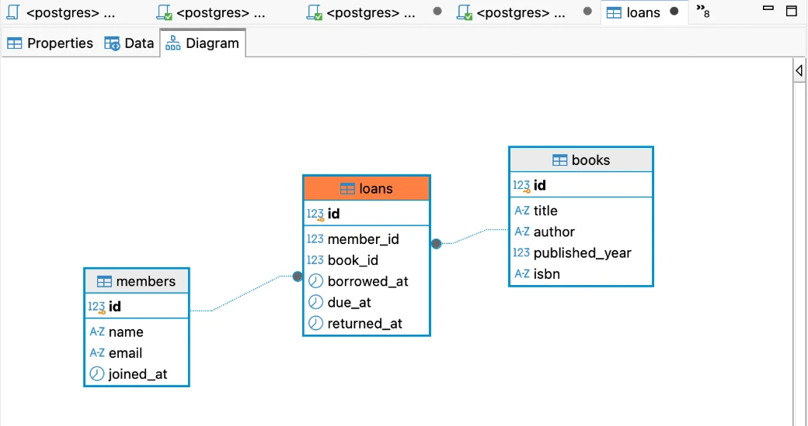
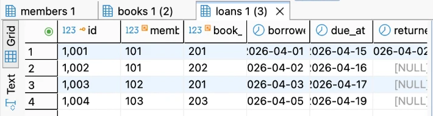
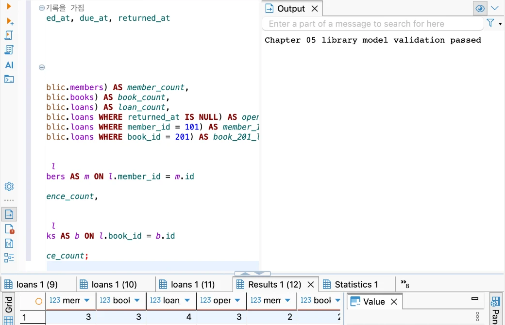
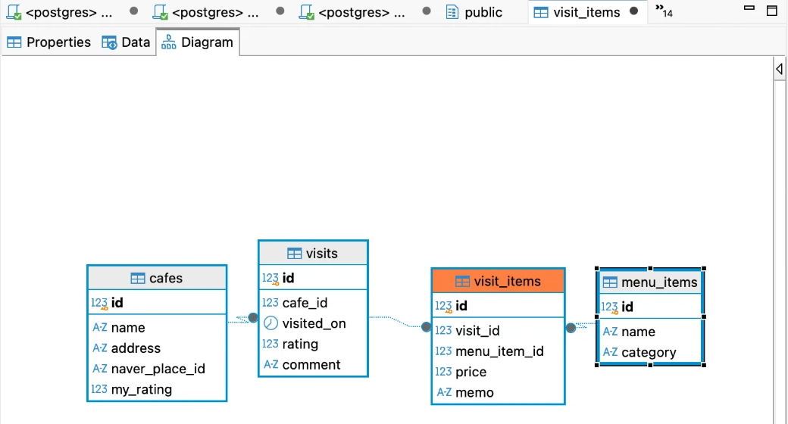

# Chapter 05 확장 실습 답안 템플릿

> **과제:** 요구사항에서 데이터 모델과 ERD 만들기  
> **사용 방법:** 이 파일을 내려받아 본인의 GitHub 저장소에 `chapter05_answer.md`라는 이름으로 저장한 뒤 실습하면서 바로 작성합니다.  
> **제출 방법:** LMS에는 파일을 직접 업로드하지 않고, **본인 GitHub 저장소의 `chapter05_answer.md` 파일 URL**을 제출합니다.

---

## 제출 전 주의

이 파일과 캡처 화면에는 실제 비밀번호, 전체 DB 접속 URL, API Key, 개인정보를 기록하지 않습니다.

```text
GitHub 계정 또는 별칭: dusen120-ai
과제 작성일: 2026-10-12
사용한 AI 도구: Claude (Claude Code)
```

---

# 1. Chapter 05 핵심 개념 복습

본문을 보지 않고 먼저 작성합니다.

```text
요구사항에서 바로 테이블부터 만들면 위험한 이유:
  아직 정해지지 않은 규칙이 제약조건으로 굳어질 수 있기 때문이다.

한 행의 의미를 먼저 정해야 하는 이유:
  의미를 확실히 정해야 중복값이 안 나오기 때문이다.

확정 요구사항과 미확정 정책을 구분해야 하는 이유:
  DB가 강제할 것과 더 세부적으로 정해야 하는 것을 나눠야 하기 때문이다.

PK와 업무상 고유값 후보의 차이:
  PK는 DB가 행을 구분하고자 붙이는 번호이므로 바뀌지 않고, 업무상 고유값은 바뀔 수 있다.

N:M 관계를 그대로 두지 않고 연결 테이블을 검토하는 이유:
  관계 자체 정보이므로 별도 테이블이 있어야 한다.
```

---

# 2. 도서 대여 요구사항 R-01~R-07 다시 분해

| 요구사항 | 관리 대상 / 사건 | 속성 후보 | 관계 / 규칙 후보 | 미확정 질문 |
| --- | --- | --- | --- | --- |
| R-01 | 회원 (대상) | (R-02에서 정의) | 도서관이 회원 여러 명을 관리한다 | 탈퇴한 회원은 삭제하나, 기록을 남기나? |
| R-02 | 회원 (대상) | 이름, 이메일, 가입일 | 세 값 모두 필수로 보임 | 이메일은 회원마다 고유한가? 이메일이 바뀔 수 있나? |
| R-03 | 도서 (대상) | 제목, 저자, 출판연도, ISBN 정보 | 제목·저자는 필수, 출판연도·ISBN은 "저장할 수 있다" → 선택값 | 출판연도와 ISBN 정보는 없는 경우도 있나? 같은 책이 2권이면 ISBN이 같은데 따로 구분하나? |
| R-04 | 대여 (사건) | (R-06에서 정의) | 회원 1명 → 대여 여러 건 | 한 회원이 동시에 빌릴 수 있는 최대 권수가 있나? |
| R-05 | 대여 (사건) | (R-06에서 정의) | 도서 1권 → 시간에 따라 대여 여러 건 | 같은 도서를 두 명이 동시에 빌릴 수 있나? |
| R-06 | 대여 기록 (사건) | 대여일, 반납예정일, 실제반납일 | 대여 기록은 회원과 도서를 하나씩 참조 | 반납예정일은 대여일 + 며칠로 자동 계산하나? 연체료가 있나? |
| R-07 | 대여 기록의 상태 | 실제반납일 (비어 있을 수 있음) | 실제반납일이 비어 있으면 = 아직 반납 안 함 | 실제반납일이 대여일보다 빠른 값은 막아야 하나? |

### 본문과 비교한 뒤 수정한 내용

```text
처음에 놓친 부분:
  R-03에서 "출판연도와 ISBN이 없을 수도 있나?"까지만 생각했고,
  같은 책이 2권 있으면 ISBN이 같아진다는 점(복본 문제)은 놓쳤다.

처음에 잘못 분류한 부분:
  R-04, R-05를 처음엔 회원·도서의 특징으로 봤는데, 실제로는 '대여'라는 사건이 반복된다는 뜻이었다.
  그래서 회원·도서가 아니라 대여 기록(사건)으로 분류했다.

수정한 이유:
  ISBN을 그냥 UNIQUE로 만들면 같은 책 두 번째 권을 등록할 수 없게 된다.
  또 대여일·반납일은 회원이나 도서 한쪽에 넣을 수 없고, 대여가 일어날 때마다 생기는 정보라서 별도 사건으로 봐야 한다.
```

---

# 3. 확정 규칙과 미확정 정책 구분

## 3-1. 확정된 규칙

```text
1. 회원은 이름, 이메일, 가입일을 가진다. (R-02)
2. 도서는 제목과 저자를 반드시 가지며, 출판연도와 ISBN은 없을 수 있다. (R-03)
3. 한 회원은 여러 번 대여할 수 있다. (R-04)
4. 한 도서는 시간에 따라 여러 번 대여될 수 있다. (R-05)
5. 대여 기록에는 대여일·반납예정일·실제반납일을 저장하고, 미반납이면 실제반납일이 비어 있다. (R-06, R-07)
```

## 3-2. 미확정 질문

최소 5개를 작성합니다.

```text
Q1. 이메일은 회원마다 고유한가? (가족이 이메일 하나를 같이 쓸 수 있나?)
Q2. ISBN이 없는 도서를 허용하나?
Q3. 같은 ISBN의 실물 2권(복본)을 따로 구분해서 관리하나?
Q4. 같은 도서를 동시에 두 명이 빌릴 수 있나? (복본이 있다면?)
Q5. 탈퇴한 회원이나 폐기한 도서의 대여 기록은 삭제하나, 남겨 두나?
```

### 미확정 정책을 바로 `UNIQUE`, `CHECK`, 삭제 규칙으로 구현하면 위험한 이유

```text
바꾸기 어렵고 아직 정해지지 않은 사항이 제약조건으로 굳어질 수 있다.
예: Q1이 정해지기 전에 email에 UNIQUE를 걸었는데 나중에 "가족은 이메일 공유 가능"으로 정해지면,
    정상적인 회원 가입이 거부되고 제약조건을 다시 지워야 한다.
```

---

# 4. 엔터티·속성·사건 후보 구분

| 후보 | 대상 엔터티 / 사건 엔터티 / 속성 | 판단 근거 | 독립 식별 필요? |
| --- | --- | --- | --- |
| 회원 | 대상 엔터티 | 혼자서도 존재하고 이름·이메일·가입일 등 여러 속성을 가진다 | 필요 (members.id) |
| 도서 | 대상 엔터티 | 혼자서도 존재하고 제목·저자 등 여러 속성을 가지며 여러 권이 저장된다 | 필요 (books.id) |
| 대여 기록 | 사건 엔터티 | 회원이 도서를 빌릴 때마다 반복해서 생기는 일이고, 날짜 속성 3개를 가진다 | 필요 (loans.id) |
| 이메일 | 속성 (회원) | 회원 한 명에게 붙어 있는 값 하나일 뿐, 혼자 존재하지 않는다 | 불필요 |
| ISBN | 속성 (도서) | 도서에 붙어 있는 값이다. 없을 수도 있고(Q2) 복본끼리 같을 수도 있어서(Q3) 식별자로도 불안하다 | 불필요 |
| 반납예정일 | 속성 (대여 기록) | 도서나 회원이 아니라 대여 한 건마다 다른 값이다 | 불필요 |

### “명사가 보이면 무조건 테이블”이 아닌 이유

```text
이메일, ISBN, 반납예정일도 명사지만 혼자 존재하지 않고 회원·도서·대여 기록에 붙어 있는 값이다.
이런 것까지 테이블로 만들면 테이블만 많아지고 의미 없는 연결이 생긴다.
독립적으로 식별해야 하는지, 여러 속성을 가지는지, 반복해서 생기는지를 보고 테이블 여부를 정해야 한다.
```

---

# 5. 테이블별 한 행의 의미와 키 후보

| 테이블 | 한 행의 의미 | PK 후보 | 업무상 고유값 후보 | FK 후보 |
| --- | --- | --- | --- | --- |
| `members` | 회원 한 명 | `id` | `email` (단, 고유성 미확정 Q1) | 없음 |
| `books` | 대여 대상 도서 한 권 (간소화된 도서 항목 한 건) | `id` | `isbn` (단, 없을 수 있고 복본끼리 같을 수 있음 Q2·Q3) | 없음 |
| `loans` | 회원이 도서를 대여한 사건 한 건 | `id` | 없음 (같은 회원이 같은 책을 다시 빌릴 수 있음) | `member_id → members.id`, `book_id → books.id` |

### `members.email`을 지금 바로 UNIQUE라고 확정하지 않는 이유

```text
한 이메일을 여러 회원이 쓸 수도 있기 때문이다. (예: 가족이 이메일 하나를 같이 쓰는 경우)
요구사항 R-02에는 이메일을 '가진다'만 있고 고유하다는 말은 없다. (Q1)
```

### `books.isbn`을 지금 바로 NOT NULL + UNIQUE라고 확정하지 않는 이유

```text
NOT NULL: ISBN이 없는 책이 있을 수 있기 때문이다. (R-03 "저장할 수 있다", Q2)
UNIQUE: 같은 책이 2권 있으면 ISBN이 같아서, 두 번째 권을 등록할 수 없게 된다. (Q3)
```

---

# 6. 관계를 양방향 문장으로 작성

## 6-1. `members ↔ loans`

```text
회원 한 명은 대여 기록을 0건 이상 가질 수 있다.

대여 기록 한 건은 반드시 회원 1명에 속한다.

카디널리티: members 1 : N loans
선택성에서 확인할 점:
  회원 쪽은 선택(0건 가능) → 막 가입해서 아직 빌리지 않은 회원도 저장할 수 있어야 한다.
  대여 쪽은 필수 → loans.member_id는 NOT NULL이어야 한다.
```

## 6-2. `books ↔ loans`

```text
도서 한 건은 시간에 따라 대여 기록을 0건 이상 가질 수 있다.

대여 기록 한 건은 반드시 도서 1건을 참조한다.

카디널리티: books 1 : N loans
선택성에서 확인할 점:
  도서 쪽은 선택(0건 가능) → 새로 들어와서 한 번도 대여되지 않은 도서도 저장할 수 있어야 한다.
  대여 쪽은 필수 → loans.book_id는 NOT NULL이어야 한다.
```

## 6-3. `members ↔ books`를 직접 N:M으로 저장하지 않고 `loans`를 두는 이유

```text
대여일, 반납예정일, 실제반납일은 관계 자체 정보이므로 별도 테이블이 있어야 한다.
회원 테이블에 넣으면 회원이 책을 여러 권 빌릴 때 저장할 곳이 없고,
도서 테이블에 넣으면 같은 책이 여러 번 대여된 이력을 남길 수 없다.
그래서 members 1:N loans N:1 books 로 풀어서 loans에 대여 정보를 저장한다.
```

### `loans`가 단순 연결표가 아니라 사건 엔터티라고 볼 수 있는 이유

```text
회원 101이 도서 201을 4월에 빌렸다가 반납하고 6월에 또 빌리면 loans에는 2줄이 생긴다.
단순 연결표라면 (101, 201) 한 줄로 "연결되어 있다"는 것만 남지만,
loans는 대여가 일어날 때마다 새 행이 생기고 각 행마다 날짜가 다르다.
즉 같은 회원·도서 조합이 시간에 따라 반복되는 '사건'을 기록하는 테이블이다.
```

---

# 7. 도서 대여 ERD 초안

아래 항목이 보이도록 ERD를 작성합니다.

```text
members
books
loans
PK
FK
주요 속성
1:N 관계
```

권장 이미지 경로:

```text
assignments/chapter05/images/step07_library_erd.png
```

Markdown 예시:

```markdown

```


> DBeaver에서 `loans` 테이블 → Diagram 탭으로 생성한 ERD입니다. 그림에서 잘 안 보이는 키와 관계를 아래에 정리합니다.

```text
members (PK id) : name, email, joined_at
books   (PK id) : title, author, published_year(NULL 가능), isbn(NULL 가능)
loans   (PK id) : member_id(FK → members.id), book_id(FK → books.id),
                  borrowed_at, due_at, returned_at(NULL 가능 = 미반납)

members 1 ── 0..N loans   (회원은 대여 0건 이상 / 대여는 반드시 회원 1명)
books   1 ── 0..N loans   (도서는 대여 0건 이상 / 대여는 반드시 도서 1건)
```

### ERD를 그린 뒤 수정한 부분

```text
회원과 도서가 직접 연결되지 않고 loans를 통해 연결된다는 사실을 확인할 수 있었다.
```

---

# 8. PostgreSQL로 도서 대여 모델 구현 확인

## 8-1. 현재 환경 확인

```sql
SELECT current_database();
SELECT current_user;
SELECT current_schema();
SHOW search_path;
SHOW transaction_read_only;
```

```text
현재 DB: ai_database_book
현재 사용자: postgres
현재 스키마: public
search_path: public
읽기 전용 여부: off (읽기 전용 아님 → CREATE/INSERT 가능)
Auto-commit: Auto (실행한 문장이 바로 확정된다. 단, 교재 SQL은 BEGIN~COMMIT으로 직접 묶어서 실행한다.)
```

- [x] 현재 DB가 `ai_database_book`이다.
- [x] 실행 범위를 확인했다. (한 문장 실행이 아니라 스크립트 전체 실행 Alt+X 사용)
- [x] Auto-commit 상태를 확인했다.

## 8-2. 스키마 생성 SQL 실행

사용 파일:

```text
code/chapter05/01_library_schema.sql
```

실행 전 예상:

```text
생성될 테이블 수: 3개
생성 순서: members → books → loans
각 테이블 예상 행 수: 모두 0행 (구조만 만들고 데이터는 아직 넣지 않음)
```

실행 후 실제:

```text
members 존재: O (to_regclass 결과 members)
books 존재: O (to_regclass 결과 books)
loans 존재: O (to_regclass 결과 loans)
각 테이블 행 수: members 0 / books 0 / loans 0 → 예상과 같음
```

### `loans`를 마지막에 만드는 이유

```text
loans는 member_id → members.id, book_id → books.id를 참조하는 FK를 가지고 있다.
members가 없으면 참조할 수 없으므로 오류가 난다. 그래서 부모 테이블(members, books)을 먼저 만들고 loans를 마지막에 만든다.
```

---

# 9. 샘플 데이터 입력과 관계 관찰

사용 파일:

```text
code/chapter05/02_library_seed.sql
```

## 9-1. 실행 전 예상

```text
members 예상 행 수: 3
books 예상 행 수: 3
loans 예상 행 수: 3
미반납 예상 건수: 3
회원 101 대여 예상 건수: 2
도서 201 대여 예상 건수: 2
```

## 9-2. 실제 결과

```text
members 실제 행 수: 3
books 실제 행 수: 3
loans 실제 행 수: 4   ← 예상(3)과 다름
미반납 실제 건수: 3
회원 101 대여 실제 건수: 2 (1001, 1002)
도서 201 대여 실제 건수: 2 (1001, 1003)

참고: 처음 실행할 때 SQL을 클립보드로 옮기는 과정에서 한글 인코딩이 깨져 회원 이름·도서 제목이 잘못 저장될 뻔했다.
      reset_library.sql로 세 테이블을 지우고 01 → 02를 UTF-8로 다시 실행해서, 이름이 '김민지'처럼 정상 저장된 것을 SELECT로 확인했다.
```

### 샘플 데이터에서 확인한 1:N 관계

```text
회원 101은 loans에 2번 나온다. (1001, 1002) → 회원 1명 : 대여 N건
도서 201은 loans에 2번 나온다. (1001, 1003) → 도서 1권 : 대여 N건
  1001번에서 회원 101이 빌렸다가 4/2에 반납했고, 4/3에 1003번으로 회원 102가 같은 책을 다시 빌렸다.
  (처음엔 도서 201이 한 번 나온다고 잘못 셌는데, book_id 열을 다시 보니 2번이었다.)
```

### `returned_at = NULL`이 의미하는 것

```text
대여했지만 반납되지 않은 상태를 의미한다. (R-07)
샘플에서는 1002, 1003, 1004 세 건이 아직 반납되지 않은 대여다.
```

### 증거 화면

권장 경로:

```text
assignments/chapter05/images/step09_seed_result.png
```



---

# 10. 검증 SQL 실행

사용 파일:

```text
code/chapter05/03_library_validation.sql
```

## 10-1. 결과 기록

```text
members = 3
books = 3
loans = 4
미반납 건수 = 3
회원 101 대여 이력 = 2
도서 201 대여 이력 = 2
회원 참조 고아 행 = 0
도서 참조 고아 행 = 0
loans FK 개수 = 2
검증 최종 메시지 = Chapter 05 library model validation passed

(고아 행·FK 개수는 화면 열이 잘려 보이지 않지만, 검증 DO 블록이 이 값들이 0·0·2가 아니면
 RAISE EXCEPTION을 내도록 되어 있으므로 passed 메시지가 나왔다는 것으로 확인된다.)
```

### 단순히 테이블 3개가 생성되었다고 설계 검증이 끝난 것이 아닌 이유

```text
테이블이 있어도 관계와 데이터가 맞는지는 넣어 봐야 알 수 있다.
(검증 SQL로 고아 행 0건, 도서 201의 반복 대여 2건, 미반납 NULL 3건을 실제로 확인했다.)
```

### 증거 화면

권장 경로:

```text
assignments/chapter05/images/step10_validation.png
```



---

# 11. 작은 시나리오로 모델 검증

아래 시나리오를 현재 모델이 표현할 수 있는지 판단합니다.

| 시나리오 | 표현 가능? | 이유 | 추가 확인할 정책 |
| --- | --- | --- | --- |
| 회원 A가 서로 다른 책 2권을 대여 | O | loans에 같은 member_id로 2행 (샘플: 회원 101 → 1001, 1002) | 한 회원의 최대 대여 권수 |
| 같은 책을 시간 차를 두고 다시 대여 | O | loans에 같은 book_id로 2행 (샘플: 도서 201 → 1001, 1003) | 반납일과 다음 대여일의 선후 규칙 |
| 아직 반납하지 않은 대여 | O | returned_at = NULL (샘플: 1002, 1003, 1004) | 연체 판단 기준(due_at 지난 미반납) |
| 회원은 있지만 대여 기록이 없음 | O | members 1 : 0..N loans, FK가 loans 쪽에만 있음 | 없음 |
| ISBN이 없는 도서 | O | books.isbn이 NULL 허용 | ISBN 없는 도서를 정말 허용하나? (Q2) |
| 같은 ISBN의 실물 복본 2권 | △ | UNIQUE가 없어 2행은 들어가지만, 둘이 '같은 책의 1권·2권'이라는 걸 DB가 모른다 | 복본을 따로 관리하나? (Q3) |
| 한 도서에 저자 2명 | X | author 열이 하나뿐이라 문자열로 우겨넣는 것 말고는 방법이 없고, 저자별 검색·구분이 안 된다 | 여러 저자를 관리해야 하나? |
| 같은 도서를 두 명이 동시에 대여 | △ | 처음엔 X라고 생각했지만, 실제로는 미반납 대여 2행이 막히지 않고 저장된다. 실물이 1권이면 잘못된 데이터인데 DB가 막지 못한다 | 동시 대여를 막아야 하나? (Q4, 복본 정책과 연결) |

### 현재 Chapter 05 모델의 한계 3가지

```text
1. 같은 ISBN의 복본을 구분하지 못한다. books 한 행이 '책 제목'인지 '실물 한 권'인지 애매하다.
2. 한 도서에 저자가 여러 명이면 제대로 저장할 수 없다. (author 열 하나 → books N:M authors 필요)
3. 같은 책을 두 명이 동시에 빌리거나, 반납일이 대여일보다 빠른 잘못된 데이터를 DB가 막지 못한다.
   (Chapter 06에서 제약조건으로 보완할 부분)
```

---

# 12. Chapter 01~04 개인 서비스 요구사항 작성

지금까지 선택한 개인 서비스 아이디어를 사용합니다.

```text
서비스 이름: 내 카페 방문 기록
서비스 목적: 내가 방문한 카페와 그때 마신 음료·디저트, 별점과 한줄평을 기록해서 나중에 다시 찾아볼 수 있게 한다.
```

## 12-1. 요구사항

최소 8개를 작성합니다.

```text
P05-R01. 카페 정보(이름, 주소, 네이버지도 장소 ID, 전체 선호도)를 관리한다.
P05-R02. 아직 방문하지 않은 카페도 미리 등록할 수 있다.
P05-R03. 카페를 방문할 때마다 방문일, 그날의 평점, 한줄평을 기록한다.
P05-R04. 같은 카페를 여러 번 방문할 수 있다.
P05-R05. 메뉴(음료·디저트)는 이름과 분류를 가진다.
P05-R06. 한 번 방문할 때 여러 메뉴를 주문할 수 있다.
P05-R07. 같은 메뉴를 여러 번의 방문에서 주문할 수 있다.
P05-R08. 방문에서 주문한 메뉴마다 그때의 가격과 메모를 남길 수 있다.
```

> 화면 기능보다 **저장해야 할 사실, 반복 사건, 상태와 관계**를 중심으로 작성합니다.

## 12-2. 미확정 질문

최소 3개를 작성합니다.

```text
P05-Q01. 폐업한 카페는 삭제할까, '폐업' 상태로 남겨 둘까? (Ch02 Q2에서 이어짐)
P05-Q02. 메뉴가 카페별로 따로인가? 카페 A의 아메리카노와 카페 B의 아메리카노를 같은 메뉴로 볼까?
P05-Q03. 같은 날 같은 카페를 두 번 갈 수도 있나?
```

---

# 13. 개인 서비스 모델 초안

## 13-1. 엔터티·사건 후보표

| 후보 | 대상 / 사건 | 한 행의 의미 | 주요 속성 | PK 후보 | 업무 식별자 후보 |
| --- | --- | --- | --- | --- | --- |
| `cafes` | 대상 | 카페 한 곳 | name, address, naver_place_id, my_rating | `id` | `naver_place_id` (단, 네이버에 없는 카페는 NULL) |
| `menu_items` | 대상 | 메뉴 종류 한 개 (예: 아메리카노) | name, category(음료/디저트) | `id` | 없음 (카페별 메뉴인지 미확정 P05-Q02) |
| `visits` | 사건 | 카페를 방문한 사건 한 번 | cafe_id, visited_on, rating, comment | `id` | 없음 (같은 날 같은 카페 재방문 가능성 P05-Q03) |
| `visit_items` | 사건 | 한 방문에서 주문한 메뉴 한 개 | visit_id, menu_item_id, price, memo | `id` | 없음 |

## 13-2. 관계 문장

최소 3쌍을 양방향으로 작성합니다.

```text
관계 1: cafes 1 : 0..N visits
카페 한 곳은 방문 기록을 0건 이상 가질 수 있다. (방문 전에 미리 등록 가능 R02)
방문 한 건은 반드시 카페 한 곳에서 일어난다.

관계 2: visits 1 : 0..N visit_items
방문 한 건은 주문한 메뉴 기록을 0건 이상 가질 수 있다. (메뉴를 안 적은 방문도 있을 수 있음)
주문 메뉴 기록 한 건은 반드시 방문 한 건에 속한다.

관계 3: menu_items 1 : 0..N visit_items
메뉴 하나는 여러 방문에서 주문된 기록을 0건 이상 가질 수 있다.
주문 메뉴 기록 한 건은 반드시 메뉴 하나를 가리킨다.
```

## 13-3. N:M 관계 검토

```text
N:M 관계 후보: visits N : M menu_items
  (방문 한 번에 메뉴 여러 개 R06 / 메뉴 하나가 여러 방문에 R07)
연결 테이블 후보: visit_items
  (처음엔 visits가 연결 테이블이라고 생각했는데, visits는 N:M의 한쪽이었다.
   도서 대여의 members–loans–books와 같은 구조로 visits–visit_items–menu_items가 된다.)
연결 테이블 한 행의 의미: 한 방문에서 주문한 메뉴 한 개
연결 테이블 자체에 필요한 사건 속성: price(그때의 가격), memo(그 메뉴에 대한 메모) (R08)
  → 같은 아메리카노라도 카페·날짜마다 가격이 다르므로 menu_items가 아니라 visit_items에 저장한다.
```

---

# 14. 개인 서비스 ERD 초안

ERD에 최소 다음을 표시합니다.

```text
테이블 3개 이상
각 테이블 PK
주요 속성
필요한 FK
관계선
카디널리티
```

권장 이미지 경로:

```text
assignments/chapter05/images/step14_my_erd.png
```



> `code/chapter05/my_cafe_schema.sql`로 실제 테이블을 만든 뒤, DBeaver에서 `visit_items` → Diagram 탭을 열고 `cafes`를 끌어다 추가한 ERD입니다.

```text
cafes       (PK id) : name, address, naver_place_id(UNIQUE, NULL 가능), my_rating(NULL 가능)
visits      (PK id) : cafe_id(FK → cafes.id), visited_on, rating(NULL 가능), comment(NULL 가능)
visit_items (PK id) : visit_id(FK → visits.id), menu_item_id(FK → menu_items.id), price(NULL 가능), memo(NULL 가능)
menu_items  (PK id) : name, category

cafes      1 ── 0..N visits       (카페는 방문 0건 이상 / 방문은 반드시 카페 1곳)
visits     1 ── 0..N visit_items  (방문은 주문 메뉴 0건 이상 / 주문 메뉴는 반드시 방문 1건)
menu_items 1 ── 0..N visit_items  (메뉴는 주문 기록 0건 이상 / 주문 메뉴는 반드시 메뉴 1개)
→ visits N:M menu_items 를 visit_items 가 풀어 준다.
```

### ERD의 각 테이블이 어떤 요구사항에서 나왔는지 설명

| 테이블 | 근거 요구사항 ID | 한 행의 의미 |
| --- | --- | --- |
| `cafes` | P05-R01, P05-R02 | 카페 한 곳 |
| `visits` | P05-R03, P05-R04 | 카페를 방문한 사건 한 번 |
| `menu_items` | P05-R05 | 메뉴 종류 한 개 |
| `visit_items` | P05-R06, P05-R07, P05-R08 | 한 방문에서 주문한 메뉴 한 개 |

---

# 15. 요구사항 추적표

| 요구사항 ID | 데이터 모델 반영 위치 | 검증 방법 | 상태 |
| --- | --- | --- | --- |
| P05-R01 | `cafes` (name, address, naver_place_id, my_rating) | 16번 시나리오: 카페 X 등록 | 반영 |
| P05-R02 | `cafes` 행이 visits 없이 존재 가능 (FK가 visits 쪽에만 있음), my_rating NULL 허용 | 16번 시나리오: 카페 Y를 방문 없이 등록 → 방문 0건 | 반영 |
| P05-R03 | `visits` (visited_on, rating, comment) + `cafe_id` FK | 16번 시나리오: 방문 1~3 | 반영 |
| P05-R04 | `visits.cafe_id`에 UNIQUE 없음 → 같은 카페로 여러 행 | 16번 시나리오: 카페 X에 방문 3번 | 반영 |
| P05-R05 | `menu_items` (name, category) | 16번 시나리오: 아메리카노(음료), 치즈케이크(디저트) | 반영 |
| P05-R06 | `visit_items`에 같은 visit_id로 여러 행 | 16번 시나리오: 방문 1에서 메뉴 2개 | 반영 |
| P05-R07 | `visit_items`에 같은 menu_item_id로 여러 행 | 16번 시나리오: 아메리카노를 방문 1·2·3에서 주문 | 반영 |
| P05-R08 | `visit_items.price`, `visit_items.memo` | 16번 시나리오: 같은 아메리카노가 4500원 → 4800원 | 반영 |
| P05-Q01 | 삭제 규칙(ON DELETE) 미설정 | - | 확인필요 |
| P05-Q02 | `menu_items`에 cafe_id 없음 | 16번에서 모호한 부분으로 확인 | 확인필요 |
| P05-Q03 | `visits`에 UNIQUE(cafe_id, visited_on) 없음 | 16번 시나리오: 같은 날 두 번 방문 | 확인필요 |

### ERD 그림만으로 요구사항 누락을 발견하기 어려운 이유

```text
그림에는 요구사항의 의미나 이유가 드러나지 않기 때문이다.
(예: 아직 방문 안 한 카페도 등록할 수 있다는 R02나, price가 '그때의 가격'이라는 R08은 그림만 봐서는 알 수 없다.
 그래서 요구사항 ID별로 반영 위치와 검증 방법을 표로 따로 확인해야 한다.)
```

---

# 16. 개인 서비스 작은 데이터 시나리오 검증

가상 데이터만 사용합니다.

```text
사용자/대상 A: 카페 X (자주 가는 카페)
사용자/대상 B: 카페 Y (가 보고 싶어서 등록만 한 카페, 방문 0번)
대상 X: 메뉴 아메리카노 (음료)
대상 Y: 메뉴 치즈케이크 (디저트)
사건 1: 10/1 카페 X 방문 → 아메리카노 4500원 + 치즈케이크 6500원
사건 2: 10/8 카페 X 방문 → 아메리카노 4800원 (가격 인상)
사건 3: 10/8 카페 X 같은 날 오후에 또 방문 → 아메리카노 4800원
사건 4: 카페 Y에 처음 가서 아메리카노를 마심 → 카페 X의 아메리카노와 같은 메뉴인가?
```

### 이 시나리오를 현재 ERD로 저장할 수 있는가?

```text
사건 1~3은 저장할 수 있다.
- 카페 Y: cafes에 1행, visits에는 0행 → 방문 전 미리 등록 가능 (R02)
- 사건 1: visits 1행 + visit_items 2행 (같은 visit_id) → 한 방문에 메뉴 여러 개 (R06)
- 사건 2: 같은 카페 X로 visits 1행 추가 → 재방문 (R04)
          아메리카노 가격이 4500 → 4800으로 달라도 visit_items.price에 방문마다 따로 저장 (R08)
- 사건 3: visits에 UNIQUE(cafe_id, visited_on)가 없으므로 같은 날 두 번째 방문도 저장된다.
- 아메리카노는 menu_items 1행이고, visit_items에서 3번 참조된다. (R07)

사건 4는 '저장'은 되지만 의미를 판단할 수 없다. (아래 참고)
```

### 저장하기 어려운 상황 또는 모호한 부분

```text
1. 사건 4: menu_items에 cafe_id가 없어서, 카페 Y의 아메리카노를 기존 아메리카노 행으로 넣어야 할지
   새 행으로 만들어야 할지 지금 ERD로는 판단할 수 없다. (P05-Q02)
   - 같은 행으로 넣으면 '아메리카노'를 모든 카페에서 마신 기록은 모아 볼 수 있지만, 카페마다 다른 메뉴인지는 구분하지 못한다.
   - 다른 행으로 넣으면 menu_items에 '아메리카노'가 여러 번 생기는데, 어느 카페 것인지 표시할 열이 없다.
2. 사건 3: 같은 날 두 번 방문은 저장되지만, 실수로 같은 방문을 두 번 입력한 것과 구분할 방법이 없다. (P05-Q03)
3. 카페 X가 폐업하면 visits와 visit_items가 cafes를 참조하고 있어서 카페를 그냥 지울 수 없다. (P05-Q01)
```

### 시나리오 검증 후 수정한 ERD 내용

```text
구조를 바꾸지는 않았다. 대신 다음을 확인하고 '일부러 제약을 넣지 않은 이유'를 정리했다.
- price를 menu_items가 아니라 visit_items에 두는 것이 맞다는 것을 사건 1·2로 확인했다.
  (같은 아메리카노가 4500원 → 4800원으로 바뀌었기 때문에 메뉴 한 행에 가격 하나로는 저장할 수 없다.)
- visits에 UNIQUE(cafe_id, visited_on)를 넣지 않은 것이 맞다는 것을 사건 3으로 확인했다.
- menu_items에 cafe_id를 넣을지는 P05-Q02가 정해질 때까지 보류한다.
```

---

# 17. AI를 설계자가 아니라 리뷰어로 활용

## 17-1. AI에게 전달한 핵심 자료

```text
요구사항: P05-R01 ~ P05-R08 (12-1)

미확정 질문: P05-Q01 폐업 카페 처리 / P05-Q02 카페별 메뉴 여부 / P05-Q03 같은 날 재방문 (12-2)

테이블별 한 행 의미:
  cafes = 카페 한 곳 / visits = 카페를 방문한 사건 한 번
  menu_items = 메뉴 종류 한 개 / visit_items = 한 방문에서 주문한 메뉴 한 개

관계 문장: cafes 1:0..N visits / visits 1:0..N visit_items / menu_items 1:0..N visit_items (13-2)

ERD 설명: visits N:M menu_items를 visit_items로 풀었고, price·memo는 visit_items에 둔다. (14번 ERD)
```

## 17-2. AI 검토 요청

실제로 사용한 프롬프트 또는 핵심 내용을 기록합니다.

```text
(사용 도구: Claude)
내 카페 방문 기록 서비스의 요구사항 P05-R01~R08, 미확정 질문 Q01~Q03,
테이블 4개(cafes, visits, menu_items, visit_items)의 한 행 의미와 관계 문장, ERD를 첨부합니다.
설계자가 아니라 리뷰어로서 누락, 근거 없는 테이블·열, 잘못된 카디널리티를 지적해 주세요.
미확정 질문을 임의로 확정하지 말고, 제안마다 근거 요구사항 ID를 붙여 주세요.
```

## 17-3. AI 제안 검토

| AI 제안 또는 질문 | 수용 / 수정 / 보류 / 거절 | 실제 근거 요구사항 | 나의 판단 이유 |
| --- | --- | --- | --- |
| ① `visits`에 `UNIQUE(cafe_id, visited_on)`을 넣어 같은 방문 중복 입력을 막자 | 보류 (처음엔 수용) | P05-Q03 (미확정) | 처음엔 중복을 막아 주니 좋다고 생각했지만, 16번 사건 3(같은 날 오후 재방문)이 오류로 막힌다. 같은 날 재방문 허용 여부가 정해질 때까지 보류한다. |
| ② `menu_items`에 `cafe_id` FK를 추가해 카페별 메뉴로 만들자 | 보류 (처음엔 거절) | P05-Q02 (미확정) | 처음엔 필요 없다고 생각했지만, 16번 사건 4에서 지금 ERD로는 판단할 수 없다는 걸 확인했다. 카페별 메뉴로 정해지면 필요할 수 있으므로 버리지 않고 보류한다. |
| ③ `rating`, `my_rating`에 `CHECK (BETWEEN 1 AND 5)`를 걸자 | 보류 (처음엔 수용) | P05-R03 (범위 언급 없음) | 요구사항에는 '평점을 기록한다'만 있고, Ch04에서도 점수 범위와 단위(1~5점? 0.5점 단위?)를 미확정으로 남겼다. |
| ④ `price`를 `visit_items`에 두는 것은 '그때의 가격'에 맞으므로 유지하자 | 수용 | P05-R08 | 16번 사건 1·2에서 같은 아메리카노가 4500원 → 4800원으로 바뀌는 것을 저장하려면 방문마다 가격이 따로 있어야 한다. |
| ⑤ `visits.cafe_id`에 `ON DELETE CASCADE`를 걸자 | 거절 | P05-Q01 (미확정), P05-R03 | 카페를 지우면 방문 기록까지 모두 사라진다. 폐업 카페 처리 방법도 아직 정해지지 않았다. |
| ⑥ 친구와 공유할 수 있게 `users` 테이블을 추가하고 모든 테이블에 `user_id`를 넣자 | 거절 (처음엔 수용) | 없음 | R01~R08 어디에도 사용자·친구·공유가 없다. '내' 카페 방문 기록이라 사용자는 나 한 명이다. AI가 요구사항에 없는 기능을 만들어 낸 것이다. |

### AI가 요구사항에 없는 정책을 임의로 확정한 부분이 있었나요?

```text
있었다.
- ⑥ users 테이블: 요구사항에 없는 '친구와 공유' 기능을 AI가 스스로 가정했다.
- ① UNIQUE(cafe_id, visited_on), ③ 평점 CHECK 1~5: 아직 미확정인 정책(Q03, 평점 범위)을
  이미 정해진 것처럼 제약조건으로 만들려고 했다.
처음에는 ①③⑥을 '좋아 보여서' 수용했는데, 요구사항 ID와 미확정 질문에 하나씩 대 보니 근거가 없거나 아직 정할 수 없는 것이었다.
```

### AI 검토를 받고도 채택하지 않은 제안 하나와 그 이유

```text
⑥ users 테이블 추가.
그럴듯한 확장처럼 보이지만 요구사항 R01~R08에 근거가 전혀 없다.
이 서비스는 나 혼자 쓰는 기록이라 users 테이블을 넣으면 모든 테이블에 user_id가 붙어 구조만 복잡해진다.
공유 기능이 실제 요구사항으로 생기면 그때 다시 검토한다.
```

---

# 18. 선택 — PostgreSQL DDL 초안

> 이 단계는 완성된 구현이 아니라 **현재 데이터 모델을 SQL 구조로 옮겨 보는 연습**입니다. Chapter 06에서 정규화와 제약조건을 더 엄격하게 검토합니다.

```sql
-- 개인 서비스 DDL 초안 (code/chapter05/my_cafe_schema.sql)
-- ai_database_book에서 실행 → cafes, menu_items, visits, visit_items 생성 확인 (14번 ERD)

CREATE TABLE public.cafes (
    id INTEGER GENERATED BY DEFAULT AS IDENTITY PRIMARY KEY,
    name VARCHAR(100) NOT NULL,
    address VARCHAR(200),
    naver_place_id VARCHAR(50) UNIQUE,
    my_rating NUMERIC(2,1)
);

CREATE TABLE public.menu_items (
    id INTEGER GENERATED BY DEFAULT AS IDENTITY PRIMARY KEY,
    name VARCHAR(100) NOT NULL,
    category VARCHAR(20) NOT NULL
);

CREATE TABLE public.visits (
    id INTEGER GENERATED BY DEFAULT AS IDENTITY PRIMARY KEY,
    cafe_id INTEGER NOT NULL REFERENCES public.cafes(id),
    visited_on DATE NOT NULL,
    rating NUMERIC(2,1),
    comment VARCHAR(200)
);

CREATE TABLE public.visit_items (
    id INTEGER GENERATED BY DEFAULT AS IDENTITY PRIMARY KEY,
    visit_id INTEGER NOT NULL REFERENCES public.visits(id),
    menu_item_id INTEGER NOT NULL REFERENCES public.menu_items(id),
    price INTEGER,
    memo VARCHAR(200)
);
```

### 아직 구현하지 않은 미확정 정책

```text
1. 같은 날 같은 카페 재방문 허용 여부 (P05-Q03) → visits에 UNIQUE(cafe_id, visited_on)를 넣지 않았다.
2. 카페별 메뉴 여부 (P05-Q02) → menu_items에 cafe_id를 넣지 않았다.
3. 폐업 카페 처리 (P05-Q01) → ON DELETE CASCADE 같은 삭제 규칙을 넣지 않았다.
4. 평점 범위·단위 → rating, my_rating에 CHECK를 넣지 않았다.
```

---

# 19. 최종 성찰

아래 문장은 반드시 본인의 말로 작성합니다.

```text
1. 요구사항에서 바로 테이블을 만들지 않고 중간 설계 과정을 거쳐야 하는 이유는
   아직 정해지지 않은 규칙이 제약조건으로 굳어질 수 있기 때문 이다.

2. 테이블의 한 행 의미가 중요한 이유는
   의미를 확실히 정해야 중복값이 안 나오기 때문 이다.

3. 미확정 정책을 그대로 남겨 두는 것이 좋은 설계 활동일 수 있는 이유는
   정상 데이터가 거부되는 걸 막을 수 있기 때문 이다.

4. N:M 관계에서 연결 엔터티가 필요한 이유는
   관계 자체 정보를 저장할 곳이 필요하기 때문 이다.

5. AI가 ERD를 만들어 주더라도 사람이 반드시 확인해야 하는 것은
   각 테이블·열·제약이 요구사항에 근거가 있는지 이다.
```

---

# 20. 제출 체크리스트

- [x] `chapter05_answer.md`를 본인 저장소에 만들었다.
- [x] R-01~R-07을 직접 재분해했다.
- [x] 확정 규칙과 미확정 질문을 구분했다.
- [x] `members/books/loans`의 한 행 의미를 설명했다.
- [x] 관계를 양방향 문장으로 작성했다.
- [x] 도서 대여 ERD를 작성했다.
- [x] `01_library_schema.sql`을 실행했다.
- [x] `02_library_seed.sql`을 실행했다.
- [x] `03_library_validation.sql` 결과를 확인했다.
- [x] 작은 시나리오로 모델의 한계를 확인했다.
- [x] 개인 서비스 요구사항을 8개 이상 작성했다.
- [x] 개인 서비스 미확정 질문을 3개 이상 작성했다.
- [x] 개인 서비스 ERD를 작성했다.
- [x] 요구사항 추적표를 작성했다.
- [x] 개인 서비스 작은 데이터 시나리오를 검증했다.
- [x] AI 제안을 수용/수정/보류/거절로 판단했다.
- [x] 핵심 캡처 또는 ERD 이미지 3~4장 이내로 정리했다.
- [x] 이미지가 GitHub 웹 화면에서 실제로 보인다.
- [x] 답안 파일을 commit/push했다.

---

# 21. LMS 제출 URL

아래 형식의 **본인 GitHub 파일 URL**을 LMS에 제출합니다.

```text
https://github.com/<본인-GitHub-ID>/<본인-저장소>/blob/main/assignments/chapter05/chapter05_answer.md
```

내 제출 URL:

```text
https://github.com/dusen120-ai/database/blob/main/assignments/chapter05/chapter05_answer.md
```

> 저장소 메인 URL, 교수자 템플릿 URL, Raw URL이 아니라 **작성 완료된 본인 `chapter05_answer.md` 파일 화면 URL**을 제출합니다.
