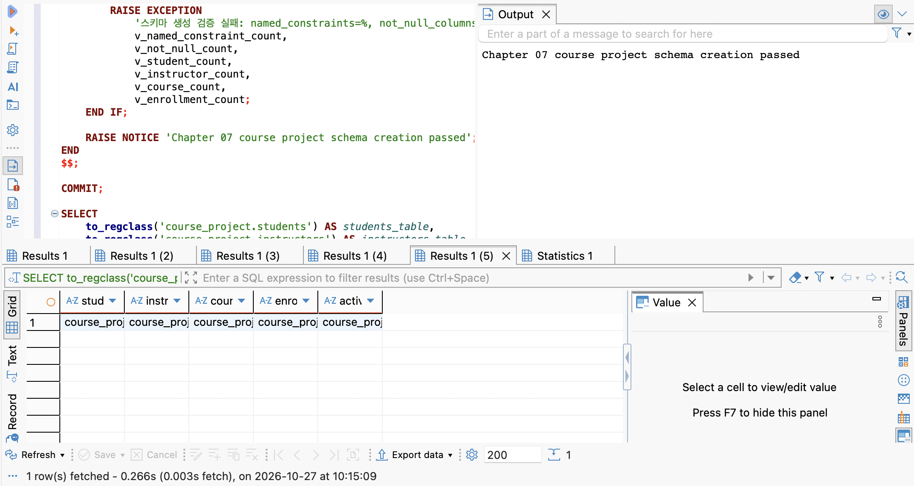

# Chapter 07 확장 실습 답안

> **과제:** 실전 프로젝트 1 — 온라인 강의 수강신청 DB 완성하기  
> **사용 방법:** 이 파일을 내려받아 본인의 GitHub 저장소에 `chapter07_answer.md`라는 이름으로 저장한 뒤 실습하면서 바로 작성합니다.  
> **제출 방법:** LMS에는 파일을 직접 업로드하지 않고, **본인 GitHub 저장소의 `chapter07_answer.md` 파일 URL**을 제출합니다.

---

## 제출 전 주의

이 파일과 캡처 화면에는 실제 비밀번호, 전체 DB 접속 URL, API Key, 개인정보를 기록하지 않습니다.

```text
GitHub 계정 또는 별칭: dusen120-ai
과제 작성일: 2026-10-26
사용한 AI 도구: Claude (Claude Code)
```

---

# 1. 시작 환경 확인

다음을 실행합니다.

```sql
SELECT current_database();
SELECT current_user;
SELECT current_schema();
SHOW search_path;
SHOW transaction_read_only;
```

| 확인 항목 | 실제 결과 | 의미 |
| --- | --- | --- |
| `current_database()` | `ai_database_book` | 교재 실습용 DB에 연결되어 있다. 모든 SQL 파일이 이 이름을 먼저 검사한다. |
| `current_user` | `postgres` | 스키마를 만들 사용자다. 01에서 만든 역할과 같은 역할로 02~06·reset을 실행해야 한다. |
| `current_schema()` | `public` | 기본 스키마는 public이지만, 프로젝트 SQL은 `course_project.students`처럼 스키마를 직접 붙이므로 상관없다. |
| `search_path` | `public, "$user"` | 이름만 쓴 객체를 찾는 순서다. course_project는 들어 있지 않으므로 직접 조회할 때도 `course_project.`을 붙인다. |
| `transaction_read_only` | `off` | 읽기 전용이 아니므로 스키마 생성·입력·변경이 가능하다. |

- [x] 현재 DB가 `ai_database_book`이다.
- [x] 쓰기 가능한 연결인지 확인했다. (`transaction_read_only = off`)
- [x] 실행할 SQL 범위를 확인했다. (`code/chapter07/01~05_*.sql`, 01~03은 파일 전체 실행, 05는 한 구간씩)
- [x] Auto-commit 상태를 확인했다. (DBeaver 툴바 `Auto` → Auto-commit 켜짐. 01~03은 파일 안에서 BEGIN ... COMMIT으로 직접 묶는다.)

### 프로젝트 SQL을 실행하기 전에 시작 상태를 확인해야 하는 이유

```text
DBeaver에는 연결이 여러 개 있을 수 있어서, 잘못된 DB나 읽기 전용 연결에서 실행하면 엉뚱한 곳에 스키마가 생기거나 중간에 실패한다.
또 01~03은 '이 상태에서 시작한다'는 전제가 있다(01은 course_project가 없어야 하고, 02는 네 테이블이 비어 있어야 한다).
시작 상태가 다르면 결과도 기준값과 달라지므로, 실행 전에 DB·사용자·쓰기 가능 여부를 확인하고
파일 안의 사전 검사가 통과하는지 본 다음 실행한다.
```

---

# 2. 프로젝트 범위와 요구사항 읽기

## 2-1. 포함 범위

본문을 그대로 복사하지 말고 자신의 말로 정리합니다.

```text
1. 학생과 강사를 각각 따로 관리한다. (이름, 이메일, 가입일 / 전문 분야)
2. 강의마다 담당 강사 한 명, 난이도, 지금 기준 가격, 개설일을 둔다.
3. 학생이 강의를 신청한 사건을 enrollments 한 행으로 남기고, 상태(신청·수강중·완료·취소)와 신청할 때 기록한 금액을 함께 저장한다.
4. 스키마 생성 → 기본 데이터 → 변경 → 최종 검증을 SQL 파일 순서대로 실행하고, 각 단계의 결과를 자동으로 확인한다.
```

## 2-2. 제외 범위

```text
1. 실제 결제 승인·실패·환불 기록 (payments, refunds 같은 테이블은 만들지 않는다)
2. 강의 정원과 대기열 (몇 명까지 받을지, 마감 후 대기 순서)
3. 신청 상태가 언제 어떻게 바뀌었는지의 전체 이력 (지금은 현재 상태만 저장)
4. 강의 콘텐츠·진도·수료, 수강평·쿠폰·할인
```

### 범위를 명확하게 정해야 하는 이유

```text
범위를 정하지 않으면 "결제도 있어야 하지 않나?", "정원은?"처럼 테이블과 규칙이 끝없이 늘어나고,
무엇이 되면 완료인지도 말할 수 없다. 범위 안의 것만 테이블·제약조건·검증 SQL로 끝까지 만들고,
범위 밖의 것은 '나중에 검토할 구조'로 따로 적어 두면 지금 프로젝트를 확실하게 끝낼 수 있다.
또 recorded_amount를 결제액으로 오해하는 것처럼, 범위 밖 의미를 지금 데이터에 덧씌우는 실수도 막는다.
```

## 2-3. 요구사항 / 프로젝트 결정 / 미확정 질문 구분

아래 항목 중 대표 항목을 정리합니다.

| ID | 종류 | 내용 요약 | DB 구조/규칙에 미치는 영향 |
| --- | --- | --- | --- |
| P07-R01 | 요구사항 | 학생은 이름·이메일·가입일을 가진다. | `students` 테이블, 세 열 모두 `NOT NULL` |
| P07-R05 | 요구사항 | 신청은 학생·강의·신청일·상태·신청 시 기록 금액을 가진다. | `enrollments` 테이블, `student_id`·`course_id` FK, `recorded_amount NUMERIC(12,0)` |
| P07-R07 | 요구사항 | 학생·강사 이메일은 각 테이블 안에서 공백이거나 중복될 수 없다. | `uq_course_students_email`, `uq_course_instructors_email` UNIQUE + 공백 금지 CHECK |
| P07-D02 | 프로젝트 결정 | 할인이 없는 지금은 신청을 만들 때 그 시점의 `courses.price`를 `recorded_amount`로 복사해 보존한다. | 신규 신청은 `INSERT ... SELECT c.price`로 만든다. CHECK로 강제하지 않고 신청 SQL과 검증이 책임진다. 나중에 가격이 바뀌어도 과거 행은 고치지 않는다. |
| P07-D03 | 프로젝트 결정 | 같은 학생·같은 강의의 진행 중(신청·수강중) 신청은 최대 한 건이다. | 부분 고유 인덱스 `uq_course_enrollments_active ... WHERE status IN ('신청','수강중')`. 완료·취소 뒤 재신청은 허용 |
| P07-Q01 | 미확정 질문 | 학생과 강사 사이에서도 이메일이 겹치면 안 되는가? (전역 고유) | 지금은 테이블별 UNIQUE만 둔다. 확정되면 users·roles 통합 모델 등 구조 자체를 다시 봐야 한다. |

### 미확정 질문을 바로 제약조건으로 만들면 안 되는 이유

```text
제약조건은 DB가 그 규칙을 어기는 데이터를 아예 거부하게 만드는 것이라, 정책이 정해지지 않았는데 걸면
실제로는 허용되어야 할 데이터까지 막힐 수 있다. 예를 들어 P07-Q01을 섣불리 '전역 고유'로 만들면
강사이면서 수강생인 사람이 같은 이메일로 가입하지 못한다. 반대로 나중에 규칙이 바뀌면 이미 쌓인 데이터와
충돌해 제약을 다시 만들어야 한다. 그래서 미확정 질문은 현재 처리 방식과 확정 시 검토할 구조만 기록해 둔다.
```

---

# 3. 네 테이블의 한 행 의미와 관계

## 3-1. 한 행 의미

```text
course_project.students 한 행 = 수강생 한 명

course_project.instructors 한 행 = 강사 한 명

course_project.courses 한 행 = 강의 한 개 (지금 기준의 강의 정보와 가격)

course_project.enrollments 한 행 = 학생 한 명이 강의 한 개를 신청한 사건 한 번
```

## 3-2. 키와 중요 규칙

| 테이블 | PK | FK | 중요 규칙 |
| --- | --- | --- | --- |
| students | `id` | 없음 | 이름·이메일·가입일 `NOT NULL`, 이메일 `UNIQUE`, 이름·이메일 공백 금지 |
| instructors | `id` | 없음 | 이름·이메일·전문 분야 `NOT NULL`, 이메일 `UNIQUE`, 세 값 공백 금지 |
| courses | `id` | `instructor_id` → instructors.id (`RESTRICT`) | 난이도는 basic·intermediate·advanced, `price >= 0`, 제목 공백 금지, 설명은 NULL 허용 |
| enrollments | `id` | `student_id` → students.id, `course_id` → courses.id (둘 다 `RESTRICT`) | 상태는 신청·수강중·완료·취소, `recorded_amount >= 0`, 같은 학생·강의의 활성 신청 1건 (부분 고유 인덱스) |

## 3-3. 관계를 양방향 문장으로 작성

```text
instructors ↔ courses:
  강사 한 명은 강의를 0개 이상 담당할 수 있다. / 강의 하나는 반드시 강사 한 명이 담당한다.

students ↔ enrollments:
  학생 한 명은 신청을 0건 이상 할 수 있다. / 신청 한 건은 반드시 학생 한 명의 것이다.

courses ↔ enrollments:
  강의 하나에는 신청이 0건 이상 들어올 수 있다. / 신청 한 건은 반드시 강의 하나에 대한 것이다.
```

### 학생과 강의의 N:M 관계가 `enrollments`를 통해 어떻게 바뀌는지 설명

```text
학생 한 명은 여러 강의를 듣고, 강의 하나도 여러 학생이 듣기 때문에 students와 courses는 N:M이다.
이것을 두 테이블 중 한쪽에 열로 넣을 수 없으므로 enrollments를 가운데 두고
students 1 : N enrollments, courses 1 : N enrollments 두 개의 1:N 관계로 나눈다.
예를 들어 학생 101은 신청 1001(강의 301), 1002(강의 302) 두 행을 가지고,
강의 301은 신청 1001(학생 101), 1003(학생 102) 두 행을 가진다.
```

### `enrollments`가 단순 연결 테이블이 아니라 사건 테이블이라고 볼 수 있는 이유

```text
enrollments에는 학생 id와 강의 id만 있는 것이 아니라 신청일, 상태, 신청할 때 기록한 금액처럼
'그 신청 한 번'에만 속하는 정보가 함께 있다. 그래서 자기 id(PK)를 따로 가진다.
또 같은 학생이 같은 강의를 완료하거나 취소한 뒤 다시 신청하면 새 행이 생긴다.
(student_id, course_id) 쌍이 여러 번 나올 수 있다는 것은 '관계'가 아니라 '일어난 일'을 기록한다는 뜻이다.
```

---

# 4. `recorded_amount`의 의미 이해

```text
courses.price = 강의의 지금 기준 가격 (앞으로 바뀔 수 있는 현재 값)

enrollments.recorded_amount = 그 신청을 만들 때 신청 행에 기록해 둔 금액 (신청 당시 값, 나중에 고치지 않음)
```

### 두 값이 처음에는 같아도 같은 의미가 아닌 이유

```text
할인이 없는 지금은 신청을 만들 때 price를 그대로 복사하므로 숫자가 같다. (신청 1005 = 강의 302 가격 120000)
하지만 price는 강의의 '현재 상태'이고 recorded_amount는 신청이라는 '사건 당시의 값'이다.
내일 강의 302 가격이 150000으로 바뀌어도 이미 신청한 1002·1005의 기록은 120000으로 남아야 한다.
recorded_amount 없이 매번 price를 JOIN해서 쓰면 가격이 바뀌는 순간 과거 신청 금액까지 바뀐 것처럼 보인다.
```

### `recorded_amount`를 실제 결제 성공액이나 회계 매출로 해석하면 안 되는 이유

```text
이 프로젝트에는 결제 승인·실패·환불 테이블이 없다(제외 범위). recorded_amount는 신청 행에 적어 둔 금액일 뿐,
실제로 돈이 들어왔는지는 알 수 없다. 신청 1004는 취소됐지만 recorded_amount는 150000 그대로 남는다.
그래서 전체 합계 590000이나 취소 제외 합계 440000은 '신청 기록 금액의 합'이지 매출이나 환불 후 순수 금액이 아니다.
매출로 보고하려면 실제 결제·환불 이력이 따로 있어야 한다.
```

---

# 5. STEP 01 — 스키마와 테이블 생성

실행 파일:

```text
code/chapter07/01_course_project_schema.sql
```

## 5-1. 실행 전 예상

```text
course_project 스키마 존재 여부: 실행 전에는 없음 → 실행 후 생성됨
예상 테이블 수: 4 (students, instructors, courses, enrollments)
예상 데이터 행 수: 네 테이블 모두 0행
예상되는 명명 제약조건 수: 15 (UNIQUE 2, FK 3, CHECK 10)
예상되는 NOT NULL 열 수: 20 (students 4 + instructors 4 + courses 6 + enrollments 6, PK id 포함 / courses.description만 NULL 허용)
부분 고유 인덱스 존재 여부: 있음 (uq_course_enrollments_active)
```

## 5-2. 실행 결과

```text
실제 테이블 수: 4 (마지막 결과에 course_project.students / instructors / courses / enrollments가 모두 나옴)
실제 명명 제약조건 수: 15 (파일 안 검증 블록이 15개가 아니면 RAISE EXCEPTION → 통과했으므로 15)
실제 NOT NULL 열 수: 20 (같은 검증 블록에서 확인)
부분 고유 인덱스: course_project.uq_course_enrollments_active (마지막 결과 active_index 열)
네 테이블의 실제 행 수: 0 / 0 / 0 / 0 (같은 검증 블록에서 확인)
통과 메시지: Chapter 07 course project schema creation passed (Output 탭)
```

### 예상과 실제 비교

```text
예상과 모두 같다. 제약조건 수·NOT NULL 열 수·행 수는 화면에 숫자로 따로 나오지 않지만,
01 파일의 마지막 DO 블록이 이 값들이 기준(15, 20, 0행)과 다르면 오류를 내고 COMMIT 전에 멈추도록 되어 있다.
Output에 통과 메시지가 나왔다는 것은 이 검사들이 모두 통과했고 전체 생성이 COMMIT되었다는 뜻이다.
```

### 증거 화면

권장 경로:

```text
assignments/chapter07/images/step05_schema.png
```



> `01_course_project_schema.sql` 전체 실행(⌥X) 결과. 오른쪽 Output에 `Chapter 07 course project schema creation passed`, 아래 결과 탭은 `to_regclass`로 확인한 테이블 4개와 부분 고유 인덱스 1개다.

---

# 6. STEP 02 — Seed 데이터 입력

실행 파일:

```text
code/chapter07/02_course_project_seed.sql
```

## 6-1. 실행 전 예상

```text
students: 3 (101, 102, 103)
instructors: 2 (201, 202)
courses: 3 (301, 302, 303)
enrollments: 4 (1001~1004)
recorded_amount 합계: 470000 (100000 + 120000 + 100000 + 150000)
학생 101 신청 건수: 2 (1001, 1002)
강의 301 신청 건수: 2 (1001, 1003)
강사 201 담당 강의 수: 2 (301, 302)
활성 중복 신청: 0
```

## 6-2. 실제 결과

```text
students:
instructors:
courses:
enrollments:
recorded_amount 합계:
학생 101 신청 건수:
강의 301 신청 건수:
강사 201 담당 강의 수:
활성 중복 신청:
1001 상태:
1004 상태:
1005 존재 여부:
통과 메시지:
```

### Seed 데이터를 단순 예제가 아니라 검증 데이터라고 볼 수 있는 이유

```text

```

---

# 7. STEP 03 — 변경 시나리오 실행

실행 파일:

```text
code/chapter07/03_course_project_changes.sql
```

## 7-1. 실행 전에 상태 변화를 예상

| 신청 ID | 변경 전 예상 상태 | 변경 후 예상 상태 | 예상 recorded_amount |
| ---: | --- | --- | ---: |
| 1001 | 수강중 | 완료 | 100000 |
| 1004 | 신청 | 취소 | 150000 (취소해도 그대로) |
| 1005 | 없음 | 신청 (학생 102 → 강의 302 신규) | 120000 (강의 302의 현재 price 복사) |

```text
변경 후 예상 enrollments 행 수: 5
변경 후 예상 전체 recorded_amount 합계: 590000 (470000 + 120000)
변경 후 예상 취소 제외 건수: 4 (1004 제외)
변경 후 예상 취소 제외 recorded_amount 합계: 440000 (590000 - 150000)
```

## 7-2. 실제 결과

```text
1001 상태 / recorded_amount:
1004 상태 / recorded_amount:
1005 상태 / recorded_amount:
최종 enrollments 행 수:
전체 recorded_amount 합계:
취소 제외 건수:
취소 제외 recorded_amount 합계:
활성 중복 신청:
통과 메시지:
```

### 조건부 UPDATE에서 예상 이전 상태를 확인해야 하는 이유

```text

```

### 증거 화면

권장 경로:

```text
assignments/chapter07/images/step07_changes.png
```

`여기에 주요 변경 전/후 결과를 삽입하세요.`

---

# 8. STEP 04 — 최종 완료 게이트 실행

실행 파일:

```text
code/chapter07/04_course_project_validation.sql
```

## 8-1. 최종 검증 결과

```text
최종 행 수 students/instructors/courses/enrollments:
서비스 JOIN 결과 행 수:
학생 101 신청 수:
강의 301 신청 수:
강사 201 강의 수:
고아 관계 수:
활성 중복 신청 수:
전체 recorded_amount:
취소 제외 recorded_amount:
통과 메시지:
```

### SQL 파일 4개가 모두 실행되었다는 사실과 프로젝트 검증 PASS가 다른 이유

```text

```

### 증거 화면

권장 경로:

```text
assignments/chapter07/images/step08_validation.png
```

`여기에 최종 validation PASS 화면을 삽입하세요.`

---

# 9. 무결성 테스트

실행 파일:

```text
code/chapter07/05_course_project_integrity_tests.sql
```

> 오류 테스트는 파일 전체를 무작정 실행하지 않고 **한 테스트 구간씩** 실행합니다.

## 9-1. 허용되어야 하는 경계값 1개

```text
테스트 내용:
기대 결과:
실제 결과:
왜 허용되어야 하는가:
```

## 9-2. 실패해야 하는 테스트 1 — 잘못된 참조 또는 값

```text
테스트 내용:
기대 결과:
실제 오류 핵심:
동작한 제약조건/규칙:
왜 실패해야 하는가:
```

## 9-3. 실패해야 하는 테스트 2 — 활성 중복 신청

```text
테스트 내용:
기대 결과:
실제 오류 핵심:
동작한 인덱스/규칙:
왜 실패해야 하는가:
```

## 9-4. 실패 후 기준 상태 재검증

```text
04 validation 재실행 결과:
기준 데이터가 유지되었는가:
```

### 실패 테스트가 프로젝트 품질 검증에 필요한 이유

```text

```

### 증거 화면

권장 경로:

```text
assignments/chapter07/images/step09_integrity.png
```

`여기에 대표 실패 테스트와 기준 상태 유지 결과를 삽입하세요.`

---

# 10. 재현성 실험

> 이 단계는 본인의 실습 환경이며 보존할 데이터가 없을 때만 수행합니다.

실행 순서:

```text
reset_course_project.sql
→ 01_course_project_schema.sql
→ 02_course_project_seed.sql
→ 03_course_project_changes.sql
→ 04_course_project_validation.sql
```

```text
처음 실행의 최종 결과:
재실행의 최종 결과:
두 결과가 일치했는가:
중간에 수동 수정이 필요했는가:
```

### 다른 사람이 같은 순서로 실행해 같은 결과를 얻는 것이 중요한 이유

```text

```

---

# 11. Chapter 01~06 개인 프로젝트를 중간 프로젝트 초안으로 확장

온라인 강의 예제를 이름만 바꾸지 않고 본인의 아이디어를 사용합니다.

## 11-1. 프로젝트 기본 정보

```text
프로젝트 이름: 내 카페 방문 기록 (Chapter 01~06에서 이어 온 개인 서비스)

해결하려는 문제:
  다녀온 카페와 그때 마신 메뉴·가격·느낌을 메모장이나 지도 앱 별표로만 남기다 보니,
  "그 카페에서 뭐가 맛있었지?", "아메리카노가 언제 올랐지?"를 다시 찾기 어렵다.
  카페·메뉴·방문·주문을 나눠 기록해 나중에 카페별·메뉴별로 다시 볼 수 있게 한다.

주요 사용자: 나 (혼자 쓰는 개인 기록)
```

> Chapter 05~06의 4개 테이블(`cafes`, `menu_items`, `visits`, `visit_items`)을 그대로 이어 쓰되,
> 미확정으로 남겨 두었던 질문 중 세 가지(P05-Q01 폐업, P05-Q02 카페별 메뉴, 평점 범위)를 이번에 프로젝트 결정으로 정했다.

## 11-2. 포함 범위 / 제외 범위

```text
[포함]
1. 카페 등록 (아직 안 가 본 카페도 미리 등록, 폐업하면 폐업일 표시)
2. 카페별 메뉴 등록 (메뉴 이름, 음료/디저트 분류)
3. 방문 기록 (방문일, 그날 평점, 한줄평)
4. 방문에서 주문한 메뉴와 그때 낸 가격·메모

[제외]
1. 다른 사람과 기록 공유, 여러 사용자 계정 (혼자 쓰는 기록이라 users 테이블 없음)
2. 사진·지도 좌표·영업시간 등 카페 상세 정보 (네이버 장소 ID로 연결만 해 둔다)
3. 카페 메뉴판의 '현재 판매가' 관리 (내가 실제로 낸 가격만 visit_items에 남긴다)
```

## 11-3. 요구사항

최소 8개를 작성합니다.

| ID | 요구사항 | 관련 테이블/관계 | 검증 방법 후보 |
| --- | --- | --- | --- |
| P07-MR01 | 카페는 이름(필수)·주소·네이버 장소 ID·내 전체 선호도를 가진다. | `cafes` | 정상 입력, 이름 NULL·공백 실패 |
| P07-MR02 | 아직 방문하지 않은 카페도 미리 등록할 수 있다. | `cafes` (visits 없이 존재 가능) | 방문 0건인 카페 조회 |
| P07-MR03 | 메뉴는 한 카페에 속하고, 이름과 분류(음료/디저트)를 가진다. | `menu_items.cafe_id` FK → cafes | 없는 카페 참조 실패, 분류 '푸드' 실패 |
| P07-MR04 | 카페를 방문할 때마다 방문일·평점·한줄평을 기록한다. | `visits.cafe_id` FK → cafes | 방문일 NULL 실패, 없는 카페 실패 |
| P07-MR05 | 같은 카페를 여러 번 방문할 수 있다. | cafes 1 : N visits | 같은 cafe_id로 visits 여러 행 성공 |
| P07-MR06 | 한 방문에서 여러 메뉴를 주문할 수 있다. | visits 1 : N visit_items | 같은 visit_id로 visit_items 여러 행 |
| P07-MR07 | 방문에서 주문한 메뉴마다 그때 낸 가격과 메모를 남길 수 있다. (가격은 생략 가능, 음수 불가) | `visit_items.price`, `memo` | price NULL·0 성공, -1 실패 |
| P07-MR08 | 평점(방문 평점, 내 전체 선호도)은 1.0~5.0 사이이며 비워 둘 수 있다. | `visits.rating`, `cafes.my_rating` CHECK | 1.0·5.0 성공, 0.5·5.5 실패 |
| P07-MR09 | 폐업한 카페도 기록은 남기고 폐업일로 구분한다. | `cafes.closed_on` (NULL = 영업 중) | 방문 기록 있는 카페 삭제 실패, closed_on 입력 성공 |
| P07-MR10 | 주문한 메뉴는 그 방문의 카페 메뉴여야 한다. | visit_items → menu_items.cafe_id = visits.cafe_id | 검증 SQL로 불일치 행 0건 |

## 11-4. 프로젝트 결정

최소 3개를 작성합니다.

| ID | 이번 프로젝트에서 내린 결정 | 이유 | 구현 후보 |
| --- | --- | --- | --- |
| P07-MD01 | 메뉴는 카페별로 따로 관리한다. (P05-Q02 확정) | 카페 A와 B의 아메리카노는 맛도 가격도 다른 메뉴다. 메뉴별로 모아 볼 때도 "어느 카페의 메뉴"인지가 필요하다. | `menu_items.cafe_id NOT NULL` FK, `UNIQUE (cafe_id, name)` |
| P07-MD02 | 평점은 1.0~5.0, 소수 첫째 자리까지, NULL 허용 (Ch06 P06-C05 확정) | 지도 앱 별점과 같은 5점 척도로 쓰고, 4.5 같은 값도 남기고 싶다. 평점 없이 기록만 하는 방문도 있다. | `NUMERIC(2,1)` + `CHECK (rating BETWEEN 1 AND 5)` |
| P07-MD03 | 폐업 카페는 삭제하지 않고 `closed_on`에 폐업일을 적는다. (P05-Q01 확정) | 카페를 지우면 방문·주문 기록을 잃는다. Ch06에서 RESTRICT로 삭제를 막았으니 대신 표시할 방법이 필요하다. | `cafes.closed_on DATE NULL`, FK는 계속 `ON DELETE RESTRICT` |
| P07-MD04 | 주문 가격은 그 방문 때 낸 금액을 `visit_items.price`에 복사해 두고 나중에 고치지 않는다. | 교재 P07-D02의 recorded_amount와 같은 이유. 아메리카노 가격이 올라도 예전 방문의 가격은 그대로여야 한다. | `visit_items.price INTEGER NULL`, `CHECK (price IS NULL OR price >= 0)` |

## 11-5. 미확정 질문

최소 3개를 작성합니다.

```text
P07-MQ01. 같은 날 같은 카페를 두 번 방문한 것을 두 행으로 허용할까? (P05-Q03에서 이어짐)
          → 지금은 UNIQUE(cafe_id, visited_on)를 걸지 않는다. 실수로 같은 방문을 두 번 입력한 것과 구분하지 못한다.
P07-MQ02. 한 방문에서 같은 메뉴를 두 잔 시키면 두 행으로 쓸까, quantity 열을 둘까?
          → 지금은 두 행으로 쓴다(UNIQUE(visit_id, menu_item_id) 없음). quantity를 두면 price가 한 잔 값인지 합계인지도 정해야 한다.
P07-MQ03. cafes.my_rating은 내가 직접 입력하는 값으로 둘까, 방문 평점 평균으로 계산할까?
          → 지금은 직접 입력(P07-MR01). 평균으로 바꾸면 파생값이라 열을 없애고 조회로 계산해야 한다.
P07-MQ04. 폐업한 카페(closed_on이 있는 카페)에 폐업일 이후 방문을 기록하면 막아야 할까?
          → 지금은 막지 않는다. 날짜를 잘못 적었을 가능성도 있어 검증 SQL로 찾아보는 수준으로 둔다.
```

---

# 12. 개인 프로젝트 ERD와 한 행 의미

## 12-1. 테이블 후보

최소 4개를 권장합니다.

| 테이블 | 한 행의 의미 | PK 후보 | FK 후보 | 주요 규칙 |
| --- | --- | --- | --- | --- |
| `cafes` | 카페 한 곳 | `id` | 없음 | 이름 필수·공백 금지, `naver_place_id` UNIQUE(NULL 허용), `my_rating` 1~5, `closed_on` NULL = 영업 중 |
| `menu_items` | 한 카페가 파는 메뉴 한 개 | `id` | `cafe_id` → cafes (RESTRICT) | 분류는 음료·디저트, 이름 공백 금지, 같은 카페 안 메뉴 이름 중복 금지 |
| `visits` | 카페를 방문한 사건 한 번 | `id` | `cafe_id` → cafes (RESTRICT) | 방문일 필수, `rating` 1~5 또는 NULL |
| `visit_items` | 한 방문에서 주문한 메뉴 한 개 | `id` | `visit_id` → visits, `menu_item_id` → menu_items (둘 다 RESTRICT) | `price` NULL 또는 0 이상, 메뉴의 카페 = 방문의 카페 (검증 SQL) |

## 12-2. 관계 문장

```text
1. 카페 한 곳은 메뉴를 0개 이상 가진다. / 메뉴 하나는 반드시 카페 한 곳에 속한다.
2. 카페 한 곳은 방문을 0번 이상 받는다. / 방문 한 번은 반드시 카페 한 곳에 대한 것이다.
3. 방문 한 번에는 주문 메뉴가 0개 이상 있다. / 주문 메뉴 한 행은 반드시 방문 한 번에 속한다.
4. 메뉴 하나는 주문 메뉴 행에 0번 이상 나온다. / 주문 메뉴 한 행은 반드시 메뉴 하나를 가리킨다.
   → visits와 menu_items의 N:M을 visit_items가 풀어 준다. (교재의 enrollments와 같은 사건 테이블)
```

## 12-3. ERD

권장 이미지 경로:

```text
assignments/chapter07/images/personal_project_erd.png
```

`여기에 본인의 ERD 이미지를 삽입하세요.`

### Chapter 05~06 ERD에서 이번에 바꾼 점

```text
1. menu_items에 cafe_id FK를 추가했다. (P07-MD01, Ch05 P05-Q02 확정)
   → 관계선이 하나 늘어 cafes가 menu_items와 visits 두 자식을 가진다.
   → 메뉴 이름 UNIQUE를 전체가 아니라 (cafe_id, name)으로 걸 수 있게 됐다. (Ch06 AI 제안 ⑦ 보류분)
2. cafes에 closed_on(폐업일)을 추가했다. (P07-MD03, P05-Q01 확정)
3. rating, my_rating에 1~5 CHECK를 추가했다. (P07-MD02, Ch06 P06-C05 확정)
4. 새로 생긴 위험: 방문은 카페 A인데 주문 메뉴는 카페 B의 메뉴를 고를 수 있다.
   FK만으로는 막히지 않아서 P07-MR10으로 적고 검증 SQL로 확인하기로 했다.
나머지(Ch06 P06-C01~C04 이름 공백·분류·가격·RESTRICT)는 그대로 유지한다.
```

> 구조는 `code/chapter07/my_cafe_project_schema.sql`로 별도 스키마 `cafe_project`에 만들었다. (Ch05~06의 `public` 카페 테이블은 그대로 둠)

---

# 13. 개인 프로젝트 완료 기준 만들기

“잘 동작한다”처럼 모호하게 쓰지 말고 검증 가능한 기준을 최소 6개 작성합니다.

| 번호 | 완료 기준 | 자동 SQL 검증 가능? | 검증 방법 |
| ---: | --- | --- | --- |
| 1 | 스키마 생성 후 `cafe_project`에 테이블 4개가 있고, 이름 붙은 UNIQUE·FK·CHECK 제약조건이 모두 존재하며, 네 테이블은 0행이다. | 예 | `to_regclass` 4개 + `pg_constraint`에서 제약조건 이름 개수 확인 |
| 2 | Seed 실행 후 cafes/menu_items/visits/visit_items 행 수가 Seed 파일에 적은 기준값과 정확히 같다. | 예 | `COUNT(*)` 4개를 기준값과 비교하고 다르면 `RAISE EXCEPTION` |
| 3 | 존재하지 않는 카페·방문·메뉴를 참조하는 행이 0건이다. | 예 | 각 FK마다 `LEFT JOIN ... WHERE 부모.id IS NULL` 개수 = 0 |
| 4 | 주문 메뉴의 카페와 방문의 카페가 다른 행이 0건이다. (P07-MR10) | 예 | `visit_items JOIN visits JOIN menu_items WHERE m.cafe_id <> v.cafe_id` 개수 = 0 |
| 5 | 분류 '푸드', 평점 5.5, 가격 -1, 공백 이름 입력은 DB가 거부하고, 평점 NULL·가격 0·방문 없는 카페 입력은 허용한다. | 예 | 교재 05처럼 실패·경계 테스트를 한 구간씩 실행하고 SQLSTATE 확인 후, 기준 행 수가 그대로인지 재검증 |
| 6 | 방문 기록이 있는 카페는 삭제되지 않고, 폐업 처리는 `closed_on` UPDATE로 되며 방문 기록 수는 변하지 않는다. | 예 | DELETE 실패(23001) 확인 → `UPDATE ... SET closed_on` 후 해당 카페의 visits 개수가 변경 전과 같음 |
| 7 | 카페별 방문 횟수와 평균 평점, 메뉴별 가격 변화를 조회할 수 있다. | 일부 | 조회 SQL 결과를 Seed로 직접 계산한 값과 비교 (화면 확인 포함) |

예시 형식:

```text
Seed 실행 후 A/B/C/D 테이블의 행 수가 각각 5/3/8/12다.
존재하지 않는 부모를 참조하는 행은 0건이다.
허용되지 않은 상태 입력은 DB가 거부한다.
검증 SQL이 예상 결과를 반환한다.
```

---

# 14. AI를 프로젝트 리뷰어로 사용

AI에게 프로젝트를 대신 완성시키지 않고 누락과 위험을 찾게 합니다.

## 14-1. AI에게 전달한 핵심 자료

```text
요구사항:

테이블/ERD 설명:

프로젝트 결정:

미확정 질문:

완료 기준:
```

## 14-2. 내가 사용한 프롬프트

```text

```

## 14-3. AI 제안 검토

| AI 제안 | 수용 / 수정 / 보류 / 거절 | 실제 근거 | 반영 내용 |
| --- | --- | --- | --- |
|  |  |  |  |
|  |  |  |  |
|  |  |  |  |
|  |  |  |  |

### AI가 미확정 정책을 임의로 확정하려 한 부분이 있었나요?

```text

```

### AI가 제안한 규칙 중 아직 배우지 않은 기능이라 보류한 것이 있나요?

```text

```

### AI 활용 후 실제로 좋아진 부분

```text

```

---

# 15. 최종 성찰

아래 문장은 반드시 본인의 말로 작성합니다.

```text
1. 데이터베이스 프로젝트가 완료되었다고 판단하려면
   SQL 파일의 존재보다 ________________________________________ 이 중요하다.

2. Seed 데이터의 목적은 단순히 화면을 채우는 것이 아니라
   ____________________________________________________________ 이다.

3. 실패 테스트가 필요한 이유는
   ____________________________________________________________ 이다.

4. 요구사항과 프로젝트 결정을 구분해야 하는 이유는
   ____________________________________________________________ 이다.

5. 내가 만든 개인 프로젝트에서 가장 먼저 추가 확인해야 할 정책은
   ____________________________________________________________ 이다.
```

---

# 16. 제출 체크리스트

- [ ] `chapter07_answer.md`를 본인 저장소에 만들었다.
- [ ] 시작 환경과 현재 DB를 확인했다.
- [ ] 프로젝트 포함/제외 범위를 설명했다.
- [ ] 요구사항/결정/미확정 질문을 구분했다.
- [ ] 네 테이블의 한 행 의미와 관계를 설명했다.
- [ ] `01_course_project_schema.sql`을 실행하고 결과를 확인했다.
- [ ] `02_course_project_seed.sql`의 기준 상태를 확인했다.
- [ ] `03_course_project_changes.sql` 전후 상태를 비교했다.
- [ ] `04_course_project_validation.sql` PASS를 확인했다.
- [ ] 허용 경계값 1개 이상을 확인했다.
- [ ] 실패 테스트 2개 이상을 한 구간씩 실행했다.
- [ ] 실패 후 validation을 다시 실행했다.
- [ ] 개인 프로젝트 요구사항 8개 이상을 작성했다.
- [ ] 프로젝트 결정 3개 이상과 미확정 질문 3개 이상을 작성했다.
- [ ] 개인 프로젝트 ERD를 작성했다.
- [ ] 검증 가능한 완료 기준 6개 이상을 작성했다.
- [ ] AI 제안을 수용/수정/보류/거절로 구분했다.
- [ ] 핵심 캡처는 3~4장 정도로 정리했다.
- [ ] 캡처에 비밀번호나 개인정보가 없다.
- [ ] GitHub 웹에서 Markdown과 이미지가 정상적으로 보인다.
- [ ] 최종 파일을 commit/push했다.

---

# 17. LMS 제출 URL

아래 형식의 **본인 GitHub 파일 URL**을 LMS에 제출합니다.

```text
https://github.com/<본인-GitHub-ID>/<본인-저장소>/blob/main/assignments/chapter07/chapter07_answer.md
```

내 제출 URL:

```text

```

> 저장소 메인 URL, 교수자 템플릿 URL, Raw URL이 아니라 **작성 완료된 본인 `chapter07_answer.md` 파일 화면 URL**을 제출합니다.
