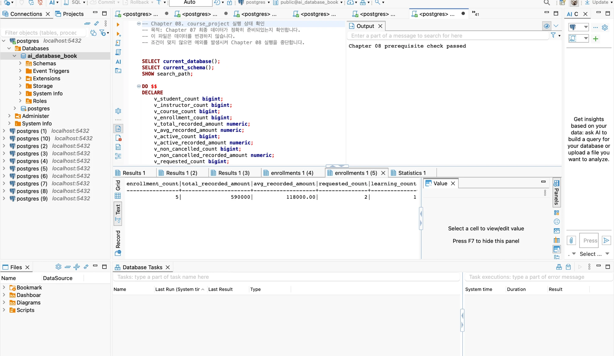
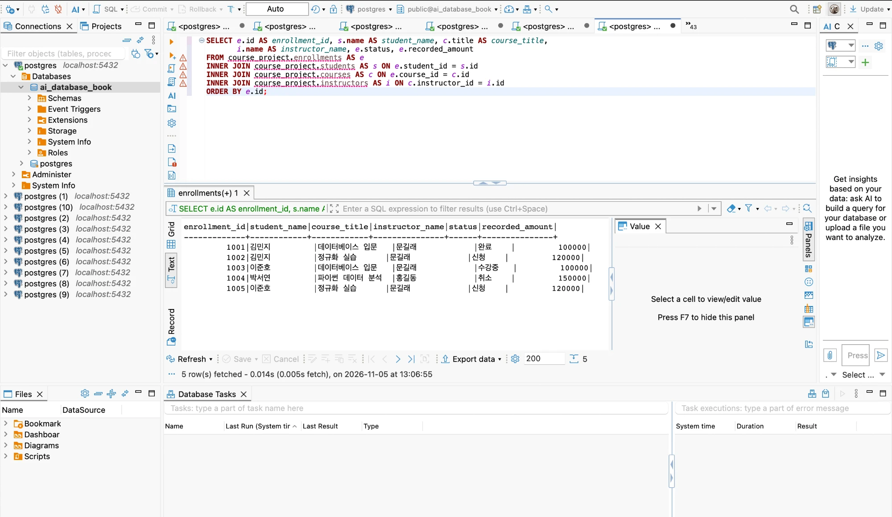
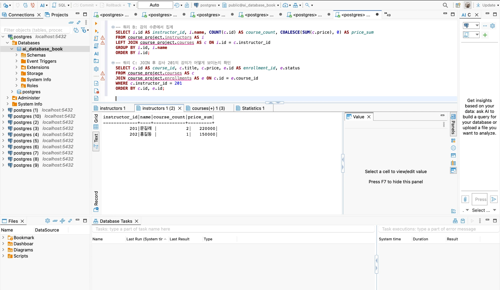

# Chapter 08 확장 실습 답안

> **과제:** JOIN과 집계로 서비스 질문에 답하기  
> **사용 방법:** 이 파일을 내려받아 본인의 GitHub 저장소에 `chapter08_answer.md`라는 이름으로 저장한 뒤 실습하면서 바로 작성합니다.  
> **제출 방법:** LMS에는 파일을 직접 업로드하지 않고, **본인 GitHub 저장소의 `chapter08_answer.md` 파일 URL**을 제출합니다.

---

## 제출 전 주의

이 파일과 캡처 화면에는 실제 비밀번호, 전체 DB 접속 URL, API Key, 개인정보를 기록하지 않습니다.

```text
GitHub 계정 또는 별칭: dusen120-ai
과제 작성일: 2026-11-05
사용한 AI 도구: Claude (Claude Code)
```

> 이 답안의 모든 결과는 `code/chapter08/my_run_all.sql`을 한 번에 실행한 출력 [`run_output.txt`](./run_output.txt)에서 옮겼다.  
> 답안용 SQL은 [`my_chapter08_answers.sql`](../../code/chapter08/my_chapter08_answers.sql), 개인 프로젝트 SQL은 [`my_cafe_questions.sql`](../../code/chapter08/my_cafe_questions.sql)에 있다.

---

# 1. Chapter 07 기준 상태 확인

다음을 실행합니다.

```text
code/chapter08/00_check_course_project.sql
```

## 1-1. 사전 검사 결과

```text
검증 메시지: Chapter 08 prerequisite check passed

students 행 수: 3
instructors 행 수: 2
courses 행 수: 3
enrollments 행 수: 5

전체 신청 건수: 5
전체 recorded_amount: 590000
활성 신청 건수: 3
활성 recorded_amount: 340000
취소 제외 신청 건수: 4
취소 제외 recorded_amount: 440000
```

기준값:

```text
students = 3
instructors = 2
courses = 3
enrollments = 5

전체 = 5 / 590000
활성 = 3 / 340000
취소 제외 = 4 / 440000
```

### 기준값이 다르면 그대로 진행하면 안 되는 이유

```text
사전 검사가 잡아내지 않았다면 집계 결과가 제대로 안 나왔을 것이다.

실제로 처음 실행했을 때 "Chapter 07의 course_project 객체가 모두 준비되지 않았습니다" 오류로 멈췄다.
ai_database_book에 course_project 스키마가 없었기 때문이다.
Chapter 07의 01 → 02 → 03 → 04를 다시 실행해 복구한 뒤 사전 검사를 통과했다.
```

### 증거 화면

권장 경로:

```text
assignments/chapter08/images/step01_prerequisite.png
```



---

# 2. 업무 질문을 SQL보다 먼저 정의하기

다음 세 질문을 각각 SQL 작성 전에 먼저 정의합니다.

## 질문 A

```text
업무 질문: 신청 한 건마다 어떤 학생이 어떤 강의를 어떤 강사에게 신청했는가?
결과 한 행의 의미: 신청 한 건 (enrollments 한 행)
포함 상태: 신청, 수강중, 완료, 취소 (전체 이력)
제외 상태: 없음
JOIN할 테이블: enrollments, students, courses, instructors
JOIN 경로: students ← enrollments → courses → instructors
INNER JOIN / LEFT JOIN 선택: INNER JOIN
그 이유: 신청은 학생과 강의를, 강의는 강사를 반드시 가진다(FK + NOT NULL). 연결이 끊긴 행이 없어야 정상이고, 신청 없는 학생을 보여 달라는 질문도 아니다.
예상 행 수: 5행 (enrollments 행 수와 같아야 함)
```

## 질문 B

```text
업무 질문: 강의별로 취소를 뺀 신청의 기록 금액 합계는 얼마인가?
결과 한 행의 의미: 강의 한 개
포함 상태: 신청, 수강중, 완료
제외 상태: 취소
JOIN할 테이블: courses, enrollments
JOIN 경로: courses → enrollments
집계 대상: enrollments.recorded_amount (courses.price가 아님)
예상 결과: 301 = 200000, 302 = 240000, 303 = 0, 합계 440000
```

## 질문 C

```text
업무 질문: 취소를 뺀 신청이 한 건도 없는 학생은 누구인가?
결과 한 행의 의미: 학생 한 명
포함 상태: 신청, 수강중, 완료인 신청이 있으면 "신청 있음"으로 본다
제외 상태: 취소인 신청은 없는 것으로 본다
0건인 부모도 보여야 하는가: 그렇다. 0건인 학생이 바로 찾으려는 대상이다.
NULL을 어떻게 해석할 것인가: LEFT JOIN 결과의 e.id가 NULL이면 조건에 맞는 신청이 연결되지 않았다는 뜻이다. 값이 비어 있는 신청이 있다는 뜻이 아니다.
예상 결과: 1명, 박서연 (신청 1004가 취소 상태)
```

---

# 3. INNER JOIN과 다중 JOIN

## 3-1. 신청 한 건마다 학생 이름과 강의 제목 조회

실행 전 예상:

```text
결과 한 행 = 신청 한 건
예상 행 수 = 5
JOIN 경로 = enrollments.student_id → students.id, enrollments.course_id → courses.id
```

내가 실행한 SQL:

```sql
SELECT e.id AS enrollment_id, s.name AS student_name, c.title AS course_title, e.status
FROM course_project.enrollments AS e
INNER JOIN course_project.students AS s ON e.student_id = s.id
INNER JOIN course_project.courses AS c ON e.course_id = c.id
ORDER BY e.id;
```

실제 결과:

```text
실제 행 수: 5
예상과 일치 여부: 일치

enrollment_id | student_name | course_title       | status
1001          | 김민지       | 데이터베이스 입문  | 완료
1002          | 김민지       | 정규화 실습        | 신청
1003          | 이준호       | 데이터베이스 입문  | 수강중
1004          | 박서연       | 파이썬 데이터 분석 | 취소
1005          | 이준호       | 정규화 실습        | 신청
```

### 학생 이름이 여러 번 보이는 것이 중복 오류가 아닐 수 있는 이유

```text
정상이다. 신청 건수별로 나뉘어서 이름이 여러 번 보인다.
결과 한 행은 학생이 아니라 신청 한 건이고, 김민지는 1001과 1002 두 건을 신청했다.
enrollment_id가 전부 다르므로 같은 신청이 반복된 것이 아니다.
```

## 3-2. 학생·강의·강사까지 연결

```text
결과 한 행 = 신청 한 건 (강의 한 개에 강사 한 명이 연결되어 강사를 붙여도 5행 그대로다)
강사까지 가는 JOIN 경로 = enrollments.course_id → courses.id, courses.instructor_id → instructors.id
                          (enrollments에는 강사 열이 없어서 courses를 거쳐야 한다)
```

```sql
SELECT e.id AS enrollment_id, s.name AS student_name, c.title AS course_title,
       i.name AS instructor_name, e.status, e.recorded_amount
FROM course_project.enrollments AS e
INNER JOIN course_project.students AS s ON e.student_id = s.id
INNER JOIN course_project.courses AS c ON e.course_id = c.id
INNER JOIN course_project.instructors AS i ON c.instructor_id = i.id
ORDER BY e.id;
```

실제 행 수:

```text
5

enrollment_id | student_name | course_title       | instructor_name | status | recorded_amount
1001          | 김민지       | 데이터베이스 입문  | 문길래          | 완료   | 100000
1002          | 김민지       | 정규화 실습        | 문길래          | 신청   | 120000
1003          | 이준호       | 데이터베이스 입문  | 문길래          | 수강중 | 100000
1004          | 박서연       | 파이썬 데이터 분석 | 홍길동          | 취소   | 150000
1005          | 이준호       | 정규화 실습        | 문길래          | 신청   | 120000
```

### 증거 화면

권장 경로:

```text
assignments/chapter08/images/step03_inner_join.png
```



---

# 4. LEFT JOIN과 0건 표현

## 4-1. 강의별 취소 제외 신청 수

신청이 없는 강의도 결과에 남도록 작성합니다.

실행 전:

```text
결과 한 행 = 강의 한 개
강의 303의 예상 실제 신청 수 = 0 (유일한 신청 1004가 취소)
강의 303의 예상 고유 학생 수 = 0
강의 303의 예상 recorded_amount = 0 (SUM은 NULL이므로 COALESCE로 0 표시)
```

내 SQL:

```sql
SELECT c.id AS course_id, c.title,
       COUNT(*) AS count_star,
       COUNT(e.id) AS count_enrollment,
       COUNT(DISTINCT e.student_id) AS count_student,
       COALESCE(SUM(e.recorded_amount), 0) AS recorded_amount
FROM course_project.courses AS c
LEFT JOIN course_project.enrollments AS e
    ON c.id = e.course_id
   AND e.status <> '취소'
GROUP BY c.id, c.title
ORDER BY c.id;
```

실제 결과:

```text
강의 301: 신청 2건 / 고유 학생 2명 / 200000
강의 302: 신청 2건 / 고유 학생 2명 / 240000
강의 303: 신청 0건 / 고유 학생 0명 / 0
```

## 4-2. `COUNT(*)`와 `COUNT(e.id)` 비교

강의 303을 기준으로 작성합니다.

```text
COUNT(*) 결과: 1
COUNT(e.id) 결과: 0
COUNT(DISTINCT e.student_id) 결과: 0
```

### 왜 `COUNT(*) = 1`인데 실제 신청 수는 0일 수 있나요?

```text
COUNT(*)는 신청 없는 강의의 행도 세기 때문이다.
LEFT JOIN은 신청이 없는 강의 303을 신청 쪽 값이 NULL인 한 행으로 남기고, COUNT(*)는 이 행을 1로 센다.
```

### 자식 사건 수를 셀 때 `COUNT(child.id)`가 더 적절한 이유

```text
COUNT(e.id)를 써야 실제로 연결된 신청 수가 세어진다.
e.id는 실제 신청 행에서는 NULL이 아니고, LEFT JOIN이 남긴 빈 행에서만 NULL이라서 빈 행은 세지 않는다.
취소를 빼는 것은 COUNT가 아니라 ON의 e.status <> '취소' 조건이다.
COUNT(*)를 쓰면 강의 303의 신청 수가 0건이 아니라 1건으로 보인다.
```

---

# 5. `LEFT JOIN`에서 `ON`과 `WHERE` 조건 비교

취소 제외 신청만 연결한다고 가정합니다.

## 5-1. 조건을 `ON`에 둔 경우

```sql
SELECT s.id, s.name, COUNT(e.id) AS non_cancelled_count
FROM course_project.students AS s
LEFT JOIN course_project.enrollments AS e
    ON s.id = e.student_id
   AND e.status <> '취소'
GROUP BY s.id, s.name
ORDER BY s.id;
```

```text
결과 학생 수: 3 (김민지 2, 이준호 2, 박서연 0)
박서연 포함 여부: 포함 (0건)
```

## 5-2. 조건을 `WHERE`에 둔 경우

```sql
SELECT s.id, s.name, COUNT(e.id) AS non_cancelled_count
FROM course_project.students AS s
LEFT JOIN course_project.enrollments AS e
    ON s.id = e.student_id
WHERE e.status <> '취소'
GROUP BY s.id, s.name
ORDER BY s.id;
```

```text
결과 학생 수: 2 (김민지 2, 이준호 2)
박서연 포함 여부: 미포함
```

## 5-3. 차이 설명

```text
ON 조건이 LEFT JOIN의 오른쪽 연결 대상을 제한하는 방식:
  조건에 맞는 신청만 연결 후보가 된다. 맞는 신청이 없어도 왼쪽 학생은 NULL 행으로 남는다.

WHERE 조건이 JOIN 이후 결과 행을 제거하는 방식:
  JOIN이 끝난 결과에서 조건이 참인 행만 남긴다. 학생까지 함께 사라질 수 있다.

이번 사례에서 ON = 3명, WHERE = 2명이 되는 이유:
  박서연의 신청은 1004(취소) 하나뿐이다.
  ON은 연결할 때부터 취소 신청이 후보에서 빠지고, e가 NULL인 행으로 남아 박서연이 포함되어 3명으로 나온다.
  WHERE는 조건 없이 모든 신청을 연결한 후, JOIN이 끝난 결과에 WHERE를 적용할 때 박서연의 행이 제거되어 2명으로 나온다.
```

---

# 6. 신청이 없는 학생 찾기 — 두 방법 비교

## 방법 1. `LEFT JOIN ... IS NULL`

```sql
SELECT s.id, s.name
FROM course_project.students AS s
LEFT JOIN course_project.enrollments AS e
    ON s.id = e.student_id
   AND e.status <> '취소'
WHERE e.id IS NULL
ORDER BY s.id;
```

## 방법 2. `NOT EXISTS`

```sql
SELECT s.id, s.name
FROM course_project.students AS s
WHERE NOT EXISTS (
    SELECT 1
    FROM course_project.enrollments AS e
    WHERE e.student_id = s.id
      AND e.status <> '취소'
)
ORDER BY s.id;
```

```text
방법 1 결과: 1명
방법 2 결과: 1명
두 결과가 같은가: 같다
찾아진 학생: 103 박서연
```

### 두 방식의 공통 의미를 자신의 말로 설명

```text
둘 다 취소 아닌 신청이 없는 학생을 찾는다.
```

---

# 7. 기본 집계 검산

다음 결과를 직접 확인합니다.

| 분석 범위 | 예상 건수 | 실제 건수 | 예상 금액 | 실제 금액 | 일치? |
| --- | ---: | ---: | ---: | ---: | --- |
| 전체 신청 | 5 | 5 | 590000 | 590000 | 일치 |
| 활성 신청 | 3 | 3 | 340000 | 340000 | 일치 |
| 취소 제외 | 4 | 4 | 440000 | 440000 | 일치 |
| 취소 | 1 | 1 | 150000 | 150000 | 일치 |

```text
추가 검산: 취소 제외 440000 + 취소 150000 = 전체 590000
```

## 7-1. 전체 평균 `recorded_amount`

```text
예상 평균: 590000 / 5 = 118000.00
실제 평균: 118000.00
```

## 7-2. 취소 제외 평균

```text
예상 평균: 440000 / 4 = 110000.00
실제 평균: 110000.00
```

### `recorded_amount`를 실제 회계 매출이라고 부르면 안 되는 이유

```text
취소된 건도 그대로 남아 있어서 실제 회계 매출이라고 부르면 안 된다.
(취소된 1004의 150000도 전체 합계 590000에 들어 있다. 이 값은 결제액이 아니라 신청할 때 기록한 금액이다.)
```

---

# 8. `GROUP BY`, `HAVING`, `FILTER`

## 8-1. 상태별 신청 건수

```sql
SELECT status, COUNT(*) AS enrollment_count
FROM course_project.enrollments
GROUP BY status
ORDER BY CASE status WHEN '신청' THEN 1 WHEN '수강중' THEN 2 WHEN '완료' THEN 3 WHEN '취소' THEN 4 END;

-- 같은 결과를 FILTER로 한 행에 표현
SELECT COUNT(*) AS total_count,
       COUNT(*) FILTER (WHERE status = '신청') AS requested,
       COUNT(*) FILTER (WHERE status = '수강중') AS learning,
       COUNT(*) FILTER (WHERE status = '완료') AS completed,
       COUNT(*) FILTER (WHERE status = '취소') AS cancelled
FROM course_project.enrollments;
```

결과:

```text
신청: 2
수강중: 1
완료: 1
취소: 1
상태별 합계: 5
```

### 상태별 건수 합이 전체 신청 5건과 맞는지 검산

```text
2 + 1 + 1 + 1 = 5로 전체 COUNT(*) 5와 같다. FILTER 결과(total 5 / 2 / 1 / 1 / 1)도 같다.
빠진 상태나 NULL 상태, 예상 밖의 상태값이 없다는 뜻이기도 하다.
```

## 8-2. 강의별 취소 제외 신청 수와 금액

4-1과 같은 SQL을 사용한다. 결과 한 행의 기준과 상태 범위가 같기 때문이다.

```sql
SELECT c.id AS course_id, c.title,
       COUNT(*) AS count_star,
       COUNT(e.id) AS count_enrollment,
       COUNT(DISTINCT e.student_id) AS count_student,
       COALESCE(SUM(e.recorded_amount), 0) AS recorded_amount
FROM course_project.courses AS c
LEFT JOIN course_project.enrollments AS e
    ON c.id = e.course_id
   AND e.status <> '취소'
GROUP BY c.id, c.title
ORDER BY c.id;
```

```text
강의 301: 2건 / 200000
강의 302: 2건 / 240000
강의 303: 0건 / 0
강의별 합계를 다시 더한 값: 200000 + 240000 + 0 = 440000
전체 취소 제외 기준 440000과 일치 여부: 일치
```

## 8-3. `HAVING` 사용

취소 제외 신청이 2건 이상인 강의를 조회합니다.

```sql
SELECT c.id, c.title, COUNT(e.id) AS enrollment_count
FROM course_project.courses AS c
JOIN course_project.enrollments AS e ON c.id = e.course_id
WHERE e.status <> '취소'
GROUP BY c.id, c.title
HAVING COUNT(e.id) >= 2
ORDER BY c.id;
```

```text
예상 강의 수: 2
실제 강의 수: 2 (301, 302)
```

> `WHERE`는 그룹을 만들기 전에 신청 행을 거르고, `HAVING`은 묶은 뒤 그룹을 거른다. 0건인 강의는 어차피 조건에서 빠지므로 여기서는 INNER JOIN으로 충분하다.

---

# 9. 과대 집계 오류 직접 관찰

강사 201의 강의 가격 합계를 구한다고 가정합니다.

## 9-1. 신청까지 JOIN해서 잘못 집계한 결과

```sql
SELECT i.id AS instructor_id, i.name, SUM(c.price) AS wrong_price_sum
FROM course_project.instructors AS i
JOIN course_project.courses AS c ON i.id = c.instructor_id
JOIN course_project.enrollments AS e ON c.id = e.course_id
GROUP BY i.id, i.name
ORDER BY i.id;
```

```text
강사 201 잘못된 가격 합계: 440000
```

본문 기준:

```text
440000
```

## 9-2. 강의 수준에서 올바르게 집계

```sql
SELECT i.id AS instructor_id, i.name, COUNT(c.id) AS course_count, COALESCE(SUM(c.price), 0) AS price_sum
FROM course_project.instructors AS i
LEFT JOIN course_project.courses AS c ON i.id = c.instructor_id
GROUP BY i.id, i.name
ORDER BY i.id;
```

```text
강사 201 올바른 가격 합계: 220000
```

본문 기준:

```text
220000
```

## 9-3. 왜 두 결과가 달라졌나요?

```text
JOIN 전 강의 행 수: 2 (301 = 100000, 302 = 120000)
JOIN 후 강의가 반복된 이유: 강의 1 : 신청 N 관계라서 강의 행이 신청 수만큼 복제된다. 301과 302가 각각 신청 2건이라 4행이 됐다.
SUM이 무엇을 반복해서 더했는가: 같은 강의의 price를 신청 수만큼 더했다. 100000 × 2 + 120000 × 2 = 440000
```

> 강사 202는 두 방식 모두 150000이지만, 신청이 우연히 한 건뿐이라 같게 나온 것이다. 잘못된 쿼리가 맞는 값을 낸다고 해서 쿼리가 맞는 것은 아니다.

### `SUM(DISTINCT c.price)`를 일반적인 해결책으로 사용하면 안 되는 이유

```text
DISTINCT는 같은 강의인지가 아니라 같은 금액인지를 본다.
서로 다른 두 강의의 가격이 모두 100000이면 하나로 합쳐져 합계가 오히려 작아진다.
이번 데이터에서는 가격이 모두 달라 우연히 맞을 뿐이다. 질문이 강의 수준이면 신청을 JOIN하지 않는 것이 해결책이다.
```

### 증거 화면

권장 경로:

```text
assignments/chapter08/images/step09_over_aggregation.png
```

잘못된 합계 (신청까지 JOIN):


올바른 합계 (강의 수준):



---

# 10. 상세 결과 ↔ 집계 결과 교차 검산

강의 하나를 선택합니다.

```text
선택한 course_id: 302
강의 제목: 정규화 실습
```

## 10-1. 상세 신청 행 조회

```sql
SELECT e.id AS enrollment_id, s.name AS student_name, e.status, e.recorded_amount
FROM course_project.enrollments AS e
JOIN course_project.students AS s ON e.student_id = s.id
WHERE e.course_id = 302
  AND e.status <> '취소'
ORDER BY e.id;
```

```text
상세 행 수: 2 (1002 김민지 신청 120000, 1005 이준호 신청 120000)
상세 recorded_amount를 직접 더한 값: 120000 + 120000 = 240000
```

## 10-2. 집계 SQL

```sql
SELECT COUNT(*) AS enrollment_count, SUM(recorded_amount) AS recorded_amount
FROM course_project.enrollments
WHERE course_id = 302
  AND status <> '취소';
```

```text
집계 건수: 2
집계 금액: 240000
```

## 10-3. 비교

```text
상세 행 수와 COUNT 결과 일치 여부: 일치 (2 = 2)
상세 금액 합과 SUM 결과 일치 여부: 일치 (240000 = 240000)
다르다면 원인: 다르지 않았다. 달랐다면 두 SQL의 상태 조건, JOIN 경로로 행이 늘었는지 순서로 확인한다.
```

---

# 11. 자동 완료 게이트

다음을 실행합니다.

```text
code/chapter08/03_join_aggregation_validation.sql
```

```text
최종 검증 메시지: Chapter 08 join and aggregation validation passed
```

기대 메시지:

```text
Chapter 08 join and aggregation validation passed
```

### 자동 검증이 통과했어도 사람이 SQL 의미를 설명해야 하는 이유

```text
게이트는 정해 둔 숫자가 맞는지만 본다. 내 질문에 맞는 SQL인지는 판단하지 못한다.
9장의 강사 202처럼 틀린 쿼리도 맞는 숫자를 낼 수 있고, 데이터가 바뀌면 그 우연은 깨진다.
결과 한 행이 무엇인지, 어떤 상태를 포함했는지는 사람이 설명할 수 있어야 한다.
```

---

# 12. 개인 프로젝트 업무 질문 3개 만들기

Chapter 07에서 작성한 개인 프로젝트를 사용합니다.

> 프로젝트: **내 카페 방문 기록** (`cafe_project` 스키마, `code/chapter07/my_cafe_project_schema.sql`)  
> Chapter 07까지는 구조만 만들어 테이블이 비어 있다. 그래서 답을 미리 계산해 둔 **샘플 데이터**를 트랜잭션 안에서 넣어 조회한 뒤 `ROLLBACK`했다. 실제 방문 기록이 아니며 DB에 남지 않는다.

```text
샘플 행 수: cafes 4 / menu_items 7 / visits 6 / visit_items 9, P07-MR10 위반 0건
ROLLBACK 후: 네 테이블 모두 0행
```

| 질문 ID | 업무 질문 | 결과 한 행 | 포함/제외 범위 | JOIN 경로 | 집계 대상 | 검산 방법 |
| --- | --- | --- | --- | --- | --- | --- |
| P08-Q01 | 카페별로 몇 번 갔고 평균 평점은 몇 점인가? | 카페 한 곳 | 방문 0회 카페 포함, 폐업 카페 포함, 평점 NULL 방문은 횟수에는 넣고 평균에서는 제외 | `cafes` → `visits` (LEFT) | `COUNT(v.id)`, `COUNT(v.rating)`, `AVG(v.rating)` | 카페별 합 = `visits` 전체 행 수 |
| P08-Q02 | 카페별로 주문을 몇 건 했고 실제로 얼마를 썼는가? | 카페 한 곳 | 방문 0회 카페 포함, 주문 없는 방문 포함, 가격 NULL 주문은 건수에는 넣고 금액에서는 제외 | `cafes` → `visits` → `visit_items` (LEFT, LEFT) | `COUNT(DISTINCT v.id)`, `COUNT(vi.id)`, `COUNT(vi.price)`, `SUM(vi.price)` | 카페 X 상세 행을 직접 합산, 카페별 합 = `visit_items` 전체 합계 |
| P08-Q03 | 메뉴별로 몇 번 주문했고 가격은 얼마에서 얼마까지 변했는가? | 카페별 메뉴 한 개 | 주문 0회 메뉴 포함, 가격 NULL 주문은 건수에는 넣고 최저·최고에서는 제외 | `menu_items` → `cafes` (INNER), `menu_items` → `visit_items` (LEFT) | `COUNT(vi.id)`, `MIN(vi.price)`, `MAX(vi.price)` | 메뉴별 합 = `visit_items` 전체 행 수 |

## 12-1. 질문 1 SQL

```sql
SELECT c.id, c.name,
       COUNT(v.id) AS visit_count,
       COUNT(v.rating) AS rated_visit_count,
       ROUND(AVG(v.rating), 2) AS avg_rating
FROM cafe_project.cafes AS c
LEFT JOIN cafe_project.visits AS v ON c.id = v.cafe_id
GROUP BY c.id, c.name
ORDER BY c.id;
```

```text
예상 결과:
  카페 X 3회 / 평점 있는 방문 2회 / (4.5 + 4.0) / 2 = 4.25
  카페 Y 2회 / 2회 / (3.5 + 4.0) / 2 = 3.75
  카페 Z 0회 / 0회 / NULL
  카페 W 1회 / 1회 / 5.00
실제 결과: 예상과 같다. 카페 Z의 평균은 NULL로 나왔다. 평점이 0점이 아니라 없는 것이므로 COALESCE로 0을 넣지 않았다.
검산 결과: 카페별 합 3 + 2 + 0 + 1 = 6, visits 전체 6행과 일치
```

## 12-2. 질문 2 SQL

```sql
SELECT c.id, c.name, c.closed_on,
       COUNT(DISTINCT v.id) AS visit_count,
       COUNT(vi.id) AS order_count,
       COUNT(vi.price) AS priced_order_count,
       COALESCE(SUM(vi.price), 0) AS spent_known
FROM cafe_project.cafes AS c
LEFT JOIN cafe_project.visits AS v ON c.id = v.cafe_id
LEFT JOIN cafe_project.visit_items AS vi ON v.id = vi.visit_id
GROUP BY c.id, c.name
ORDER BY c.id;
```

```text
예상 결과:
  카페 X 방문 3 / 주문 6 / 가격 있는 주문 5 / 25400
  카페 Y 방문 2 / 주문 2 / 2 / 8000
  카페 Z 방문 0 / 주문 0 / 0 / 0
  카페 W 방문 1 / 주문 1 / 1 / 5500
실제 결과: 예상과 같다.
검산 결과:
  카페 X 상세 6행: 4500 + 6500 + 4800 + 4800 + 4800 + NULL = 25400 일치
  카페별 합 25400 + 8000 + 0 + 5500 = 38900, visit_items 전체 SUM(price) 38900과 일치
  주문 수 합 6 + 2 + 0 + 1 = 9, visit_items 전체 9행과 일치
```

이 질문에서 교재와 같은 과대 집계를 직접 확인했다. 같은 JOIN에서 방문을 그대로 세고 평점을 평균 내면 다음과 같이 틀린다.

```text
           | 잘못된 방문 수 COUNT(v.id) | 올바른 방문 수 | 잘못된 평균 AVG(v.rating) | 올바른 평균 (12-1)
카페 X     | 6                          | 3              | 4.33                      | 4.25
카페 Y     | 3                          | 2              | 3.67                      | 3.75
```

```text
주문이 많은 방문의 평점이 주문 수만큼 반복되어 평균이 기울었다. 방문 수는 COUNT(DISTINCT v.id)로 고칠 수 있지만
평균 평점은 DISTINCT로 고칠 수 없다(같은 점수의 다른 방문까지 합쳐진다). 그래서 평균 평점은 주문을 JOIN하지 않는 12-1에서 따로 구한다.
```

## 12-3. 질문 3 SQL

```sql
SELECT m.id, c.name AS cafe_name, m.name AS menu_name,
       COUNT(vi.id) AS order_count,
       COUNT(vi.id) - COUNT(vi.price) AS unpriced_count,
       MIN(vi.price) AS min_price,
       MAX(vi.price) AS max_price
FROM cafe_project.menu_items AS m
INNER JOIN cafe_project.cafes AS c ON m.cafe_id = c.id
LEFT JOIN cafe_project.visit_items AS vi ON m.id = vi.menu_item_id
GROUP BY m.id, c.name, m.name
ORDER BY m.id;
```

```text
예상 결과:
  카페 X 아메리카노 4회 / 4500~4800
  카페 X 치즈케이크 2회 / 가격 미기록 1회 / 6500~6500
  카페 X 라떼 0회 / NULL
  카페 Y 아메리카노 1회 / 5000~5000
  카페 Y 마들렌 1회 / 3000~3000
  카페 Z 아메리카노 0회 / NULL
  카페 W 라떼 1회 / 5500~5500
실제 결과: 예상과 같다. 아메리카노가 카페별로 따로 나오는 것은 P07-MD01(메뉴는 카페별 관리) 때문이다.
검산 결과: 메뉴별 합 4 + 2 + 0 + 1 + 1 + 0 + 1 = 9, visit_items 전체 9행과 일치. 주문 0회 메뉴 2개.
```

> 같은 메뉴를 두 잔 시키면 두 행으로 기록하는 P07-MQ02의 잠정 처리를 따랐기 때문에 카페 X 아메리카노는 방문 3번에 주문 4회로 나온다. 이 결정이 바뀌면 `COUNT`가 아니라 `SUM(quantity)`로 고쳐야 한다.

> 아직 개인 프로젝트 테이블을 PostgreSQL로 완성하지 않았다면 SQL 초안과 예상 검산 방법까지만 작성하고 `미실행`이라고 명시합니다.

---

# 13. AI를 JOIN·집계 리뷰어로 활용

## 13-1. 내가 AI에게 전달한 질문

```text
(이 답안을 함께 작성한 대화와 별개의 새 Claude 대화에서 질문)
너는 SQL 리뷰어야. 아래 스키마와 업무 질문을 보고 먼저 네 SQL을 작성한 다음, 내 SQL과 비교해서 위험한 점을 찾아 줘.
실행에 성공하는지보다 결과 한 행의 의미, 상태 범위, JOIN 경로, INNER/LEFT 선택, COUNT 대상, 과대 집계 위험, 상세 검산 방법을 기준으로 봐 줘.

스키마 (PostgreSQL, 스키마 이름 cafe_project):
- cafes(id PK, name NOT NULL, closed_on DATE NULL) = 카페 한 곳
- visits(id PK, cafe_id FK NOT NULL, visited_on NOT NULL, rating NUMERIC(2,1) NULL) = 방문 한 번
- visit_items(id PK, visit_id FK NOT NULL, menu_item_id FK NOT NULL, price INTEGER NULL) = 한 방문에서 주문한 메뉴 한 개

업무 질문: 카페별로 방문 횟수, 주문 수, 실제 지출 금액을 알고 싶다.
방문하지 않은 카페와 폐업 카페도 결과에 나와야 한다. 가격을 기록하지 않은 주문이 있을 수 있다.

내 SQL:
SELECT c.id, c.name,
       COUNT(DISTINCT v.id) AS visit_count,
       COUNT(vi.id) AS order_count,
       COUNT(vi.price) AS priced_order_count,
       COALESCE(SUM(vi.price), 0) AS spent
FROM cafe_project.cafes AS c
LEFT JOIN cafe_project.visits AS v ON c.id = v.cafe_id
LEFT JOIN cafe_project.visit_items AS vi ON v.id = vi.visit_id
GROUP BY c.id, c.name
ORDER BY c.id;
```

## 13-2. 내 SQL과 AI SQL 비교

| 검토 항목 | 내 판단/SQL | AI 제안 | 최종 선택 | 이유 |
| --- | --- | --- | --- | --- |
| 결과 한 행 | 카페 한 곳 | 최종 행은 맞지만 중간 행의 단위가 섞이므로 CTE로 먼저 집계하기 | 보류 (내 SQL 유지) | 지금 질문에는 AI 제안이 꼭 필요한 사항은 아니라고 판단했다. |
| 상태 범위 | 방문 0회·폐업 카페 포함, 가격 NULL 주문은 건수에만 포함 | 폐업 카페를 구분하도록 `closed_on` 추가 | 수용 | 폐업 카페를 구분할 수 있어 결과에 추가했다. |
| JOIN 경로 | `cafes` → `visits` → `visit_items` | 같은 경로를 CTE 안에서 사용 | 내 SQL 유지 | 같은 FK로 연결하는 경로라서 바꾸지 않았다. |
| INNER/LEFT 선택 | 둘 다 LEFT. 방문 0회 카페와 주문 없는 방문을 남겨야 함 | LEFT가 맞음. 기간 조건을 `WHERE`에 넣으면 LEFT JOIN이 사실상 INNER가 됨 | 수용 | 5장에서 확인한 내용과 같았다. 지금 쿼리에는 기간 조건이 없다. |
| COUNT 대상 | 방문 `COUNT(DISTINCT v.id)`, 주문 `COUNT(vi.id)`, 가격 있는 주문 `COUNT(vi.price)` | 세 COUNT 모두 의도대로임 | 내 SQL 유지 | AI도 세 COUNT의 대상이 맞다고 했다. |
| 과대 집계 위험 | 방문 쪽 값은 주문 수만큼 반복되므로 `AVG(v.rating)`을 같은 쿼리에 넣지 않음 | `AVG(v.rating)`을 넣으면 주문이 많은 방문의 평점이 더 반영됨 | 수용 | 12-2에서 카페 X 평균이 4.25에서 4.33으로 틀어지는 것을 직접 확인했다. 그래서 평점은 12-1에서 따로 구했다. |
| 상세 검산 방법 | 카페 X 상세 합산, 카페별 합 = `visit_items` 전체 합 | 전체 합계 대조, 양방향 `EXCEPT`, 경계 케이스 확인 | 수용 | 내 SQL과 AI SQL을 양방향 `EXCEPT`로 비교했다. |
| 지출 금액 이름 | `spent` | `spent_known`으로 변경 | 수용 | 가격 미기록 주문이 빠진 합계라는 뜻이 이름에 드러나서 반영했다. |
| 가격 전부 미기록인 경우 | `COALESCE`로 0 표시 | 0 대신 `NULL` 표시 검토 | 보류 | 혼자 쓰는 기록이라 `priced_order_count`로 구분할 수 있다고 판단했다. |
| "정답이 우연한 조건에 기댄다"는 지적 | `SUM(vi.price)`는 주문 행 단위라 안전함 | 수정할 때 깨지기 쉬움 | 일부 거절 | `SUM(vi.price)`는 주문 행이 한 번씩만 나오는 구조라 우연이 아니었다. AI도 같은 답변에서 현재는 안전하다고 했다. 위험한 것은 방문 단위 값을 추가할 때였다. |

### AI가 만든 SQL에서 발견한 위험 또는 확인한 점

```text
AI SQL을 샘플 데이터에서 실행해 내 SQL과 양방향 EXCEPT로 비교했더니 mine_only = 0, ai_only = 0으로 같았다.
카페 X 25400, 카페 Y 8000, 카페 Z 0, 카페 W 5500으로 합계 38900이 visit_items 전체 합계와 일치했다.
AI가 제안한 폐업일 이후 방문 점검도 0행이었다.
다만 이 비교는 이번 샘플 기준이라, 두 SQL이 모든 데이터에서 같다는 증명은 아니다.
AI의 "정답이 우연한 조건에 기댄다"는 표현은 과했다. SUM(vi.price)는 주문 행이 한 번씩만 나오는 구조라서 안전했다.
```

### AI SQL이 실행 성공했다고 바로 정답이라고 할 수 없는 이유

```text
9장의 잘못된 합계 440000도 오류 없이 실행됐다. 실행 성공은 문법이 맞다는 뜻일 뿐, 질문에 맞는 답이라는 뜻이 아니다.
그래서 결과 한 행의 의미와 집계 대상을 확인하고, 상세 합계와 EXCEPT로 검산했다.
```

---

# 14. 최종 성찰

아래 문장은 본인의 말로 작성합니다.

```text
1. JOIN SQL을 작성하기 전에 가장 먼저 정해야 하는 것은
   결과 한 행의 의미 이다.

2. LEFT JOIN에서 COUNT(*) 대신 COUNT(child.id)를 검토해야 하는 이유는
   둘의 값이 다를 수 있기 때문 이다.

3. ON과 WHERE 조건 위치가 중요한 이유는
   취소 건을 서로 다르게 처리하기 때문 이다.

4. 여러 1:N 관계를 JOIN한 뒤 바로 SUM하면 위험한 이유는
   값이 중복되어 합쳐질 수 있기 때문 이다.

5. 집계 결과를 신뢰하기 전에 가장 좋은 검산 방법 중 하나는
   상세 행을 직접 조회해 더한 값과 집계 결과를 비교하는 것 이다.
```

---

# 15. 제출 체크리스트

- [x] `chapter08_answer.md`를 본인 저장소에 만들었다.
- [x] `00_check_course_project.sql`이 통과했다.
- [x] 업무 질문마다 결과 한 행을 먼저 정의했다.
- [x] INNER JOIN과 다중 JOIN을 실행했다.
- [x] LEFT JOIN에서 0건 부모를 확인했다.
- [x] `COUNT(*)`와 `COUNT(child.id)` 차이를 설명했다.
- [x] ON과 WHERE 조건 위치 차이를 직접 비교했다.
- [x] `LEFT JOIN ... IS NULL`과 `NOT EXISTS`를 비교했다.
- [x] 전체/활성/취소 제외 기준값을 직접 검산했다.
- [x] `GROUP BY`, `HAVING`을 사용했다.
- [x] 과대 집계 오류와 수정 결과를 비교했다.
- [x] 상세 결과와 집계 결과를 교차 검산했다.
- [x] `03_join_aggregation_validation.sql`이 통과했다.
- [x] 개인 프로젝트 업무 질문 3개를 작성했다.
- [x] AI SQL을 실행 성공 여부가 아니라 의미와 검산 결과로 평가했다.
- [x] 핵심 캡처는 3~4장 정도만 사용했다.
- [x] 비밀번호·개인정보·비밀정보가 없다.
- [ ] GitHub 웹에서 Markdown과 이미지가 정상적으로 보인다.
- [ ] 최종 답안을 commit/push했다.

---

# 16. LMS 제출 URL

아래 형식의 **본인 GitHub 파일 URL**을 LMS에 제출합니다.

```text
https://github.com/<본인-GitHub-ID>/<본인-저장소>/blob/main/assignments/chapter08/chapter08_answer.md
```

내 제출 URL:

```text
https://github.com/dusen120-ai/database/blob/main/assignments/chapter08/chapter08_answer.md
```

> 저장소 메인 URL, 교수자 템플릿 URL, Raw URL이 아니라 **작성 완료된 본인 `chapter08_answer.md` 파일 화면 URL**을 제출합니다.
