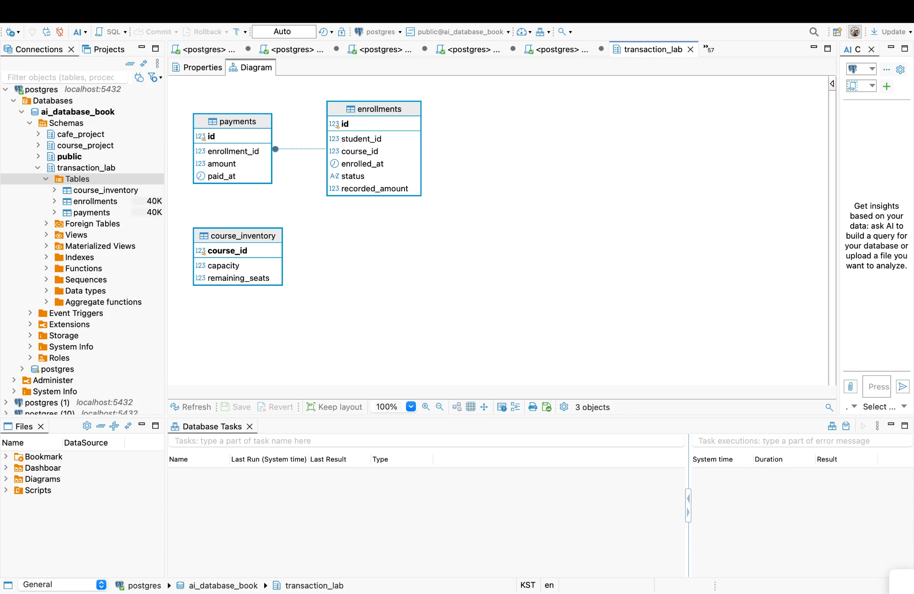
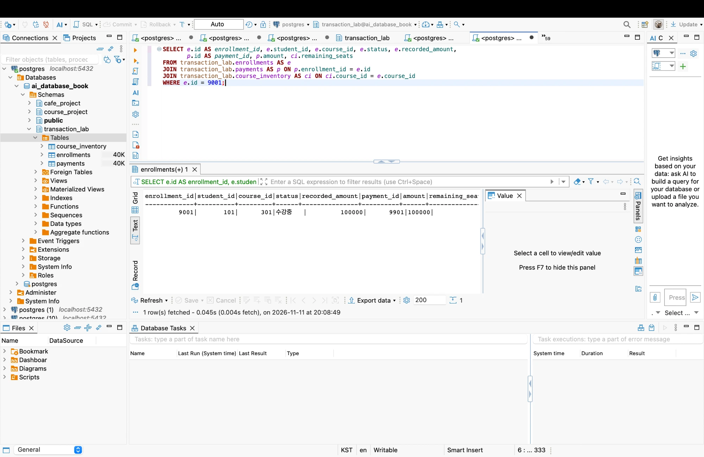
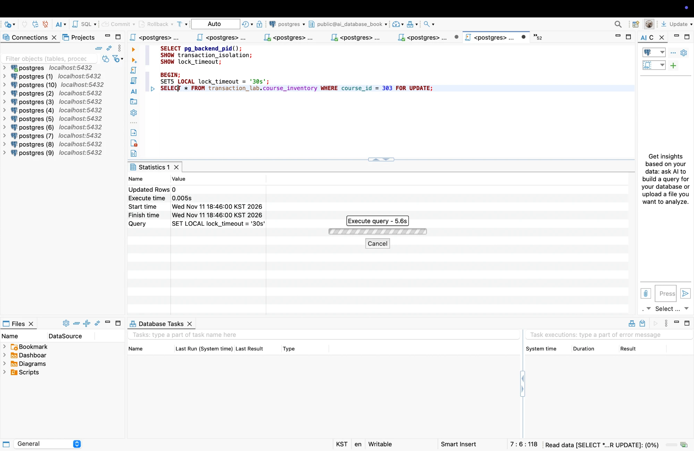

# Chapter 09 확장 실습 답안

> **과제:** 트랜잭션으로 데이터 정합성 지키기  
> **사용 방법:** 이 파일을 내려받아 본인의 GitHub 저장소에 `chapter09_answer.md`라는 이름으로 저장한 뒤 실습하면서 바로 작성합니다.  
> **제출 방법:** LMS에는 파일을 직접 업로드하지 않고, **본인 GitHub 저장소의 `chapter09_answer.md` 파일 URL**을 제출합니다.

---

## 제출 전 주의

이 파일과 캡처 화면에는 실제 비밀번호, 전체 DB 접속 URL, API Key, 개인정보를 기록하지 않습니다.

```text
GitHub 계정 또는 별칭: dusen120-ai
과제 작성일: 2026-11-11
사용한 AI 도구: Claude (Claude Code)
```

---

# 1. 시작 환경과 Chapter 07·08 기준 상태 확인

다음을 실행하거나 Chapter 09의 `01_transaction_lab_schema.sql` 사전 검사를 확인합니다.

```sql
SELECT current_database();
SELECT current_user;
SELECT current_schema();
SHOW search_path;
SHOW transaction_read_only;
```

| 확인 항목 | 실제 결과 | 의미 |
| --- | --- | --- |
| `current_database()` | `ai_database_book` | 교재 실습용 DB에 접속해 있다. 다른 DB였다면 `course_project`가 없거나 엉뚱한 곳에 lab이 생긴다. |
| `current_user` | `postgres` | 로컬 관리자 역할이라 `transaction_lab` 스키마를 만들 CREATE 권한이 있다. |
| `current_schema()` | `public` | 스키마를 생략한 객체는 `public`에 만들어진다. 그래서 실습 SQL은 모두 `transaction_lab.`, `course_project.`처럼 스키마를 명시한다. |
| `search_path` | `"$user", public` | 기본값이다. `postgres` 스키마가 없으므로 실제로는 `public`만 탐색된다. |
| `transaction_read_only` | `off` | 쓰기 가능한 세션이라 BEGIN/INSERT/UPDATE/COMMIT 실습이 가능하다. |

실제 확인한 Chapter 07·08 기준 상태:

```text
students / instructors / courses / enrollments = 3 / 2 / 3 / 5
전체 recorded_amount = 590000
상태별 = 신청 2(240000) / 수강중 1(100000) / 완료 1(100000) / 취소 1(150000)
활성(신청+수강중) = 3 / 340000
취소 제외 = 4 / 440000
transaction_lab 스키마 = 아직 없음 (깨끗한 시작)
→ 기준값과 모두 일치
```

Chapter 07·08 기준값:

```text
students = 3
instructors = 2
courses = 3
enrollments = 5
전체 recorded_amount = 590000
활성 = 3 / 340000
취소 제외 = 4 / 440000
```

### 기준 상태가 다르면 Chapter 09를 계속 진행하면 안 되는 이유

```text
transaction_lab은 course_project의 학생·강의를 외래키로 참조하고, 강의 301/302/303의
가격(100000/120000/150000)을 결제 금액 기준으로 사용한다. 출발점이 다르면 이후 COMMIT·
ROLLBACK 결과가 기대값과 달라져도 그것이 트랜잭션 때문인지, 원래 데이터가 달라서인지
구분할 수 없다. 또 06 검증은 실습 뒤에도 course_project가 3/2/3/5, 590000 그대로인지
다시 확인하는데, 시작부터 달랐다면 "실습이 보호 대상 데이터를 건드리지 않았다"는 것을
증명할 수 없다. 그래서 기준이 다르면 Chapter 07·08을 먼저 바로잡고 진행해야 한다.
```

---

# 2. `transaction_lab` 스키마 생성

실행 파일:

```text
code/chapter09/01_transaction_lab_schema.sql
```

## 2-1. 생성 전 예상

```text
생성될 스키마: transaction_lab
생성될 테이블 3개: course_inventory, enrollments, payments

course_inventory 한 행의 의미: 강의 하나(course_id)의 정원(capacity)과 현재 남은 좌석(remaining_seats).
                               course_project.courses를 참조하며 강의당 한 행이다.
enrollments 한 행의 의미: 학생 한 명이 강의 하나를 신청한 기록 1건. 상태(수강중/취소)와
                          신청 당시 기록한 금액(recorded_amount)을 가진다.
payments 한 행의 의미: 신청 1건에 대한 결제 기록 1건. enrollment_id가 UNIQUE라 신청당 최대 한 건이다.
```

## 2-2. 생성 결과

```text
통과 메시지: Chapter 09 transaction lab schema validation passed

실행 로그 요약:
DO (Chapter 07·08 사전 게이트 통과)
BEGIN → CREATE SCHEMA → CREATE TABLE ×3 → CREATE INDEX (uq_transaction_enrollments_active) → DO(구조 검사) → COMMIT

생성된 주요 규칙 (\d 확인):
course_inventory: PK(course_id), CHECK(capacity > 0),
                  CHECK(remaining_seats >= 0 AND remaining_seats <= capacity),
                  FK course_id → course_project.courses(id)
enrollments: id IDENTITY, FK student_id/course_id → course_project,
             CHECK(status IN ('수강중','취소')), CHECK(recorded_amount >= 0),
             부분 UNIQUE 인덱스(학생·강의별 '수강중' 1건)
payments: id IDENTITY, UNIQUE(enrollment_id), FK → transaction_lab.enrollments(id), CHECK(amount >= 0)
```

기대 메시지:

```text
Chapter 09 transaction lab schema validation passed
```

### Chapter 07·08의 `course_project`와 별도 `transaction_lab`을 사용하는 이유

```text
course_project는 Chapter 07에서 만들고 Chapter 08의 JOIN·집계 답이 기대는 기준 데이터다
(5건 / 590000). 트랜잭션 실습은 좌석을 줄이고, 신청·결제를 만들고, 일부러 ROLLBACK하거나
실패시키는 "변경 실험"이라 같은 테이블에서 하면 기준값이 깨질 위험이 있다.
별도 스키마에서 실습하면 학생·강의는 FK로 참조만 하고 직접 수정하지 않으므로 기준 데이터가 보호된다.
문제가 생겨도 reset_transaction_lab.sql로 transaction_lab만 지우고 다시 시작할 수 있다.
또 01 파일 자체도 BEGIN~COMMIT으로 묶여 있어서, 중간에 실패하면 스키마가 반쯤 만들어진 채 남지 않는다.
```

### 증거 화면

권장 경로:

```text
assignments/chapter09/images/step02_schema.png
```



---

# 3. 초기 좌석과 기준 데이터 입력

실행 파일:

```text
code/chapter09/02_transaction_lab_seed.sql
```

## 3-1. 실행 전 예상

```text
course 301 remaining_seats 예상: 3 (템플릿 기대값 3/0/0을 그대로 믿은 예상)
course 302 remaining_seats 예상: 0
course 303 remaining_seats 예상: 0
lab enrollments 예상 행 수: 0
payments 예상 행 수: 0
```

## 3-2. 실제 결과

```text
course 301 remaining_seats: 2  (capacity 2, 데이터베이스 입문, 100000원)
course 302 remaining_seats: 1  (capacity 1, 정규화 실습, 120000원)
course 303 remaining_seats: 1  (capacity 1, 파이썬 데이터 분석, 150000원)
course_inventory 행 수: 3
lab enrollments 행 수: 0
payments 행 수: 0
통과 메시지: Chapter 09 transaction lab seed validation passed
```

기대 초기 상태:

```text
course 301 / 302 / 303 remaining_seats = 3 / 0 / 0
lab enrollments = 0
payments = 0
```

### 예상과 실제가 다른 경우 원인

```text
좌석이 3/0/0이 아니라 2/1/1로 나왔지만 검증은 통과했다. 02 파일의 검증 블록을 읽어 보니
'3/0/0'은 좌석 수가 아니라 "course_inventory 3행 / enrollments 0행 / payments 0행"이라는
행 수 기준이었다. 좌석 자체는 INSERT 값대로 301=2/2, 302=1/1, 303=1/1을 검사한다.
즉 템플릿의 "remaining_seats = 3/0/0" 표기는 행 수 기준을 좌석 수로 잘못 옮긴 것이다.

실제 값 2/1/1이 맞다는 근거도 뒤 단계와 맞춰 확인했다. 주 실습 최종 기대값은
301=1, 302=0, 303=1이다. 9001(301 신청)로 301이 2→1, 9002(302 신청)로 302가 1→0,
303은 신청이 없어 1로 남는다. 반대로 302가 처음부터 0이었다면 9002 신청이 성공할 수 없다.
→ 기대값을 그대로 믿지 않고 검증 SQL과 데이터 흐름으로 확인해야 한다는 점을 배웠다.
```

---

# 4. 첫 번째 정상 COMMIT 추적

실행 파일:

```text
code/chapter09/03_commit_transaction.sql
```

이 실습은 학생 101이 강의 301을 신청하는 하나의 업무 단위를 추적합니다.

## 4-1. 업무 단위 정의

```text
이 트랜잭션에서 함께 성공해야 하는 변경 1: course_inventory 301의 remaining_seats를 1 줄인다 (2 → 1)
변경 2: enrollments에 9001 (학생 101 / 강의 301 / 수강중 / recorded_amount 100000) 1행을 만든다
변경 3: payments에 9901 (enrollment 9001 / amount 100000) 1행을 만든다

하나라도 실패하면 전체를 취소해야 하는 이유:
세 변경은 "학생 101이 301을 수강 신청했다"는 한 사실의 세 측면이다. 일부만 남으면
- 좌석만 줄고 신청이 없으면 → 아무도 쓰지 않는 좌석이 사라진다 (유령 좌석 손실)
- 신청만 있고 결제가 없으면 → 수강중인데 결제 기록이 없는 신청이 생긴다
- 좌석 차감 없이 신청·결제만 생기면 → 정원보다 많은 학생이 들어갈 수 있다
어느 경우든 "활성 신청 수 = capacity - remaining_seats" 규칙이 깨지므로 셋은 전부 반영되거나 전부 취소돼야 한다.
```

## 4-2. 상태 변화 기록

| 시점 | course 301 남은 좌석 | lab enrollment 9001 | payment 9901 | 설명 |
| --- | ---: | --- | --- | --- |
| BEGIN 전 | 2 | 없음 | 없음 | 02 seed 직후 상태. 03의 사전 DO 블록이 `remaining_seats = 2`, 9001·9901 미존재를 확인 |
| 트랜잭션 내부 | 1 | 있음 (101 / 301 / 수강중 / 100000) | 있음 (9001 / 100000) | `FOR UPDATE`로 301 행을 잠근 뒤 CTE 한 문장으로 좌석 차감 → 신청 → 결제. 아직 미확정이라 이 세션에서만 보인다. 별도로 확인한 결과(run_output.txt "관찰" 항목), A 세션에서 303을 1→0으로 바꾼 채 열어 두었을 때 B 세션은 여전히 1로 읽었고, A가 ROLLBACK한 뒤에도 1이었다 |
| COMMIT 후 | 1 | 있음 | 있음 | 자동 검증 DO 블록 통과 후 COMMIT. 이제 모든 세션에 보이는 확정 상태 |

## 4-3. COMMIT 조건

```text
좌석 UPDATE 기대 영향 행 수: 1
실제 영향 행 수: 1 (seat CTE의 RETURNING이 1행을 넘겨 줘서 후속 INSERT가 1행씩 생성됨)
신청 생성 기대 행 수: 1 (실제 9001 1행)
결제 생성 기대 행 수: 1 (실제 9901 1행, 마지막 문장 결과 INSERT 0 1)
recorded_amount와 payment.amount 일치 여부: 일치 (100000 = 100000, 강의 301 가격과도 같음)
최종 COMMIT 판단: COMMIT. COMMIT 직전 DO 블록이 신청·결제·좌석을 JOIN해
                 9001/101/301/수강중/100000, 9901 amount = recorded_amount, remaining_seats = 1을
                 모두 확인했고, 통과 메시지 "Chapter 09 first commit validation passed"가 출력됐다.
```

기대 메시지:

```text
Chapter 09 first commit validation passed
```

### SQL 오류가 없었다는 사실만으로 COMMIT하면 안 되는 이유

```text
업무상 실패가 SQL 오류로 나타나지 않는 경우가 있기 때문이다. 예를 들어 좌석이 0이면
`UPDATE ... WHERE remaining_seats > 0`은 오류 없이 "0행 변경"으로 끝난다. 이 실습의 CTE에서는
그러면 신청·결제도 0행이 되어 오류 없이 "아무 일도 일어나지 않은" 트랜잭션이 된다.
CTE가 아니라 문장을 따로 썼다면 좌석은 못 줄였는데 신청·결제는 들어가는 경우도 생길 수 있다.
금액을 잘못 복사하거나 다른 강의 번호를 넣은 경우도 SQL 문법상으로는 정상이다.
그래서 COMMIT 전에 영향 행 수와 테이블 간 관계(좌석 감소 = 신청 1건 = 결제 1건, 금액 일치)를
직접 검증하고, 기대 상태일 때만 COMMIT해야 한다. 03 파일의 COMMIT 직전 DO 블록이 이 역할을 한다.
```

### 증거 화면

권장 경로:

```text
assignments/chapter09/images/step04_commit.png
```



---

# 5. ROLLBACK으로 전체 원상복구 확인

실행 파일:

```text
code/chapter09/04_rollback_transaction.sql
```

## 5-1. ROLLBACK 전 예상

```text
트랜잭션 안에서 임시로 바뀔 값: 학생 102가 강의 302를 신청 → course 302 remaining_seats 1 → 0,
                               enrollment 9002(102/302/120000), payment 9902(9002/120000) 생성
ROLLBACK 후 다시 돌아와야 할 값: course 302 remaining_seats = 1, 9002·9902 없음,
                               lab enrollments 1행 / payments 1행 (9001·9901만)
이미 이전 파일에서 COMMIT된 9001/9901은 유지되어야 하는가: 유지되어야 한다. ROLLBACK은 현재
  트랜잭션(04의 BEGIN 이후) 변경만 취소하고, 이미 COMMIT으로 확정된 03의 결과는 건드리지 않는다.
```

## 5-2. 실제 결과

```text
트랜잭션 내부 (ROLLBACK 직전): 9002 / 102 / 302 / 120000, 9902 / 120000, course 302 remaining = 0
ROLLBACK 후 course 302 상태: capacity 1 / remaining_seats 1 (원상복구)
ROLLBACK 후 course 301 상태: capacity 2 / remaining_seats 1 (03 COMMIT 결과 그대로)
ROLLBACK 후 lab enrollments 행 수: 1 (9002 조회 결과 0개 행)
ROLLBACK 후 payments 행 수: 1 (9902 조회 결과 0개 행)
9001 존재 여부: 존재 (101 / 301 / 수강중 / 100000)
9901 존재 여부: 존재 (9001 / 100000)
통과 메시지: Chapter 09 rollback validation passed
```

기대 메시지:

```text
Chapter 09 rollback validation passed
```

## 5-3. ROLLBACK과 IDENTITY

```text
ROLLBACK이 테이블 행 변경을 되돌리는 방식:
PostgreSQL은 트랜잭션 안에서 만든 행 버전에 그 트랜잭션 번호를 기록해 둔다. ROLLBACK하면 그
트랜잭션이 "취소됨"으로 표시되어 그 사이 INSERT한 행은 아무에게도 보이지 않고, UPDATE 전의
옛 행 버전이 다시 유효한 값이 된다. 그래서 9002·9902는 사라지고 302 좌석은 1로 보인다.
이 트랜잭션 밖에서 이미 COMMIT된 9001·9901은 영향을 받지 않는다.

IDENTITY 자동 번호가 반드시 이전 값으로 되돌아가지는 않는 이유:
IDENTITY는 내부 시퀀스에서 번호를 받는데, 시퀀스의 nextval은 트랜잭션과 무관하게 즉시 확정된다.
여러 세션이 동시에 번호를 받아도 기다리지 않도록 일부러 그렇게 설계되어 있다
(되돌릴 수 있게 하려면 번호를 받은 트랜잭션이 끝날 때까지 다른 세션이 모두 기다려야 한다).
직접 실험(run_output.txt "관찰: ROLLBACK과 IDENTITY"):
  실험 전 enrollments_id_seq = last_value 1 / is_called f  → 다음 번호 1
  BEGIN → id를 생략한 INSERT → 자동 id 1 발급 → ROLLBACK
  실험 후 = last_value 1 / is_called t  → 다음 번호 2, lab enrollments는 여전히 1행
→ 행은 취소됐지만 번호 1은 소비되어 돌아오지 않았다.
참고로 03·04처럼 9001·9002를 직접 지정한 INSERT는 시퀀스를 전혀 움직이지 않았다(last_value가 그대로 1).
그래서 05에서 RESTART WITH로 다음 번호를 9003·9903에 맞춘다.

번호가 건너뛰었다고 데이터 손상이라고 단정할 수 없는 이유:
IDENTITY의 역할은 "겹치지 않는 번호"를 보장하는 것이지 "빈틈없이 이어지는 번호"가 아니다.
ROLLBACK, 실패한 INSERT, 서버 재시작 시 캐시된 번호 등으로 번호는 정상적으로도 건너뛴다.
손상 여부는 번호 연속성이 아니라 좌석 = capacity - 활성 신청 수, 신청당 결제 1건,
금액 일치 같은 정합성 규칙으로 판단해야 한다. 연속 번호가 업무상 꼭 필요하면(영수증 번호 등)
별도 채번 테이블처럼 다른 방법을 써야 한다.
```

---

# 6. 두 번째 COMMIT과 좌석 부족 0행 관찰

실행 파일:

```text
code/chapter09/05_commit_and_sold_out.sql
```

## 6-1. 두 번째 정상 COMMIT

```text
생성된 enrollment id: 9002 (04에서 ROLLBACK된 명시적 ID를 다시 사용)
학생 id: 103
course id: 302
recorded_amount: 120000
payment id: 9902
payment amount: 120000
course 302 remaining_seats: 1 → 0 (마지막 좌석), 검증 후 COMMIT
```

## 6-2. 좌석 부족 시도

```text
좌석 확보 UPDATE 기대 영향 행 수: 0 (302 remaining_seats = 0이라 WHERE remaining_seats > 0에 걸리는 행이 없음)
실제 영향 행 수: 0
  - 05 안에서는 seat CTE가 0행을 RETURNING
  - 같은 조건부 UPDATE를 단독으로 실행해 확인: 오류 없이 "UPDATE 0", RETURNING 0개 행 (확인 후 ROLLBACK)
후속 enrollment 생성 행 수: 0 (seat가 0행이라 SELECT ... FROM seat도 0행)
후속 payment 생성 행 수: 0 (마지막 문장 결과 "INSERT 0 0", RETURNING 0개 행)
이후 처리: 9003·9903 미생성을 확인하고 ROLLBACK.
          ALTER ... RESTART WITH 9003 / 9903을 한 트랜잭션으로 COMMIT → 시퀀스 last_value 9003·9903 (is_called f)
통과 메시지: Chapter 09 sold-out validation passed
```

기준상 좌석 부족 시 생성되지 않아야 하는 ID:

```text
9003
9903
```

### `UPDATE 0`이 SQL 실패가 아니라 업무상 실패일 수 있는 이유

```text
SQL 입장에서 UPDATE 0은 "조건에 맞는 행이 없어서 바꿀 것이 없었다"는 정상 결과다. 문법도
제약조건도 어기지 않았으므로 오류가 나지 않고 트랜잭션도 aborted 상태가 되지 않는다.
하지만 업무 입장에서 이 UPDATE의 목적은 "좌석 하나를 확보하는 것"이었고, 0행은 그 목적을
달성하지 못했다는 뜻, 즉 "매진"이라는 업무상 실패다. 그래서 프로그램(또는 CTE 구조)이
영향 행 수 / RETURNING 결과를 직접 확인해 실패를 판단해야 한다.
조건을 WHERE에 넣은 덕분에 확인과 차감이 한 문장에서 원자적으로 일어나서,
"먼저 SELECT로 좌석이 있는지 보고 나중에 UPDATE"할 때 생기는 사이 틈 문제도 없다.
```

### 영향 행 수가 0인데 신청과 결제를 계속 생성하면 어떤 정합성 문제가 생기나요?

```text
302는 정원 1명에 이미 9002(학생 103)가 들어가 있다. 좌석 차감은 실패했는데 9003 신청과
9903 결제를 만들면
- 정원 초과: 활성 신청이 2건인데 capacity는 1이다
- 좌석 수 불일치: remaining_seats는 0 그대로라 "capacity - remaining_seats = 활성 신청 수"
  (1 - 0 = 1 ≠ 2) 규칙이 깨진다
- 결제가 이미 기록되어 있어 나중에 환불·취소 처리까지 꼬인다
remaining_seats의 CHECK(0 이상)는 좌석을 음수로 만드는 것만 막을 뿐, 좌석 변경 없이
들어온 신청은 막지 못한다. 여러 테이블에 걸친 규칙이기 때문이다. 그래서 이 실습은
seat CTE의 RETURNING 결과에서만 신청·결제를 만들도록 연결해 0행이면 후속도 0행이 되게 했다.
```

---

# 7. 주 실습 최종 정합성 검증

실행 파일:

```text
code/chapter09/06_transaction_validation.sql
```

## 7-1. lab 최종 상태

| 항목 | 기대값 | 실제값 | 일치? |
| --- | ---: | ---: | --- |
| course_inventory 행 수 | 3 | 3 | O |
| lab enrollments 행 수 | 2 | 2 | O |
| payments 행 수 | 2 | 2 | O |
| course 301 remaining | 1 | 1 | O |
| course 302 remaining | 0 | 0 | O |
| course 303 remaining | 1 | 1 | O |

좌석 사용량과 활성 신청 비교 (capacity - remaining_seats = 활성 신청 수):

| course | capacity | remaining | 활성 신청 | used_seats | is_consistent |
| --- | ---: | ---: | ---: | ---: | --- |
| 301 데이터베이스 입문 | 2 | 1 | 1 | 1 | t |
| 302 정규화 실습 | 1 | 0 | 1 | 1 | t |
| 303 파이썬 데이터 분석 | 1 | 1 | 0 | 0 | t |

위반 데이터 조회 (모두 0행이어야 함) → 실제 모두 0행:

```text
좌석 범위 위반 (remaining_seats < 0 또는 > capacity): 0행
수강중인데 결제 없음 / recorded_amount ≠ payment.amount: 0행
신청 없는 고아 결제: 0행
같은 학생·강의 수강중 2건 이상: 0행
좌석 부족 테스트 잔여 행 9003 / 9903: 0행 / 0행
```

## 7-2. 주요 행

```text
9001 = student 101 / course 301 / amount 100000 / payment 9901
실제: 9001 / 101 김민지 / 301 데이터베이스 입문 / 수강중 / 100000 / payment 9901 amount 100000 / amount_matches t

9002 = student 103 / course 302 / amount 120000 / payment 9902
실제: 9002 / 103 박서연 / 302 정규화 실습 / 수강중 / 120000 / payment 9902 amount 120000 / amount_matches t

9003·9903 = 존재하지 않아야 함
실제: enrollments id 9003 조회 0개 행, payments id 9903 조회 0개 행 → 존재하지 않음
```

## 7-3. 보호 대상 확인

```text
course_project.enrollments 행 수: 5
전체 recorded_amount: 590000
활성 건수/금액: 3 / 340000
취소 제외 건수/금액: 4 / 440000
→ 기대값과 모두 일치. 최종 메시지: Chapter 09 main transaction validation passed
```

기대값:

```text
course_project.enrollments = 5
전체 = 590000
활성 = 3 / 340000
취소 제외 = 4 / 440000
```

최종 기대 메시지:

```text
Chapter 09 main transaction validation passed
```

### transaction_lab 실습 후에도 course_project 기준 상태를 다시 검사하는 이유

```text
transaction_lab은 course_project의 학생·강의를 FK로 참조하고 가격을 읽어 오기 때문에, 실습 중
실수로 course_project 쪽 행을 바꾸거나 지웠을 가능성을 배제할 수 없다. "별도 스키마라서 안전하다"는
설계 의도일 뿐 증거가 아니므로, 실습 전(1단계)과 실습 후(7단계)에 같은 기준값(5건 / 590000 /
340000 / 440000)을 비교해야 실제로 보호됐다고 말할 수 있다.
또 Chapter 08의 JOIN·집계 답과 이후 장의 실습이 이 기준 데이터에 기대므로, 여기서 바뀌었다면
이후 결과가 모두 달라진다. 검증은 "바꾼 곳이 맞게 바뀌었는가"와 함께 "바꾸지 말아야 할 곳이
그대로인가"까지 확인해야 완성된다.
```

---

# 8. ACID를 이번 실습으로 설명

교과서 정의를 그대로 복사하지 말고 이번 좌석·신청·결제 사례로 작성합니다.

```text
Atomicity (원자성) — "좌석·신청·결제는 셋 다 되거나 셋 다 안 된다"
  04에서 학생 102의 302 신청은 좌석 1→0, 9002, 9902까지 모두 만들어졌지만 ROLLBACK 한 번에
  셋이 함께 사라졌다(302 좌석 1, 9002·9902 0행). 좌석만 줄고 신청이 남지 않는 "반쪽 상태"는
  없었다. 매진 시도(05)에서도 좌석 확보가 0행이면 신청·결제도 0행이었다.

Consistency (일관성) — "트랜잭션 전후 모두 업무 규칙이 지켜진다"
  모든 COMMIT 전후로 capacity - remaining_seats = 활성 신청 수, 신청당 결제 1건,
  recorded_amount = payment.amount, 0 ≤ remaining_seats ≤ capacity가 성립했다(06 is_consistent t,
  위반 조회 모두 0행). DB가 보장하는 것은 CHECK·FK·UNIQUE까지이고, 좌석과 신청 수를 맞추는
  규칙은 트랜잭션 설계(조건부 UPDATE + RETURNING 연결 + COMMIT 전 검증)가 지켰다.

Isolation (격리성) — "다른 사람의 확정 안 된 신청은 내 화면에 보이지 않는다"
  직접 관찰: 세션 A가 303 좌석을 1→0으로 바꾸고 COMMIT하지 않은 동안 세션 B는 여전히 1을 읽었고,
  A가 ROLLBACK하자 0은 한 번도 외부에 드러나지 않은 채 사라졌다(READ COMMITTED).
  또 03·05는 FOR UPDATE로 좌석 행을 잠가, 두 학생이 동시에 같은 마지막 좌석을 잡는 것을 막는다(9단계).

Durability (지속성) — "COMMIT이 끝났다는 응답을 받은 신청은 사라지지 않는다"
  03에서 COMMIT한 9001·9901은 그 psql 연결이 끝난 뒤 새로 연 04·05·06의 별도 연결에서도
  계속 조회됐다. PostgreSQL은 COMMIT 응답 전에 변경을 WAL(로그)에 디스크까지 기록하므로
  서버가 꺼져도 재시작 때 복구된다. (이번 실습에서 서버 재시작까지 직접 시험하지는 않았다.)
```

### Atomicity와 Consistency가 같은 뜻이 아닌 이유

```text
Atomicity는 "어떻게 반영되는가"(전부 아니면 전무)에 대한 보장이고, Consistency는 "반영된 결과가
규칙에 맞는가"에 대한 보장이다. 원자적이어도 일관성이 깨질 수 있다.
예: 트랜잭션 안에서 좌석 차감 없이 신청 9003과 결제 9903만 넣고 COMMIT하면, 두 INSERT는
원자적으로(둘 다) 반영되지만 302의 활성 신청 2건 ≠ capacity - remaining_seats 1이 되어
일관성은 깨진다. 반대로 Atomicity는 DB 엔진이 자동으로 보장하지만, Consistency 중 여러 테이블에
걸친 업무 규칙은 개발자가 올바른 변경들을 한 트랜잭션에 넣고 COMMIT 전에 검증해야 지켜진다.
즉 Atomicity는 Consistency를 지키기 위한 도구 중 하나일 뿐 같은 말이 아니다.
```

---

# 9. 선택 실습 — 두 세션 Lock 대기 관찰

실행 파일:

```text
code/chapter09/07_concurrency_two_sessions.sql
```

가능하면 DBeaver에서 **서로 다른 두 연결 세션**으로 수행합니다.

## 9-1. 내 환경

```text
실제 두 세션 실습 수행 / 절차 분석만 수행: 실제 두 세션 실습 수행
  - 실험 1 (Lock 대기 → 해제 후 진행): DBeaver SQL 편집기 2개로 직접 수행, 캡처 step09_lock.png
  - 실험 2 (lock_timeout 초과): 같은 방식으로 DBeaver에서 직접 수행 (Session B pid 23097)
    참고: 같은 절차를 psql 두 연결로도 실행해 시각까지 기록함 (run_output.txt, 결과 동일)
transaction_isolation: read committed (PostgreSQL 기본값)
lock_timeout: 0 (기본값 = 무기한 대기). 실습에서는 SET LOCAL로 실험 1은 '30s', 실험 2는 '5s' 지정
```

## 9-2. 시간 순서 기록

| 순서 | Session A | Session B | 관찰 |
| ---: | --- | --- | --- |
| 1 | `BEGIN;` → `SELECT ... WHERE course_id = 303 FOR UPDATE;` | | A가 303 행 잠금 획득, remaining_seats 1 조회. COMMIT하지 않고 유지 |
| 2 | | `BEGIN;` → `SET LOCAL lock_timeout = '30s';` → 같은 `SELECT ... FOR UPDATE;` | B는 결과 없이 대기. DBeaver에 "Execute query - 5.6s", 상태 표시줄 "Read data [SELECT ...FOR UPDATE]: (0%)" |
| 3 | `ROLLBACK;` | (대기 중) | A의 잠금 해제 → B의 SELECT가 곧바로 결과 반환, 303 remaining_seats = 1 (A가 바꾼 것이 없으므로 그대로) |
| 4 | | `ROLLBACK;` | B 종료. 이후 확인: 열린 트랜잭션 0개, 303 = 1 |
| 실험 2-1 | `BEGIN;` → 303 `FOR UPDATE` (잠금 유지, ROLLBACK 안 함) | | A가 303 잠금 보유 |
| 실험 2-2 | | (pid 23097) `BEGIN;` → `SET LOCAL lock_timeout = '5s';` → 303 `FOR UPDATE` | 약 5초 대기 후 `SQL Error [55P03]: ERROR: canceling statement due to lock timeout` / `Where: while locking tuple (0,3) in relation "course_inventory"` |
| 실험 2-3 | | `SELECT 1;` | 이것도 오류. timeout으로 트랜잭션이 aborted 상태가 되어 ROLLBACK 전까지 어떤 명령도 실행되지 않음 (psql 재현 시 메시지: `current transaction is aborted, commands ignored until end of transaction block`) |
| 실험 2-4 | `ROLLBACK;` | `ROLLBACK;` | 두 세션 종료. 이후 확인: 열린 트랜잭션 0개, 303 = 1 |

```text
먼저 Lock을 획득한 세션: Session A (SELECT ... FOR UPDATE로 course 303 행 잠금)
대기한 세션: Session B (같은 행에 FOR UPDATE를 요청해 A가 끝날 때까지 대기)
A가 COMMIT/ROLLBACK한 뒤 B에서 일어난 일: A가 ROLLBACK하자 잠금이 풀려 B의 SELECT가 바로 완료됐고,
  B가 잠금을 넘겨받았다. READ COMMITTED라서 B는 기다린 뒤 "그 시점의 최신 확정값"을 읽는다.
  이번에는 A가 아무것도 바꾸지 않아 1이었지만, A가 좌석을 1 → 0으로 줄이고 COMMIT했다면
  B는 0을 읽고 신청을 진행하지 않아야 한다. 즉 마지막 좌석을 두 사람이 동시에 잡는 일을 막는다.
  기다리다 lock_timeout을 넘기면(실험 2) B의 문장은 취소되고 트랜잭션 전체가 aborted 상태가 되어
  ROLLBACK 외의 명령은 모두 거부된다.
```

### Lock 대기와 Deadlock의 차이

```text
Lock 대기: B가 A의 잠금 해제를 기다리는 한 방향 관계다(B → A). A가 COMMIT/ROLLBACK하면
반드시 풀린다. 이번 실습처럼 시간이 지나면 해결되므로 정상적인 동시성 제어 결과다.
(다만 A가 트랜잭션을 열어 둔 채 방치하면 B가 계속 기다리므로 lock_timeout과 짧은 트랜잭션이 필요하다.)

Deadlock: 두 트랜잭션이 서로 상대가 가진 잠금을 기다리는 순환 관계다(A → B 그리고 B → A).
예: A는 301을 잠근 뒤 302를, B는 302를 잠근 뒤 301을 요청하면 둘 다 영원히 끝나지 않는다.
기다려도 풀리지 않으므로 PostgreSQL이 deadlock_timeout(기본 1초) 후 순환을 감지해 한쪽을
"deadlock detected" 오류로 강제 취소한다. 예방하려면 여러 행을 잠글 때 항상 같은 순서(예: course_id 오름차순)로 잠근다.
```

### `SELECT ... FOR UPDATE`가 모든 UPDATE 앞에 항상 필요한 것은 아닌 이유

```text
UPDATE 자체가 수정하는 행에 같은 종류의 행 잠금을 건다. 그리고 READ COMMITTED에서 다른 트랜잭션이
먼저 그 행을 바꿨다면 UPDATE는 기다린 뒤 최신 값으로 WHERE 조건을 다시 검사한다.
그래서 "UPDATE ... SET remaining_seats = remaining_seats - 1 WHERE course_id = 302 AND remaining_seats > 0"
한 문장만으로 확인과 차감이 원자적으로 일어나며, 매진이면 05처럼 0행으로 끝난다.
FOR UPDATE가 필요한 경우는 "읽은 값으로 여러 판단을 이어 가야 할 때"다. 예를 들어 좌석을 SELECT로
읽고, 애플리케이션에서 가격·할인·대기열 여부를 계산한 뒤 UPDATE한다면 그 사이에 다른 세션이 값을
바꾸지 못하게 먼저 잠가야 한다. 불필요한 FOR UPDATE는 잠금 시간만 늘려 대기를 키운다.
```

### 증거 화면

실제 수행했다면 권장 경로:

```text
assignments/chapter09/images/step09_lock.png
```



---

# 10. 선택 실습 — 취소와 좌석 복구

실행 파일:

```text
code/chapter09/08_cancel_and_restore.sql
```

```text
수행 방법: DBeaver에서 08_cancel_and_restore.sql을 스크립트 실행(Alt+X)으로 직접 수행

9001 취소 성공 행 수: 1 (결과: 9001 / 취소 / course 301 / capacity 2 / remaining_seats 2)
course 301 좌석 변화: 1 → 2
같은 취소를 다시 시도한 행 수: 0 (repeated_cancel_count = 0)
두 번째 좌석 복구 행 수: 0 (repeated_restore_count = 0)
payment 9901 유지 여부: 유지 (취소는 신청 상태만 바꾸고 결제 기록은 지우지 않음)
최종 ROLLBACK 후 원상복구 여부: 복구됨. 실행 후 확인 결과 9001 수강중 / 9901 / course 301 remaining 1,
                               9002 수강중 / 9902 / course 302 remaining 0, 열린 트랜잭션 0개
통과 메시지: Chapter 09 cancel rollback validation passed
```

기대 흐름:

```text
9001 수강중 → 취소 1행
course 301 remaining 1 → 2
같은 취소 재시도 → 0행
추가 좌석 복구 → 0행
마지막 ROLLBACK → 주 실습 기준으로 복구
```

### 같은 취소를 두 번 처리해도 좌석이 두 번 증가하지 않아야 하는 이유

```text
좌석은 "capacity - 활성 신청 수"와 항상 같아야 한다. 9001 하나를 취소하면 활성 신청이 1건 줄었으므로
좌석도 정확히 1개만 늘어야 한다. 사용자가 취소 버튼을 두 번 누르거나, 네트워크 오류로 요청이 재전송되는
일은 실제 서비스에서 흔하다. 그때마다 좌석이 늘면 301은 2 → 3이 되어 capacity(2)를 넘거나
(CHECK가 막아 오류), 다른 학생의 활성 신청이 남아 있는데도 빈 좌석이 있는 것처럼 보여 정원 초과 신청을 받게 된다.
08은 취소 UPDATE에 WHERE status = '수강중'을 걸고, 그 UPDATE의 RETURNING 결과(cancelled)만 좌석 복구의
입력으로 쓴다. 두 번째 시도에서는 이미 '취소'라 cancelled가 0행이고, 따라서 좌석 복구도 0행이었다
(0 / 0 확인). 같은 요청을 여러 번 해도 결과가 한 번 한 것과 같은 성질(멱등성)을 SQL 구조로 보장한 것이다.
```

---

# 11. 선택 실습 — 오류 상태와 SAVEPOINT

실행 파일:

```text
code/chapter09/09_error_and_savepoint.sql
```

## 11-1. 일반 오류 후 트랜잭션 상태

```text
발생시킨 오류: 9단계 실험 2에서 DBeaver로 직접 관찰.
  BEGIN → SET LOCAL lock_timeout = '5s' → 잠긴 course 303에 FOR UPDATE
  → SQL Error [55P03]: ERROR: canceling statement due to lock timeout
오류 이후 다음 SQL 실행 결과: SELECT 1; 같은 단순한 문장도 오류
  (current transaction is aborted, commands ignored until end of transaction block)
전체 ROLLBACK이 필요한 이유:
PostgreSQL은 트랜잭션 안에서 한 문장이라도 오류가 나면 그 트랜잭션을 aborted 상태로 표시한다.
오류 전에 실행한 변경 중 무엇이 유효한지 DB가 대신 판단할 수 없으므로, 부분 상태로 계속 진행하거나
COMMIT하는 것을 막는 것이다. 이 상태에서는 ROLLBACK(또는 SAVEPOINT로 되돌리기) 외의 명령이 모두
거부되고, 오류 상태에서 COMMIT을 실행해도 실제로는 ROLLBACK된다. 그래서 오류 후에는 전체를 ROLLBACK하고
처음부터 다시 시작하는 것이 기본 복구 방법이다.
```

## 11-2. SAVEPOINT 사용

```text
수행 방법: DBeaver SQL 편집기 하나에서 한 문장씩 직접 실행
실행 순서: BEGIN → SAVEPOINT → 301 좌석 UPDATE(1 → 0, 임시) → 중복 INSERT(오류)
          → ROLLBACK TO SAVEPOINT → 301 좌석 SELECT → ROLLBACK

SAVEPOINT 이름: before_duplicate_enrollment
오류 발생 위치: SAVEPOINT 이후 enrollments에 9003(학생 101 / 강의 301 / 수강중)을 INSERT할 때
  SQL Error [23505]: ERROR: duplicate key value violates unique constraint "uq_transaction_enrollments_active"
  Detail: Key (student_id, course_id)=(101, 301) already exists.
  → 학생 101은 이미 9001로 301을 수강중이므로 부분 UNIQUE 인덱스가 중복 활성 신청을 막았다.
ROLLBACK TO SAVEPOINT 후 상태: course 301 remaining_seats = 1
  (SAVEPOINT 이후 실행한 좌석 차감까지 함께 취소됨, 9003 미생성)
이후 계속 실행할 수 있었는가: 예. 오류 직후에는 aborted 상태였지만, ROLLBACK TO SAVEPOINT 뒤
  SELECT가 정상 실행되어 좌석 1을 확인했다. 마지막 ROLLBACK으로 종료했고, 이후 확인 결과
  좌석 301 = 1 / 302 = 0 / 303 = 1, lab enrollments 2건, 열린 트랜잭션 0개로 주 실습 상태가 유지됐다.
```

### SAVEPOINT가 전체 ROLLBACK과 다른 점

```text
전체 ROLLBACK은 BEGIN 이후의 모든 변경을 취소하고 트랜잭션 자체를 끝낸다. 다시 하려면 BEGIN부터 새로 시작해야 한다.
ROLLBACK TO SAVEPOINT는 그 SAVEPOINT 이후의 변경만 취소하고 트랜잭션은 열린 채로 둔다.
SAVEPOINT 이전에 한 작업은 살아 있고, aborted 상태도 풀려서 다음 SQL을 계속 실행할 수 있다.
이번 실습에서는 좌석 차감이 SAVEPOINT 뒤에 있어서 함께 취소됐다. 만약 좌석 차감을 SAVEPOINT 앞에 두었다면
좌석은 0으로 남은 채 신청만 취소되어 좌석이 사라졌을 것이다. 그래서 SAVEPOINT는 "어디까지를 함께 되돌릴지"를
업무 단위에 맞게 정한 위치에 둬야 한다.
또 SAVEPOINT는 트랜잭션을 확정하지 않는다. 마지막에 COMMIT하지 않고 ROLLBACK하면 SAVEPOINT 이전 작업도 모두 취소된다.
예: 여러 학생을 한 번에 등록할 때 한 명이 중복 오류가 나도 그 학생만 SAVEPOINT로 되돌리고 나머지는 계속 처리할 수 있다.
```

---

# 12. 개인 프로젝트 트랜잭션 시나리오 설계

Chapter 07에서 시작한 개인 프로젝트를 사용합니다.

둘 이상의 변경이 함께 성공해야 하는 업무를 **하나** 선택합니다.

예:

```text
예약 생성 + 좌석 차감
주문 생성 + 재고 차감
대여 생성 + 대여 가능 상태 변경
답변 등록 + 질문 상태 변경
```

## 12-1. 업무 정의

```text
시나리오 ID: P09-T01
프로젝트: 내 카페 방문 기록 (Chapter 07 cafe_project: cafes / menu_items / visits / visit_items)
업무 이름: 방문 기록 저장 (방문 1건 + 그 방문에서 주문한 메뉴 N건)
사용자 행동: 카페에 다녀온 뒤 앱에서 날짜·평점·한줄평을 적고, 마신 메뉴 2개(가격·메모)를 고른 다음 [저장]을 누른다.
왜 하나의 트랜잭션이어야 하는가:
  "그날 그 카페에서 이것들을 마셨다"는 하나의 기록이다. visits만 저장되고 visit_items가 실패하면
  주문 없는 빈 방문이 남아 "카페별 방문 횟수"는 늘었는데 메뉴별 기록·평균 가격은 빠진다(Chapter 08 집계가 어긋남).
  주문 2개 중 1개만 저장돼도 사용자는 저장됐다고 믿지만 기록은 반쪽이다.
  다시 [저장]을 누르면 같은 방문이 중복으로 생긴다. 그래서 방문과 주문 전체가 함께 COMMIT되거나 함께 ROLLBACK돼야 한다.
```

## 12-2. 트랜잭션 설계표

| 항목 | 내 설계 |
| --- | --- |
| BEGIN 전 확인 상태 | 카페가 존재하고 방문일 기준 영업 중(`closed_on IS NULL OR closed_on > visited_on`), 고른 메뉴가 모두 그 카페의 메뉴, 같은 카페·같은 날짜 방문이 이미 있는지(중복 저장 의심) |
| 잠금/경쟁 가능 데이터 | `cafes` 해당 행. 저장하는 사이 다른 화면(또는 다른 기기)에서 폐업일을 입력하거나 메뉴를 정리할 수 있으므로 `SELECT ... FOR SHARE`로 카페 행을 공유 잠금한다(읽기는 막지 않고 변경만 막음). 1인용 서비스라 경쟁은 드물지만, 두 기기에서 동시에 [저장]하는 중복 요청이 가장 현실적인 위험 |
| 변경 1 | `visits` INSERT: 영업 중인 카페일 때만 1행 생성 (`INSERT ... SELECT ... WHERE closed_on 조건 RETURNING id, cafe_id`) |
| 기대 영향 행 수 | 1 (0이면 폐업·없는 카페 → 업무상 실패) |
| 변경 2 | `visit_items` INSERT: 변경 1이 RETURNING한 visit_id에만 연결하고, `menu_items.cafe_id = visits.cafe_id`인 메뉴만 생성 |
| 기대 영향 행 수 | 사용자가 고른 메뉴 수 = 2 (2보다 적으면 다른 카페 메뉴나 없는 메뉴가 섞임) |
| 추가 변경 | (선택) 이번 평점을 반영해 `cafes.my_rating` 갱신 → 기대 1행. 단 "내 전체 선호도"는 직접 정하는 값이라 이번 설계에서는 자동 변경하지 않음 |
| COMMIT 전 검증 | ① 방문 1행 ② 주문 = 고른 메뉴 수 ③ 이번 방문의 주문 중 메뉴 카페 ≠ 방문 카페인 행 0건 (P07-MR10: DB가 강제하지 않는 규칙) ④ 주문 없는 방문 0건 ⑤ 가격 NULL 또는 0 이상 |
| COMMIT 조건 | ①~⑤ 모두 기대값과 일치할 때만 COMMIT |
| ROLLBACK 조건 | 변경 1이 0행, 변경 2 행 수 ≠ 고른 메뉴 수, 검증 위반 1건 이상, 또는 어떤 SQL 오류(CHECK·FK 위반, lock timeout 등)든 발생 → 전체 ROLLBACK |

## 12-3. 실패 시나리오

최소 두 개 작성합니다.

```text
실패 1: 다른 카페의 메뉴가 섞임 (카페 A 방문인데 메뉴 목록에 카페 B의 '바닐라라떼' id가 들어옴 — 앱의 메뉴 선택 버그)
어느 단계에서 발생: 변경 2. visit_items INSERT의 JOIN 조건(m.cafe_id = v.cafe_id)에 걸려 2개 중 1개만 생성됨 → 행 수 1 ≠ 2
  (JOIN 조건 없이 넣었다면 FK는 통과하므로 오류 없이 잘못된 주문이 저장됨)
남으면 안 되는 부분 상태: 방문 1행 + 주문 1행만 있는 "반쪽 방문", 또는 다른 카페 메뉴가 연결된 주문
ROLLBACK 후 기대 상태: visits·visit_items 모두 저장 전과 같은 행 수, 사용자에게 "메뉴를 다시 선택하세요" 안내

실패 2: 주문 가격 입력 오류 (가격 칸에 -4500 입력)
어느 단계에서 발생: 변경 2. chk_visit_items_price(price >= 0) 위반으로 SQL 오류 → 트랜잭션 aborted
남으면 안 되는 부분 상태: 이미 INSERT된 visits 1행 (주문 없는 방문)
ROLLBACK 후 기대 상태: 방문도 함께 취소되어 visits 행 수 변화 0, IDENTITY 번호 하나가 비는 것은 정상

실패 3: 폐업한 카페에 방문 저장 (closed_on = 2026-10-31인데 방문일 2026-11-11)
어느 단계에서 발생: 변경 1. INSERT ... SELECT의 WHERE 조건에 걸려 오류 없이 0행 (UPDATE 0과 같은 업무상 실패)
남으면 안 되는 부분 상태: 없음 (방문이 0행이라 RETURNING에 연결된 주문도 0행) — 하지만 0행을 성공으로 오해하면 사용자에게 "저장됨"이라고 잘못 알릴 수 있음
ROLLBACK 후 기대 상태: 변화 없음, "폐업한 카페입니다" 안내
```

## 12-4. SQL 초안

```sql
-- P09-T01 방문 기록 저장 초안 (cafe_project 테이블은 생성되어 있으나 아직 0행이라 실행 검증은 하지 않음)
-- 입력 예: 카페 1, 2026-11-11, 평점 4.5, 메뉴 10(4500원)·12(6000원)
BEGIN;

-- 0. 카페 행 공유 잠금 + 영업 여부 확인 (0행이면 ROLLBACK)
SELECT id, name, closed_on
FROM cafe_project.cafes
WHERE id = 1
  AND (closed_on IS NULL OR closed_on > DATE '2026-11-11')
FOR SHARE;

-- 1~2. 방문 생성 → 그 방문에만 주문 연결 (방문이 0행이면 주문도 0행)
WITH new_visit AS (
    INSERT INTO cafe_project.visits (cafe_id, visited_on, rating, comment)
    SELECT c.id, DATE '2026-11-11', 4.5, '산미 있는 원두가 좋았다'
    FROM cafe_project.cafes AS c
    WHERE c.id = 1
      AND (c.closed_on IS NULL OR c.closed_on > DATE '2026-11-11')
    RETURNING id, cafe_id
),
picked (menu_item_id, price, memo) AS (
    VALUES (10, 4500, '아이스'), (12, 6000, NULL)
),
new_items AS (
    INSERT INTO cafe_project.visit_items (visit_id, menu_item_id, price, memo)
    SELECT v.id, m.id, p.price, p.memo
    FROM new_visit AS v
    JOIN picked AS p ON TRUE
    JOIN cafe_project.menu_items AS m
        ON m.id = p.menu_item_id
       AND m.cafe_id = v.cafe_id          -- P07-MR10: 방문한 카페의 메뉴만
    RETURNING visit_id
)
SELECT
    (SELECT COUNT(*) FROM new_visit) AS visit_rows,   -- 기대 1
    (SELECT COUNT(*) FROM new_items) AS item_rows,    -- 기대 2 (= picked 행 수)
    (SELECT MAX(id) FROM new_visit)  AS new_visit_id;

-- 3. COMMIT 전 검증: 기대와 다르면 예외 → 트랜잭션 aborted → ROLLBACK
DO $$
DECLARE
    v_visit_id INTEGER;
BEGIN
    SELECT MAX(id) INTO v_visit_id
    FROM cafe_project.visits
    WHERE cafe_id = 1 AND visited_on = DATE '2026-11-11';

    IF v_visit_id IS NULL THEN
        RAISE EXCEPTION 'ROLLBACK: 방문이 생성되지 않았습니다(폐업 또는 없는 카페).';
    END IF;

    IF (SELECT COUNT(*) FROM cafe_project.visit_items WHERE visit_id = v_visit_id) <> 2 THEN
        RAISE EXCEPTION 'ROLLBACK: 주문 행 수가 선택한 메뉴 수(2)와 다릅니다.';
    END IF;

    IF EXISTS (
        SELECT 1
        FROM cafe_project.visit_items AS vi
        JOIN cafe_project.visits AS v ON v.id = vi.visit_id
        JOIN cafe_project.menu_items AS m ON m.id = vi.menu_item_id
        WHERE vi.visit_id = v_visit_id
          AND m.cafe_id <> v.cafe_id
    ) THEN
        RAISE EXCEPTION 'ROLLBACK: 다른 카페의 메뉴가 연결되었습니다.';
    END IF;
END
$$;

COMMIT;
-- 위 단계 어디서든 0행·검증 실패·SQL 오류가 나면 COMMIT 대신 ROLLBACK;
-- 한계: 같은 카페·같은 날 두 번 방문을 허용하므로 MAX(id)는 초안용 단순화다.
--       실제 구현에서는 CTE가 RETURNING한 new_visit_id를 애플리케이션 변수로 받아 검증에 사용한다.
```

---

# 13. AI를 트랜잭션 리뷰어로 활용

AI에게 완성 SQL부터 요구하지 않습니다.

## 13-1. 사용한 프롬프트

사용한 AI: 별도 AI 채팅 (스키마 DDL은 보내지 않고 테이블 이름만 알려 줌)

```text
내 카페 방문 기록 프로젝트(cafes, menu_items, visits, visit_items)에서
"방문 1건 + 주문 메뉴 N건 저장"을 하나의 트랜잭션으로 만들려고 해.
완성 SQL부터 주지 말고 먼저 다음을 검토해 줘.
1. 하나의 업무 단위가 어디까지인지
2. BEGIN 전에 확인할 상태
3. 경쟁 가능 데이터와 잠금이 필요한지
4. 각 변경의 기대 영향 행 수
5. 여러 테이블에 걸친 최종 정합성 검증
6. COMMIT 조건 / 7. ROLLBACK 조건
8. 동시 실행 위험
그다음 PostgreSQL 초안을 제안해 줘.
```

AI 응답 요약: 8개 항목을 검토한 뒤 저장 함수 record_visit() 초안을 제안했다. 단 DDL이 없어서
menu_items.price, visit_items.quantity/unit_price, visits.total_amount, visited_at timestamptz를 가정했고,
실제 스키마(가격은 visit_items.price에 실제 낸 금액만, visited_on DATE, cafes.closed_on 폐업일)와 달랐다.

권장 질문 요소:

```text
1. 하나의 업무 단위가 어디까지인지
2. BEGIN 전 확인할 상태
3. 경쟁 가능 데이터와 잠금 필요성
4. 각 변경의 기대 영향 행 수
5. 여러 테이블 최종 정합성 검증
6. COMMIT 조건
7. ROLLBACK 조건
8. 동시 실행 위험
을 먼저 검토한 뒤 PostgreSQL 초안을 제안하도록 요청
```

## 13-2. AI 제안 검토

| AI 제안 | 수용 / 수정 / 보류 / 거절 | 실제 또는 논리 검증 | 판단 이유 |
| --- | --- | --- | --- |
| ① 요청마다 `client_request_id`를 만들고 `UNIQUE` + `ON CONFLICT DO NOTHING`으로 중복 저장 방지 | 수용 | 논리: 더블클릭·재전송 시 같은 키의 두 번째 INSERT는 UNIQUE에 걸려 0행 → 기존 방문 id 반환. 동시에 들어와도 두 번째는 첫 번째의 COMMIT/ROLLBACK을 기다린 뒤 판정되므로(9단계 Lock 대기와 같은 원리) 방문이 2건 생기지 않는다 | 12단계 설계에 "두 기기 동시 저장 = 가장 현실적 위험"이라고 적어 놓고 막는 장치가 없었다. 잠금보다 UNIQUE 제약이 확실하다 |
| ② `INSERT ... SELECT ... JOIN`은 조건에 안 맞는 행을 오류 없이 빠뜨리므로 `GET DIAGNOSTICS ROW_COUNT`로 기대 N과 비교 | 수용 | 논리: 6단계에서 매진 강의에 대한 좌석 확보가 오류 없이 UPDATE 0 / INSERT 0 0으로 끝난 것과 같은 구조. 다른 카페 메뉴가 섞이면 JOIN에서 빠져 N보다 적게 들어간다 | 내 초안은 `MAX(id)`로 방문을 다시 찾는 단순화였는데, 같은 날 두 번 방문하면 틀린다. 문장 직후 영향 행 수를 받는 쪽이 정확하다 |
| ③ `visit_items`에 `cafe_id`를 두고 복합 FK `(visit_id, cafe_id) → visits(id, cafe_id)`, `(menu_item_id, cafe_id) → menu_items(id, cafe_id)` | 수정 (이번 장은 보류, 다음 스키마 개선 후보) | 논리: 두 복합 FK가 모두 같은 `visit_items.cafe_id`를 쓰므로 "방문 카페 = 메뉴 카페"가 DB에서 강제된다. 단 참조 대상에 `UNIQUE (id, cafe_id)`가 있어야 하고 열 추가·기존 데이터 채우기가 필요 | P07-MR10을 검증 SQL 대신 제약으로 막는 더 좋은 방법이지만, 스키마 변경이라 이번 트랜잭션 설계 범위를 넘는다. 지금은 COMMIT 전 검증 쿼리로 유지 |
| ④ FK가 참조 행에 `FOR KEY SHARE`를 자동으로 걸어 삭제를 막으므로 cafes 별도 잠금은 불필요 | 수정 | 논리: FK 검사가 거는 `FOR KEY SHARE`는 키 삭제·변경만 막고 키가 아닌 열 UPDATE는 허용한다. 우리 설계는 `cafes.closed_on`(폐업일)으로 영업 여부를 판단하므로, 저장 중 폐업 처리를 막으려면 `FOR SHARE`가 필요하다. AI 표에서도 "판매 여부 플래그 변경은 FOR KEY SHARE로 막히지 않는다"고 스스로 적었다 | 삭제 방지 설명은 맞지만 우리 스키마의 closed_on을 몰라서 생긴 결론이다. FOR SHARE 유지 |
| ⑤ `menu_items.price`를 `unit_price`로 복사하는 가격 스냅샷 + `visits.total_amount` 저장·검증 | 거절 | 논리: 실제 스키마에는 menu_items.price, quantity, unit_price, total_amount가 없다. Chapter 07 결정(메뉴판 현재가는 관리하지 않고 내가 실제로 낸 가격만 visit_items.price에 기록)과 충돌 | 없는 열을 전제로 한 제안. 합계는 조회 때 SUM으로 계산하면 되고, 파생 값을 저장하지 않는 쪽이 정합성 관리가 쉽다는 AI 의견에도 동의 |

### AI SQL에서 확인한 가장 중요한 위험

```text
1) 스키마를 가정해서 쓴 SQL이다. visited_at timestamptz, quantity, unit_price, total_amount, menu_items.price는
   실제로 없으므로 그대로 실행하면 오류가 나고, 더 위험하게는 폐업 카페 확인(cafes.closed_on)이 통째로 빠져 있다.
   오류는 바로 드러나지만, 빠진 업무 규칙은 오류 없이 잘못된 데이터를 COMMIT시킨다.
2) 멱등 키 재사용 검사가 `client_request_id = p_request_id AND cafe_id = p_cafe_id`뿐이다. 같은 키로 날짜나 메뉴가
   다른 요청이 오면 "이미 저장됨"으로 기존 id를 돌려주고 새 기록은 조용히 버려진다. 요청 내용 전체(또는 해시)를 비교해야 한다.
→ AI SQL은 문법이 그럴듯해도 우리 스키마·업무 규칙과 대조하기 전에는 실행하지 않는다.
```

### “오류가 없으면 COMMIT”만으로 부족한 이유

```text
이번 실습과 AI 리뷰에서 "오류 없이 틀리는" 경우를 계속 만났다.
- 매진 강의 좌석 확보: UPDATE 0, 오류 없음 (6단계)
- INSERT ... SELECT ... JOIN: 다른 카페 메뉴가 조용히 빠짐, 오류 없음 (AI 제안 ②)
- 폐업 카페 조건을 빼먹은 SQL: 폐업 카페에 방문이 정상 저장됨, 오류 없음 (AI SQL 위험 1)
- 멱등 키 비교가 느슨함: 새 기록이 무시되고 정상 종료, 오류 없음 (AI SQL 위험 2)
SQL 오류는 DB가 아는 규칙(문법·CHECK·FK·UNIQUE) 위반만 알려 준다. 여러 테이블에 걸친 업무 규칙은 DB가 모르므로
영향 행 수와 COMMIT 전 검증 쿼리로 "기대한 상태가 되었는가"를 직접 확인한 뒤에만 COMMIT해야 한다.
```

---

# 14. 최종 성찰

아래 문장은 본인의 말로 작성합니다.

```text
1. 트랜잭션은 여러 SQL을 단순히 묶는 것이 아니라
   "학생 101이 301을 신청했다"처럼 하나의 업무 사실을 이루는 변경들(좌석·신청·결제)의
   경계를 정하는 것이다.

2. ROLLBACK이 필요한 대표 상황은
   좌석이 없어 UPDATE가 0행이거나, 중복 신청처럼 중간 단계에서 오류가 나서
   좌석만 줄고 신청·결제가 없는 반쪽 상태가 남을 수 있는 경우이다.

3. 조건부 UPDATE의 영향 행 수가 중요한 이유는
   행 수를 보지 않으면 실패를 성공으로 착각하고 신청 및 결제를 계속 하게 되기 때문이다.

4. 제약조건이 있어도 트랜잭션이 필요한 이유는
   CHECK·FK·UNIQUE는 한 행이나 두 행 사이의 규칙만 지킬 뿐,
   "capacity - remaining_seats = 활성 신청 수"처럼 여러 테이블에 걸친 규칙은 막지 못하기 때문이다.

5. Lock이 필요한 이유는
   두 사람이 동시에 마지막 좌석을 읽고 둘 다 신청하는 일을 막기 위해,
   한 사람이 확정할 때까지 다른 사람이 같은 좌석 행을 기다리게 해야 하기 때문이다.

6. AI가 만든 트랜잭션 SQL을 검토할 때 가장 먼저 확인할 것은
   AI가 실제 스키마를 알고 검토했는지이다.
```

---

# 15. 제출 체크리스트

- [x] `chapter09_answer.md`를 본인 저장소에 만들었다.
- [x] Chapter 07·08 기준 상태를 확인했다.
- [x] `transaction_lab` 스키마와 초기 데이터를 만들었다.
- [x] 정상 COMMIT의 전·중·후 상태를 기록했다.
- [x] ROLLBACK 후 부분 변경이 남지 않는지 확인했다.
- [x] ROLLBACK과 IDENTITY 번호의 차이를 설명했다.
- [x] 좌석 부족 시 영향 행 수 0을 관찰했다.
- [x] 영향 행 수 0일 때 후속 행이 생성되지 않음을 확인했다.
- [x] `06_transaction_validation.sql` 최종 검증을 통과했다.
- [x] `course_project`가 변경되지 않았음을 확인했다.
- [x] ACID를 이번 실습 사례로 설명했다.
- [x] Lock 실습 또는 두 세션 절차 분석을 수행했다.
- [x] 개인 프로젝트 트랜잭션 시나리오를 작성했다.
- [x] AI 제안의 COMMIT/ROLLBACK/영향 행 수 검증을 확인했다.
- [x] 핵심 캡처는 3~4장 정도로 정리했다.
- [x] 캡처에 비밀번호·개인정보가 없다.
- [ ] GitHub 웹에서 Markdown과 이미지가 정상적으로 보인다.
- [ ] 최종 파일을 commit/push했다.

---

# 16. LMS 제출 URL

아래 형식의 **본인 GitHub 파일 URL**을 LMS에 제출합니다.

```text
https://github.com/<본인-GitHub-ID>/<본인-저장소>/blob/main/assignments/chapter09/chapter09_answer.md
```

내 제출 URL:

```text
https://github.com/dusen120-ai/database/blob/main/assignments/chapter09/chapter09_answer.md
```

> 교수자 템플릿 URL, 저장소 메인 URL, Raw URL이 아니라 **작성 완료된 본인의 `chapter09_answer.md` 파일 화면 URL**을 제출합니다.
