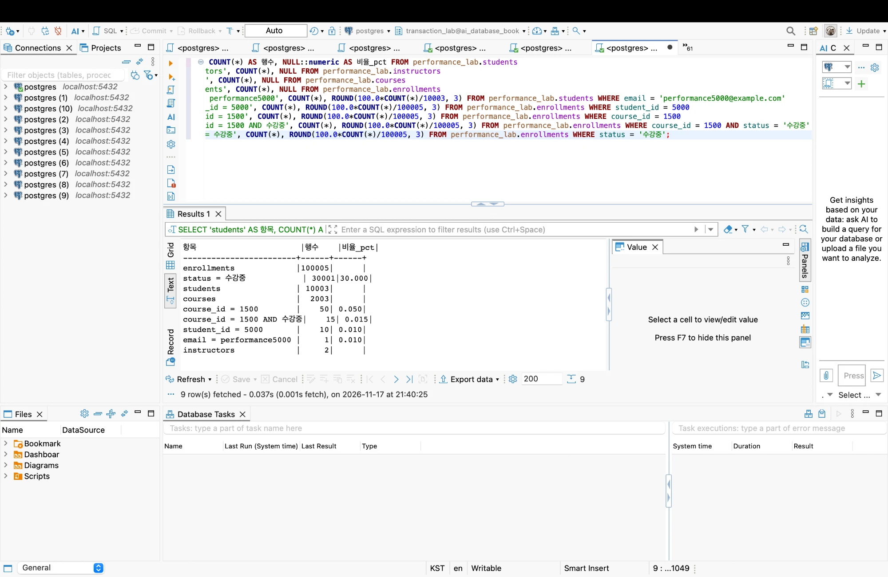
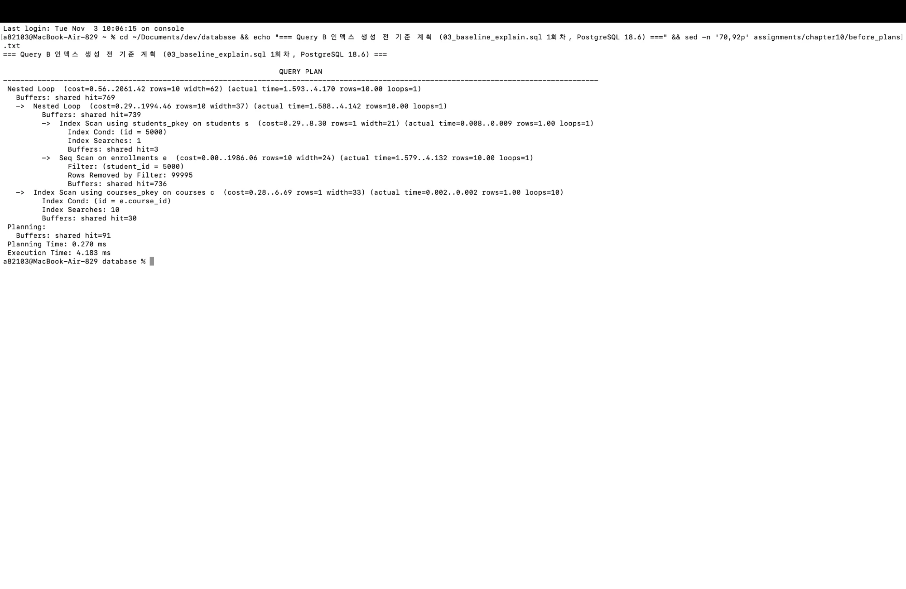
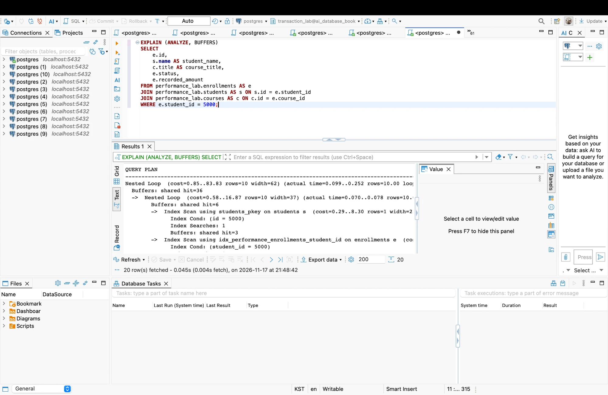

# Chapter 10 확장 실습 답안

> **과제:** 실행 계획으로 인덱스 효과 검증하기  
> **사용 방법:** 이 파일을 내려받아 본인의 GitHub 저장소에 `chapter10_answer.md`라는 이름으로 저장한 뒤 실습하면서 바로 작성합니다.  
> **제출 방법:** LMS에는 파일을 직접 업로드하지 않고, **본인 GitHub 저장소의 `chapter10_answer.md` 파일 URL**을 제출합니다.

---

## 제출 전 주의

이 파일과 캡처 화면에는 실제 비밀번호, 전체 DB 접속 URL, API Key, 개인정보를 기록하지 않습니다.

```text
GitHub 계정 또는 별칭: dusen120-ai
과제 작성일: 2026-11-17
사용한 AI 도구: Claude (Claude Code)
```

> 원본 실행 로그
> - 01·02·04·06·07 실행 출력: [`run_output.txt`](./run_output.txt)
> - 인덱스 생성 **전** 기준 계획(공식 기록, 1회차): [`before_plans.txt`](./before_plans.txt)
> - 인덱스 생성 **후** 계획(공식 기록, 1회차): [`after_plans.txt`](./after_plans.txt)
> - 전·후 각 5회 반복 측정: [`plans/before_run1~5.txt`](./plans/), [`plans/after_run1~5.txt`](./plans/)
> - 쓰기 비용 측정: [`plans/write_cost_repeat.txt`](./plans/write_cost_repeat.txt)
> - 개인 프로젝트 인덱스 실험: [`cafe_index_experiment.sql`](./cafe_index_experiment.sql), [`plans/cafe_scale1.txt`](./plans/cafe_scale1.txt), [`plans/cafe_scale100.txt`](./plans/cafe_scale100.txt)

---

# 1. PostgreSQL 버전과 시작 환경 확인

```sql
SELECT version();
SELECT current_database();
SELECT current_user;
SELECT current_schema();
SHOW search_path;
```

| 확인 항목 | 실제 결과 | 의미 |
| --- | --- | --- |
| PostgreSQL 버전 | `PostgreSQL 18.6 on aarch64-apple-darwin24.6.0` (클라이언트 psql 16.15) | 교재 자동 검증 기준(16)보다 높은 18이다. 18에는 B-tree Skip Scan, `EXPLAIN ANALYZE`의 `Index Searches` 표시, 기본 `BUFFERS` 출력 등이 추가되어 계획 모양이 교재와 다를 수 있다. |
| `current_database()` | `ai_database_book` | 교재 실습 DB. `course_project`, `transaction_lab`이 있는 곳이며 `performance_lab`도 여기에 만든다. |
| `current_user` | `postgres` | 로컬 관리자 역할이라 `performance_lab` 스키마를 만들 CREATE 권한이 있다. |
| `current_schema()` | `public` | 스키마를 생략하면 `public`에 객체가 생긴다. 실습 SQL은 모두 `performance_lab.`처럼 스키마를 명시하므로 영향이 없다. |
| `search_path` | `"$user", public` | 기본값. `postgres` 스키마가 없으므로 실제로는 `public`만 탐색한다. |

### PostgreSQL 버전을 기록해야 하는 이유

```text
옵티마이저(실행 계획을 고르는 부분)는 버전마다 바뀐다. 같은 SQL·같은 데이터라도
버전이 다르면 다른 계획이 나올 수 있으므로, 버전 없이 남긴 실행 계획은 재현·비교할 수 없다.

실제로 이번 실습에서도 버전 차이가 보였다.
- PostgreSQL 18은 EXPLAIN ANALYZE 결과에 "Index Searches: 1" 줄을 추가로 출력한다 (16에는 없음).
- 18에는 B-tree Skip Scan이 있어서 (course_id, status) 인덱스의 후행 컬럼 status만으로
  조회할 때 16과 다른 계획이 나올 "가능성"이 있다. (실제 결과는 8장 참고: 이 데이터에서는 Seq Scan 유지)
교재 기준(16)과 내 결과(18.6)가 다를 때 "내가 틀렸는지, 버전 차이인지"를 구분하려면 버전 기록이 필수다.
```

> 이 장의 자동 검증 기준은 PostgreSQL 16입니다. PostgreSQL 18 이상에서는 B-tree Skip Scan 등으로 동일 SQL의 실행 계획이 달라질 수 있습니다.

---

# 2. Chapter 07·08 기준 상태 확인

Chapter 10은 기존 `course_project`를 변경하지 않습니다.

확인 기준:

```text
students = 3
instructors = 2
courses = 3
enrollments = 5

전체 recorded_amount = 590000
활성 = 3건 / 340000
취소 제외 = 4건 / 440000
```

```text
1001 = 완료 / 100000
1004 = 취소 / 150000
1005 = 신청 / 120000
```

### 실제 확인 결과

```text
students: 3
instructors: 2
courses: 3
enrollments: 5
전체 recorded_amount: 590000
활성 신청 건수/금액: 3건 / 340000  (신청 2건 240000 + 수강중 1건 100000)
취소 제외 건수/금액: 4건 / 440000  (590000 - 취소 1건 150000)

1001 = 완료 / 100000, 1004 = 취소 / 150000, 1005 = 신청 / 120000 → 기준과 일치
performance_lab 스키마: 실습 시작 전 존재하지 않음 (깨끗한 시작)
실습 종료 후 07_result_validation.sql에서 course_project 보존을 다시 확인 → 통과
```

### 성능 실험을 기존 `course_project`에 대량 데이터를 넣지 않고 별도 스키마에서 하는 이유

```text
1. course_project는 Chapter 07~09 검증 기준(3/2/3/5, 590000 등)이 걸린 "정답 데이터"다.
   10만 건을 섞으면 이전 장의 검증 SQL이 모두 깨지고, 실험 후 원상복구도 위험하다.
2. 성능 실험은 인덱스 생성·삭제와 초기화를 반복한다. 별도 스키마(performance_lab)면
   reset_performance_lab.sql로 이 스키마만 안전하게 지우고 다시 시작할 수 있다.
3. 5행짜리 course_project에서는 어떤 인덱스를 만들어도 PostgreSQL이 Seq Scan을 고르는 게 합리적이라
   인덱스 효과를 관찰할 수 없다. 의미 있는 비교를 하려면 10만 건 규모의 데이터가 필요하다.
4. 실험용 인덱스가 course_project의 쓰기 성능·저장 공간·제약조건에 영향을 주지 않게 격리한다.
```

---

# 3. `performance_lab` 생성과 대량 데이터 확인

```text
code/chapter10/01_performance_lab_schema.sql   → 4개 테이블, 자동 인덱스 6개 생성
code/chapter10/02_performance_lab_seed.sql     → NOTICE: Chapter 10 performance lab seed validation passed
```

## 3-1. 생성 후 행 수

| 테이블 | 기대 행 수 | 실제 행 수 | 일치? |
| --- | ---: | ---: | --- |
| `performance_lab.students` | 10003 | 10003 | ✅ |
| `performance_lab.instructors` | 2 | 2 | ✅ |
| `performance_lab.courses` | 2003 | 2003 | ✅ |
| `performance_lab.enrollments` | 100005 | 100005 | ✅ |

## 3-2. 데이터 분포 확인

| 조건 | 기대 행 수 | 실제 행 수 | 대략적 비율 |
| --- | ---: | ---: | ---: |
| `performance5000@example.com` | 1 | 1 | 0.010% (students 10003 기준) |
| `student_id = 5000` | 10 | 10 | 0.010% |
| `course_id = 1500` | 50 | 50 | 0.050% |
| `course_id = 1500 AND status='수강중'` | 15 | 15 | 0.015% |
| 전체 `status='수강중'` | 30001 | 30001 | 30.000% |

상태별 분포: `신청 30002 / 수강중 30001 / 완료 20001 / 취소 20001`. `course_id = 1500`은 `신청 15 / 수강중 15 / 완료 10 / 취소 10`.

### 선택도가 낮은 조건과 많은 행을 반환하는 조건은 인덱스 판단에서 어떻게 다르게 볼 수 있나요?

```text
- 반환 비율이 아주 작은 조건(student_id = 5000 → 0.01%, course_id = 1500 → 0.05%)은
  인덱스로 해당 위치만 찾아가면 10만 행 중 10~50행만 읽으면 된다. 인덱스 후보로 적합하다.
  실제로 이 조건들은 인덱스 생성 후 Buffers가 736 → 3~52로 줄었다(7장).

- 많은 행을 반환하는 조건(status = '수강중' → 30%)은 인덱스를 써도 결국 테이블 대부분의 페이지를
  방문해야 한다. 인덱스 페이지를 추가로 읽고, 테이블 페이지를 무작위 순서로 왔다 갔다 하는 비용까지 붙어서
  테이블을 처음부터 끝까지 한 번 순서대로 읽는 Seq Scan보다 오히려 비쌀 수 있다.
  실제로 인덱스가 있어도 PostgreSQL은 Seq Scan을 선택했다(8장).

- 즉 "WHERE에 자주 쓰인다"가 아니라 "그 조건이 전체의 몇 %를 돌려주는가"가 인덱스 판단의 출발점이다.
  다만 비율은 단서일 뿐이고, 최종 판단은 실제 실행 계획과 Buffers로 한다.
```

### 증거 화면

```text
assignments/chapter10/images/step03_data_scale.png
```



---

# 4. 인덱스 생성 전 기준 계획 기록

`03_baseline_explain.sql`을 **04보다 먼저** 실행했고, 첫 실행 결과를 [`before_plans.txt`](./before_plans.txt)에 그대로 저장했습니다. 이어서 같은 파일을 4번 더 실행(총 5회)해 시간의 흔들림을 확인했습니다.

측정 조건: `enable_seqscan/indexscan/bitmapscan = on`, 02에서 `ANALYZE` 후 통계 변경 없음. 데이터가 모두 공유 버퍼에 올라와 있어 Buffers가 전부 `shared hit`(디스크 read 0)였습니다.

## Query A — 강의 제목 정확 일치 (03의 2번)

```text
업무 질문: 강의 제목으로 강의 한 건을 찾는다 (강의 검색 화면)
WHERE / JOIN / ORDER BY / LIMIT: WHERE title = '성능 테스트 강의 00500' / 없음 / 없음 / 없음
예상 반환 행 수: 1
실제 반환 행 수: 1
```

```sql
EXPLAIN (ANALYZE, BUFFERS)
SELECT id, title, level, price
FROM performance_lab.courses
WHERE title = '성능 테스트 강의 00500';
```

| 관찰 항목 | 기록 |
| --- | --- |
| 주요 Scan/계획 노드 | `Seq Scan on courses` |
| estimated rows | 1 (cost=0.00..59.04) |
| actual rows | 1 (loops=1) |
| Filter | `title = '성능 테스트 강의 00500'`, **Rows Removed by Filter: 2002** |
| Index Cond | 없음 (title 인덱스 없음) |
| Buffers hit/read | shared hit=34 / read=0 (courses 테이블 전체 34페이지) |
| Planning Time | 0.027 ms |
| Execution Time | 0.139 ms (5회: 0.105~0.139, 중앙값 0.115) |

## Query B — 학생별 신청 JOIN (03의 3번)

```text
업무 질문: 학생 5000의 신청 목록을 학생 이름·강의 제목과 함께 보여준다 (마이페이지)
WHERE / JOIN / ORDER BY / LIMIT: WHERE e.student_id = 5000 / enrollments-students-courses / 없음 / 없음
예상 반환 행 수: 10
실제 반환 행 수: 10
```

```sql
EXPLAIN (ANALYZE, BUFFERS)
SELECT e.id, s.name AS student_name, c.title AS course_title, e.status, e.recorded_amount
FROM performance_lab.enrollments AS e
JOIN performance_lab.students AS s ON s.id = e.student_id
JOIN performance_lab.courses AS c ON c.id = e.course_id
WHERE e.student_id = 5000;
```

| 관찰 항목 | 기록 |
| --- | --- |
| 주요 Scan/계획 노드 | `Nested Loop` × 2. 안쪽에 **`Seq Scan on enrollments e`**, `Index Scan using students_pkey`, `Index Scan using courses_pkey`(loops=10) |
| estimated rows | 10 (전체 cost=0.56..2061.42, enrollments Seq Scan cost=1986.06) |
| actual rows | 10 |
| Filter | enrollments: `student_id = 5000`, **Rows Removed by Filter: 99995** |
| Index Cond | `students_pkey: id = 5000`, `courses_pkey: id = e.course_id` (enrollments 쪽은 없음) |
| Buffers hit/read | 전체 hit=769 (그중 enrollments Seq Scan **736**, students 3, courses 30) / read=0 |
| Planning Time | 0.270 ms |
| Execution Time | 4.183 ms (5회: 3.467~4.183, 중앙값 3.652) |

## Query C — course_id + status 복합 조건 (03의 5번)

```text
업무 질문: 강의 1500에서 현재 수강중인 신청을 본다 (강사용 수강생 관리 화면)
WHERE / JOIN / ORDER BY / LIMIT: WHERE course_id = 1500 AND status = '수강중' / 없음 / 없음 / 없음
예상 반환 행 수: 15
실제 반환 행 수: 15
```

```sql
EXPLAIN (ANALYZE, BUFFERS)
SELECT id, student_id, course_id, status, recorded_amount
FROM performance_lab.enrollments
WHERE course_id = 1500
  AND status = '수강중';
```

| 관찰 항목 | 기록 |
| --- | --- |
| 주요 Scan/계획 노드 | `Seq Scan on enrollments` |
| estimated rows | 15 (cost=0.00..2236.07) |
| actual rows | 15 |
| Filter | `(course_id = 1500) AND (status = '수강중')`, **Rows Removed by Filter: 99990** |
| Index Cond | 없음 |
| Buffers hit/read | shared hit=736 / read=0 (enrollments 전체) |
| Planning Time | 0.012 ms |
| Execution Time | 4.062 ms (5회: 3.901~4.135, 중앙값 4.062) |

### 나머지 기준 계획 요약 (03의 8개 SQL 전체)

| # | SQL | 기준 계획 노드 | est / actual rows | Buffers | Exec 중앙값(5회) |
| --- | --- | --- | --- | ---: | ---: |
| 1 | email 정확 일치 | Index Scan using `uq_performance_students_email` (UNIQUE 자동 인덱스) | 1 / 1 | 3 | 0.007 ms |
| 2 | title 정확 일치 (A) | Seq Scan, Rows Removed 2002 | 1 / 1 | 34 | 0.115 ms |
| 3 | 학생별 JOIN (B) | Nested Loop + Seq Scan on enrollments | 10 / 10 | 769 | 3.652 ms |
| 4 | course_id = 1500 | Seq Scan, Rows Removed 99955 | 50 / 50 | 736 | 3.605 ms |
| 5 | course_id + status (C) | Seq Scan, Rows Removed 99990 | 15 / 15 | 736 | 4.062 ms |
| 6 | status = '수강중' | Seq Scan, Rows Removed 70004 | 29748 / 30001 | 736 | 6.908 ms |
| 7 | ORDER BY title | Sort (quicksort 179kB) ← Seq Scan | 2003 / 2003 | 37 | 0.842 ms |
| 8 | ORDER BY title LIMIT 20 | Limit ← Sort (top-N heapsort 26kB) ← Seq Scan | 20 / 20 | 34 | 0.353 ms |

관찰: 이메일(#1)은 UNIQUE 제약이 이미 인덱스를 만들어 두었기 때문에 **후보 인덱스 없이도** Index Scan이다. 반면 enrollments를 조건으로 거르는 #3~#6은 반환 행 수(10~30001)와 상관없이 **똑같이 736페이지 전체**를 읽었다. 추정 행 수(rows=)는 #6의 29748 vs 30001을 빼면 모두 정확히 맞았다 → 통계가 정확하므로 계획 차이를 "통계가 틀려서"로 설명할 필요가 없다.

### `cost`와 실제 실행 시간이 같은 개념이 아닌 이유

```text
cost는 옵티마이저가 계획을 "고르기 위해" 계산한 상대적인 추정 점수다. 단위는 ms가 아니라
"순차 페이지 1개 읽기 = 1.0"(seq_page_cost)을 기준으로 한 임의 단위이고, 실행 전에 통계로 계산한다.
actual time은 실제로 실행해서 잰 ms다.

예) Query B의 기준 계획은 cost=2061.42인데 실제 시간은 약 4 ms였고,
    #6 status 조회는 cost=1986.06으로 B보다 cost가 낮지만 실제 시간은 약 7 ms로 더 오래 걸렸다.
    (#6은 3만 행을 결과로 만들어 넘기는 비용이 cost 모델에 비해 컸다.)
cost는 같은 SQL의 "후보 계획끼리" 비교하는 용도이지, 다른 SQL끼리 혹은 실제 시간으로 환산하는 값이 아니다.
```

### `EXPLAIN ANALYZE`는 실제 SQL을 실행한다는 점을 왜 기억해야 하나요?

```text
EXPLAIN만 쓰면 계획만 보여주지만, ANALYZE를 붙이면 SQL을 진짜로 실행하고 결과를 버린다.
- SELECT라면 결과가 화면에 안 나올 뿐 부담은 그대로다(큰 테이블이면 운영 DB에 실제 부하).
- INSERT/UPDATE/DELETE에 쓰면 데이터가 실제로 바뀐다. 꼭 필요하면
  BEGIN; EXPLAIN ANALYZE ...; ROLLBACK; 처럼 트랜잭션으로 감싸야 한다.
  (이번 실습에서 enable_seqscan=off 참고 실험도 BEGIN ~ SET LOCAL ~ ROLLBACK 안에서만 했다.)
- 또 실행하면서 버퍼 캐시가 데워지고 idx_scan 같은 통계 숫자도 올라간다.
  실제로 06의 idx_scan 값에는 내가 반복 측정한 EXPLAIN ANALYZE 횟수가 섞여 있다(10장).
그래서 이 실습의 규칙대로 EXPLAIN (ANALYZE, BUFFERS)는 SELECT에만 사용했다.
```

### 증거 화면

```text
assignments/chapter10/images/step04_before_plan.png
```



---

# 5. 후보 인덱스를 만들기 전에 이유 작성

(04 실행 **전**에 4장의 기준 계획을 보고 작성)

| 후보 인덱스 | 대응 조회 패턴 | 예상 이점 | 컬럼 순서 이유 | 예상 비용/단점 |
| --- | --- | --- | --- | --- |
| `idx_performance_courses_title` `(title)` | Query A: `WHERE title = ?` (1행), #7·#8: `ORDER BY title [LIMIT 20]` | Seq Scan이 2002행을 버리던 것을 Index Scan 1건으로. 인덱스는 title 순으로 정렬되어 있어 ORDER BY의 Sort를 없애고, LIMIT 20이면 앞 20개만 읽고 멈출 수 있음 | 단일 컬럼. 등호 검색과 정렬 모두 title 하나가 기준 | courses는 2003행·34페이지로 작아서 이점이 절대량으로는 작음. 강의 등록/제목 수정 때마다 인덱스 갱신. 문자열이라 크기가 비교적 큼 |
| `idx_performance_enrollments_student_id` `(student_id)` | Query B: `WHERE e.student_id = ?` + JOIN (10행 = 0.01%) | 10만 행 Seq Scan(736페이지)을 학생 1명 위치로 바로 이동하는 탐색으로 | 단일 컬럼. 조회 조건이 student_id 등호 하나. FK(`student_id → students.id`) 자식 컬럼이라 학생 삭제 시 RESTRICT 검사에도 쓰임 | enrollments는 신청이 계속 쌓이는 쓰기 많은 테이블 → INSERT마다 인덱스 갱신. 10만 행 기준 수백 kB 추가 저장 |
| `idx_performance_enrollments_course_status` `(course_id, status)` | Query C: `course_id = ? AND status = ?` (15행), #4: `course_id = ?` (50행) | 두 조건을 모두 인덱스 안에서 걸러 15행 위치만 방문. 선두가 course_id라 course_id 단독 조회에도 재사용 가능 → course_id 단독 인덱스를 따로 만들 필요 없음 | **course_id를 앞에**: 거의 항상 등호로 주어지고 값 종류가 2000개라 범위를 크게 좁힘(0.05%). status는 4종류뿐(약 20~30%)이라 선두에 두면 처음에 거의 못 좁힘. status 단독 조회는 이 인덱스로 이득을 보기 어려울 것으로 예상(8장에서 확인) | enrollments 쓰기 비용 추가. status 변경(신청→수강중→완료)은 UPDATE 때마다 이 인덱스 항목도 갱신해야 함(HOT 업데이트 불가) |

### "중요한 컬럼이므로 인덱스를 만든다"는 설명이 부족한 이유

```text
인덱스의 이득은 "컬럼이 중요한가"가 아니라 "어떤 조회가 그 컬럼을 어떤 식으로(등호/범위/정렬)
쓰고, 그 조건이 전체의 몇 %를 돌려주는가"로 결정된다.
- status는 업무적으로 매우 중요한 컬럼이지만 4종류 값뿐이라 한 값이 30%를 차지한다.
  인덱스가 있어도 Seq Scan이 더 싸다(8장에서 실제로 확인).
- 반대로 student_id는 "중요"하다기보다 0.01%만 돌려주는 반복 조회의 조건이라 효과가 크다.
또한 인덱스마다 쓰기·저장 비용이 있으므로, 어떤 SQL이 얼마나 자주 실행되고 기준 계획에서
무엇이 낭비되는지(Rows Removed, Buffers)를 근거로 말할 수 있어야 한다.
```

### `(course_id, status)`와 `(status, course_id)`가 항상 같은 효과가 아닌 이유

```text
B-tree 복합 인덱스는 "첫 번째 컬럼으로 정렬하고, 같은 값 안에서 두 번째 컬럼으로 정렬"된 하나의 목록이다.
전화번호부가 (성, 이름)으로 정렬되어 있으면 성으로는 바로 찾지만, 이름만으로는 전체를 훑어야 하는 것과 같다.

(course_id, status):
  - course_id = 1500            → 1500 구간으로 바로 이동 (선두 컬럼 사용) ✔
  - course_id = 1500 AND status → 1500 안의 '수강중' 구간으로 바로 이동 ✔
  - status 단독                  → status는 course_id 2000개 구간마다 흩어져 있어 바로 못 감
(status, course_id):
  - status 단독                  → 가능하지만 30%를 돌려주므로 어차피 이득이 작음
  - course_id 단독               → 선두가 아니라 바로 못 감 ✘ (course_id 단독 조회를 위해 인덱스가 하나 더 필요)
둘 다 "course_id AND status" 조회는 처리할 수 있지만, 그 밖의 조회(course_id 단독)까지 재사용되는 것은
(course_id, status)뿐이다. 그래서 등호로 자주 쓰이고 범위를 많이 좁히는 컬럼을 앞에 둔다.
PostgreSQL 18의 Skip Scan은 선두 컬럼 값 종류가 "적을 때" 후행 컬럼만으로도 쓸 수 있게 해주지만,
course_id는 2000종류라 이득이 없다(8장).
```

---

# 6. 후보 인덱스 생성

`04_create_candidate_indexes.sql` 실행 → `NOTICE: Chapter 10 candidate index creation passed`

```sql
CREATE INDEX idx_performance_courses_title ON performance_lab.courses(title);
CREATE INDEX idx_performance_enrollments_student_id ON performance_lab.enrollments(student_id);
CREATE INDEX idx_performance_enrollments_course_status ON performance_lab.enrollments(course_id, status);
```

생성 후 확인:

```text
후보 인덱스 수: 3
전체 인덱스 수: 9  (자동 6 = 4개 테이블 PK 4 + students·instructors UNIQUE email 2, 후보 3)
04는 ANALYZE를 다시 실행하지 않음 → 전후 비교에 같은 테이블 통계 사용
```

### PRIMARY KEY나 UNIQUE가 이미 인덱스를 만들 수 있는데 같은 목적의 인덱스를 또 만들면 어떤 문제가 생기나요?

```text
- 조회 이득은 0이다. 예를 들어 students.email은 UNIQUE 제약이 uq_performance_students_email 인덱스를
  이미 만들어 두었고, 4장 #1에서 후보 인덱스 없이도 Index Scan(Buffers 3)으로 처리됐다.
  여기에 CREATE INDEX ... (email)을 또 만들면 같은 내용의 B-tree가 2개가 된다.
- 비용은 2배가 된다: INSERT/UPDATE마다 두 인덱스를 모두 갱신해야 하고(쓰기 비용, 11장에서 측정),
  디스크·메모리(공유 버퍼)를 그만큼 더 차지한다. students의 email 인덱스는 536 kB로 테이블(832 kB)의
  절반이 넘는다.
- 옵티마이저가 고를 후보가 늘어 계획 시간이 약간 늘고, 나중에 "어느 인덱스가 진짜 필요한지"
  관리하기 어려워진다(idx_scan이 둘로 나뉘어 둘 다 덜 쓰이는 것처럼 보임).
그래서 인덱스를 만들기 전에 pg_indexes로 PK/UNIQUE/기존 인덱스가 이미 그 컬럼을 덮는지 먼저 확인한다.
```

---

# 7. 같은 SQL로 인덱스 후 재측정

`05_after_index_explain.sql`을 실행해 **03과 똑같은 8개 SQL**을 재측정했습니다(첫 실행 → [`after_plans.txt`](./after_plans.txt), 총 5회 반복). 데이터·통계·설정은 그대로입니다.

## Query A 전후 비교 — title 정확 일치

| 항목 | Before | After | 해석 |
| --- | --- | --- | --- |
| 주요 계획 노드 | `Seq Scan on courses` | `Index Scan using idx_performance_courses_title` | 새 인덱스를 선택 |
| actual rows | 1 | 1 | 결과 행 수 동일 |
| Buffers hit/read | 34 / 0 | 3 / 0 | 읽은 페이지 34 → 3 (약 1/11) |
| Execution Time (5회 중앙값) | 0.115 ms (0.105~0.139) | 0.005 ms (5회 모두 0.005) | 범위가 겹치지 않음 → 안정적인 개선 |
| Index Cond | 없음 (Filter로 2002행 버림) | `title = '성능 테스트 강의 00500'` | 버리는 행 없이 인덱스에서 바로 찾음 |

```text
결과 행이 동일했는가: 예. 1행 → 1행 (07에서 title_result_count = 1 재확인)
읽은 버퍼가 줄었는가: 예. 34 → 3
계획이 바뀌었는가: 예. Seq Scan → Index Scan
실행 시간 한 번만으로 결론낼 수 있는가: 아니오. 5회 반복에서 범위가 겹치지 않고 Buffers도 함께 줄었기 때문에
  개선이라고 판단했다. 단, courses는 2003행·34페이지짜리 작은 테이블이라 절대 시간 차이는 0.1 ms 수준이다.
```

## Query B 전후 비교 — 학생별 신청 JOIN

| 항목 | Before | After | 해석 |
| --- | --- | --- | --- |
| 주요 계획 노드 | Nested Loop 안에 `Seq Scan on enrollments e` | Nested Loop 안에 `Index Scan using idx_performance_enrollments_student_id` | JOIN 모양은 같고 enrollments 접근 방식만 바뀜 |
| actual rows | 10 | 10 | 동일 |
| Buffers hit/read | 769 (enrollments 736) / 0 | 36 (enrollments **3**) / 0 | enrollments 736 → 3, 전체 769 → 36 |
| Execution Time (5회 중앙값) | 3.652 ms (3.467~4.183) | 0.040 ms (0.038~0.052) | 약 90배. 범위가 전혀 겹치지 않음 |
| Index Cond | enrollments 쪽 없음 (Rows Removed 99995) | `student_id = 5000` | 99995행을 읽고 버리던 일이 사라짐 |

```text
cost도 2061.42 → 83.83으로 줄었다. 남은 Buffers 36 중 30은 courses_pkey로 강의 10개를 찾는 비용(loops=10)이다.
```

## Query C 전후 비교 — course_id + status

| 항목 | Before | After | 해석 |
| --- | --- | --- | --- |
| 주요 계획 노드 | `Seq Scan on enrollments` | `Bitmap Heap Scan` ← `Bitmap Index Scan on idx_performance_enrollments_course_status` | 복합 인덱스 사용. 15행이 흩어진 15페이지에 있어 Bitmap 방식 선택 |
| actual rows | 15 | 15 | 동일 |
| Buffers hit/read | 736 / 0 | 17 / 0 (인덱스 2 + 테이블 15, Heap Blocks exact=15) | 736 → 17 |
| Execution Time (5회 중앙값) | 4.062 ms (3.901~4.135) | 0.013 ms (0.012~0.014) | 범위 겹치지 않음 |
| Index Cond | 없음 (Rows Removed 99990) | `(course_id = 1500) AND (status = '수강중')` | **두 컬럼 모두** Index Cond에 들어감 → 복합 인덱스가 제대로 쓰임 |

### 8개 SQL 전체 전후 요약 (각 5회 반복)

| # | SQL | After 계획 노드 | Buffers 전 → 후 | Exec 중앙값 전 → 후 | 판단 |
| --- | --- | --- | --- | --- | --- |
| 1 | email | Index Scan (UNIQUE 자동, 변화 없음) | 3 → 3 | 0.007 → 0.006 ms | 후보와 무관. 대조군 |
| 2 | title (A) | Index Scan `courses_title` | 34 → 3 | 0.115 → 0.005 ms | 개선 |
| 3 | 학생 JOIN (B) | Index Scan `student_id` | 769 → 36 | 3.652 → 0.040 ms | 크게 개선 |
| 4 | course_id 단독 | Bitmap Index Scan `course_status`, Index Cond: `course_id = 1500` | 736 → 52 | 3.605 → 0.038 ms | 복합 인덱스 **선두 컬럼만**으로도 사용됨 |
| 5 | course_id + status (C) | Bitmap Index Scan `course_status` | 736 → 17 | 4.062 → 0.013 ms | 크게 개선 |
| 6 | status 단독 | **Seq Scan 그대로** | 736 → 736 | 6.908 → 7.728 ms | 개선 없음 (8장) |
| 7 | ORDER BY title | Index Scan `courses_title` (Sort 사라짐) | 37 → 49 (hit 37 + read 12) | 0.842 → 0.351 ms | 개선, 단 버퍼는 증가 (9장) |
| 8 | ORDER BY title LIMIT 20 | Limit ← Index Scan `courses_title` | 34 → 3 | 0.353 → 0.010 ms | 크게 개선 (9장) |

### `Index Scan`으로 바뀌었다는 사실만으로 성공이라고 할 수 없는 이유

```text
1. 결과가 같아야 한다. 계획이 바뀌어도 결과가 달라지면 실패다 → 07에서 1/1/10/50/15/30001 행 수를 따로 확인했다.
2. 실제로 덜 읽어야 한다. #7(ORDER BY title)은 Index Scan으로 바뀌었지만 Buffers는 37 → 49로 오히려 늘었다.
   (인덱스 페이지 12개를 추가로 읽음.) 이번에는 Sort를 없앤 덕분에 시간이 줄었지만,
   더 큰 테이블에서는 인덱스 순서대로 테이블을 무작위로 왔다 갔다 하는 비용이 더 커질 수 있다.
3. 강제로 Index를 쓰게 하면 더 느려진다. status 단독 조회를 enable_seqscan=off로 강제해 보니
   Bitmap Index Scan으로 바뀌었지만 Buffers 736 → 864, 시간 7.7 → 17.2 ms로 나빠졌다(8장, 참고 실험).
   즉 "Index Scan이 나왔다"는 그 자체로 목표가 아니다.
4. 그 인덱스가 만드는 쓰기·저장 비용(11장: INSERT 약 7배, 후보 인덱스 합계 약 2 MB)을
   조회 이득이 넘어서는지까지 봐야 "성공"이다.
```

### 증거 화면

```text
assignments/chapter10/images/step07_after_plan.png
```



> 위 캡처는 후보 인덱스 생성 후 DBeaver에서 같은 Query B를 다시 실행한 화면이다. 계획 노드(`Index Scan using idx_performance_enrollments_student_id`), `Index Cond: (student_id = 5000)`, `Buffers: shared hit=36`은 05의 기록과 같고, 실행 시간만 회차마다 조금씩 다르다.
> 4장의 기준 계획 캡처(`step04_before_plan.png`)는 인덱스를 만들기 **전에** 저장한 `before_plans.txt`의 Query B 부분을 터미널에 출력한 화면이다(인덱스가 생긴 지금 다시 실행하면 기준 계획이 나오지 않으므로).

---

# 8. `status` 단독 조회와 Seq Scan 해석

```text
예상 행 수 = 30001   (옵티마이저 추정 rows=29748)
실제 행 수 = 30001
주요 계획 노드 = 인덱스 생성 전·후 모두 Seq Scan on enrollments
                Filter: status = '수강중', Rows Removed by Filter: 70004, Buffers: shared hit=736
                Exec 중앙값 6.908 ms(전) / 7.728 ms(후) — 같은 계획·같은 버퍼인데 시간만 약 12% 다름
```

**참고 실험 (최종 증거 아님):** 계획이 왜 그렇게 정해졌는지 보려고 트랜잭션 안에서만 `SET LOCAL enable_seqscan = off`로 실행한 뒤 `ROLLBACK` 했습니다 ([`plans/reference_forced_status.txt`](./plans/reference_forced_status.txt)). 실행 후 `enable_seqscan = on` 복귀를 확인했습니다.

| | 실제 선택 (Seq Scan) | 강제 (Bitmap Index Scan on `course_status`) |
| --- | --- | --- |
| cost | 0.00..**1986.06** | 1237.77..**2345.62** |
| Buffers | **736** | **864** (인덱스 128 + 테이블 736) |
| Execution Time | 약 7.7 ms | **17.24 ms** |
| Index Searches | - | **1** (Skip Scan이 아니라 인덱스 전체를 한 번 훑음) |

### 인덱스가 존재해도 PostgreSQL이 Seq Scan을 선택할 수 있는 이유

```text
1. 반환 비율이 크다: 30%(30001행)를 돌려줘야 한다. 3만 행은 736페이지 거의 전부에 고루 퍼져 있어서
   인덱스로 찾아가도 결국 테이블 페이지 736개를 다 읽어야 한다(강제 실험에서 Heap Blocks exact=736).
2. 인덱스가 오히려 추가 비용이다: 그 위에 인덱스 페이지 128개를 더 읽는다 → 736 vs 864.
3. 복합 인덱스의 후행 컬럼이다: (course_id, status)에서 status는 두 번째 컬럼이라 '수강중'이
   course_id 2000개 구간마다 흩어져 있다. 바로 찾아갈 수 없어 인덱스 전체를 훑어야 한다.
4. 옵티마이저는 통계(추정 29748행, 실제 30001과 거의 일치)로 두 계획의 cost를 비교해서
   1986 < 2345인 Seq Scan을 골랐고, 강제 실험 결과(7.7ms vs 17.2ms)가 그 판단이 맞았음을 보여준다.
```

### "Seq Scan = 나쁜 계획"이라고 단정하면 안 되는 이유

```text
Seq Scan은 테이블을 처음부터 끝까지 "순서대로" 읽는다. 디스크·OS는 연속된 읽기를 빠르게 처리하고,
인덱스를 거치는 추가 단계도 없다. 많은 행을 돌려줘야 하거나 테이블이 작을 때는 이것이 가장 싼 방법이다.
- 이 실습의 status 조회: Seq Scan(736페이지, 7.7ms)이 강제 Index 계획(864페이지, 17.2ms)보다 빨랐다.
- courses(34페이지)처럼 작은 테이블도 Seq Scan이 수십 마이크로초로 충분하다.
Seq Scan이 문제인 경우는 "아주 적은 행(Query B: 10행)을 얻으려고 큰 테이블 전체(736페이지)를 읽고
99995행을 버리는" 때다. 그래서 계획 노드 이름이 아니라 Rows Removed by Filter와 Buffers를 같이 봐야 한다.
```

### PostgreSQL 16과 18 이상에서 복합 B-tree 후행 컬럼 조건의 계획이 다를 수 있는 이유

```text
PostgreSQL 16의 B-tree는 선두 컬럼(course_id) 조건이 없으면 후행 컬럼(status)만으로 탐색 범위를
줄이지 못한다. 인덱스를 쓰려면 전체를 훑어야 해서 대부분 Seq Scan이 선택된다.

PostgreSQL 18에는 B-tree Skip Scan이 추가되었다. 선두 컬럼의 서로 다른 값마다
"course_id = 1001 AND status = '수강중'", "course_id = 1002 AND ..."처럼 작은 탐색을 반복해
후행 컬럼만으로도 인덱스를 쓸 수 있다. 그래서 18에서는 같은 SQL이 다른 계획이 될 "수" 있다.

하지만 내 PostgreSQL 18.6 결과는 16 기준과 같은 Seq Scan이었다. 이유:
- Skip Scan은 선두 컬럼 값 종류가 적을 때 유리하다. course_id는 2000종류라 2000번 탐색해야 하고,
- 반환 행이 30%라 어차피 테이블 거의 전체를 읽어야 한다.
- 강제 실험에서도 Skip Scan이 아닌 "Index Searches: 1"(인덱스 전체 1회 훑기)이 나왔다.
→ "18이니까 Skip Scan이 나온다"는 단정은 틀리다. 버전은 가능성을 열 뿐이고, 실제 선택은 데이터 분포와 cost가 정한다.
```

---

# 9. `ORDER BY`와 `LIMIT`에서 인덱스 관찰

```text
ORDER BY title 계획:
  전: Sort (Sort Key: title, Sort Method: quicksort Memory: 179kB) ← Seq Scan on courses
      rows 2003, Buffers 37, cost 163.87..168.88, Exec 중앙값 0.842 ms
  후: Index Scan using idx_performance_courses_title on courses (Sort 노드 없음)
      rows 2003, Buffers 49 (hit 37 + read 12), cost 0.28..128.50, Exec 중앙값 0.351 ms

ORDER BY title LIMIT 20 계획:
  전: Limit ← Sort (top-N heapsort Memory: 26kB) ← Seq Scan on courses (rows=2003 전부 읽음)
      Buffers 34, cost 107.33..107.38, Exec 중앙값 0.353 ms
  후: Limit ← Index Scan using idx_performance_courses_title (rows=20만 읽고 멈춤)
      Buffers 3, cost 0.28..1.56, Exec 중앙값 0.010 ms (5회 모두 0.010)
```

### LIMIT이 있을 때 PostgreSQL이 전체 정렬보다 인덱스 순서를 활용하는 것이 유리할 수 있는 이유

```text
인덱스 없이 "제목순 앞 20개"를 얻으려면 2003행을 전부 읽고 그중 가장 작은 20개를 골라야 한다
(top-N heapsort). 결과는 20행이지만 읽는 양은 전체와 같다(Seq Scan rows=2003, Buffers 34).

title 인덱스는 이미 제목순으로 정렬된 목록이다. 앞에서부터 20개를 읽으면 그게 곧 답이므로
20개째에서 멈추면 된다(Index Scan rows=20, Buffers 3). 정렬 작업 자체가 사라지고 읽는 양도 LIMIT에 비례한다.
그래서 LIMIT이 작을수록 인덱스 순서 활용의 이득이 크다. "목록 첫 페이지 20개" 같은 화면에 특히 유리하다.

반대로 LIMIT 없이 전체를 정렬할 때는 이득이 작다. 어차피 2003행 전부를 돌려줘야 하고,
인덱스를 따라 테이블을 왔다 갔다 해야 해서 Buffers가 37 → 49로 오히려 늘었다.
이번에는 courses가 작아 Sort를 없앤 효과가 더 커서 시간이 줄었지만, 테이블이 크면 Sort + Seq Scan이
더 나을 수도 있다.
```

### 실제 계획에서 Sort 노드 또는 Index Scan을 어떻게 확인했나요?

```text
- 전: 계획 트리에 "Sort" 노드와 "Sort Key: title", "Sort Method: quicksort / top-N heapsort"가 있었다.
  즉 Seq Scan으로 읽은 뒤 메모리에서 따로 정렬했다.
- 후: Sort 노드가 사라지고 "Index Scan using idx_performance_courses_title"가 최상위(또는 Limit 바로 아래)에 있었다.
  Index Cond 줄이 없는 Index Scan = 조건 필터가 아니라 "정렬된 순서"를 얻으려고 인덱스를 쓴 것이다.
- LIMIT 20 후 계획에서 Index Scan의 actual rows=20 → 인덱스를 20개만 읽고 멈췄음을 확인했다.
  (전 계획의 Seq Scan actual rows=2003과 비교)
```

---

# 10. 인덱스 검토

`06_index_review.sql` 실행 → `NOTICE: Chapter 10 index review validation passed`. 9개 인덱스 모두 `is_valid = t`, `is_ready = t`. `stats_reset`은 비어 있음(통계 초기화 기록 없음).

## 10-1. 인덱스별 판단

| 인덱스 | 크기/사용 관찰 | 유지 / 보류 / 제거 | 판단 근거 |
| --- | --- | --- | --- |
| `idx_performance_enrollments_student_id` | 936 kB, idx_scan 10 | **유지** | Query B: Buffers 769 → 36, 3.65 → 0.04 ms (5회 범위 겹치지 않음). 0.01% 반환 조회 + FK 자식 컬럼(학생 삭제 시 RESTRICT 검사). 크기는 테이블(5888 kB)의 약 16% |
| `idx_performance_enrollments_course_status` | 960 kB, idx_scan 36 | **유지** | Query C(736 → 17)와 course_id 단독(#4, 736 → 52)을 **하나로** 처리. course_id 단독 인덱스를 따로 만들 필요가 없어짐. 단 status 단독 조회에는 쓰이지 않으므로 그 목적으로는 기대하지 않음. status 변경 UPDATE가 많다면 쓰기 비용 재검토 |
| `idx_performance_courses_title` | 120 kB, idx_scan 20 | **유지(조건부)** | 정확 일치(34 → 3)와 ORDER BY title LIMIT 20(34 → 3, 0.353 → 0.010 ms)에 효과. 다만 courses는 2003행으로 작아 절대 차이가 0.1~0.3 ms 수준. 제목 검색·목록 화면이 실제로 자주 쓰일 때만 의미 있음. 제목 부분 검색(`LIKE '%..%'`)에는 B-tree가 도움 안 됨 |

참고 — 자동 인덱스: `enrollments_pkey`(2208 kB)와 `uq_performance_instructors_email`(16 kB)은 **idx_scan = 0**이지만 PK·UNIQUE 제약을 지키는 인덱스이므로 검토 대상이 아니다(삭제하면 제약 자체가 사라짐).

```text
주의: 위 idx_scan 값에는 내가 03·05를 5회씩 반복 실행한 EXPLAIN ANALYZE와 07의 COUNT 검증이 섞여 있다.
실제 서비스 사용량이 아니다. 예) course_status의 36 = 05 5회 × (#4, #5) + 강제 실험 + 06·07 검증 등.
```

### `idx_scan = 0`이라는 이유 하나만으로 인덱스를 삭제하면 안 되는 이유

```text
1. PK·UNIQUE 인덱스는 조회가 아니라 "중복 금지"를 지키기 위해 존재한다. enrollments_pkey는 idx_scan = 0이지만
   지우면 PRIMARY KEY 제약이 사라진다.
2. 관찰 기간이 짧을 수 있다. 통계가 언제부터 쌓였는지(stats_reset), 월말 정산·학기 시작처럼 드물지만
   중요한 시점에만 쓰이는 인덱스인지 확인해야 한다. 이번 DB는 막 만든 실습 데이터라 관찰 기간이 사실상 0이다.
3. 통계는 서버(또는 복제본)별이다. 읽기 복제본에서만 쓰이는 인덱스는 주 서버에서 0으로 보일 수 있다.
4. FK 자식 인덱스는 부모 행 삭제·키 변경 시의 검사에 쓰이는데, 이런 사용은 드물게 일어난다.
5. idx_scan은 "인덱스 탐색 횟수"이지 사용자 SQL 실행 횟수와 1:1이 아니다(Nested Loop 안쪽이면 loops만큼 증가).
   courses_pkey가 100132, students_pkey가 100019인 것은 사용자 조회가 아니라 02 시드에서 신청 10만 건을
   INSERT할 때마다 FK 검사가 부모 PK 인덱스를 탐색했고, JOIN의 Nested Loop가 loops만큼 반복 탐색했기 때문이다.
→ 0이면 "삭제 후보로 조사 시작"이지 "삭제 확정"이 아니다.
```

### 외래키 자식 컬럼 인덱스가 무결성 자체의 필수 조건은 아니지만 성능상 필요할 수 있는 이유

```text
FK 무결성은 "자식이 가리키는 부모가 존재하는가"이다. 자식 행을 INSERT할 때 부모(students.id)의 PK 인덱스로
확인하므로, 자식 컬럼(enrollments.student_id)에 인덱스가 없어도 정합성은 지켜진다. PostgreSQL도 그래서
FK 자식 컬럼 인덱스를 자동으로 만들지 않는다(06 결과: 자동 인덱스 6개 중 FK 자식 인덱스 없음).

하지만 반대 방향에서 성능 문제가 생긴다.
1. 부모 삭제·키 변경: students 1명을 지우면 ON DELETE RESTRICT 검사로 "이 학생을 참조하는 신청이 있나"를
   enrollments에서 찾아야 한다. 인덱스가 없으면 매번 10만 행 Seq Scan(736페이지)이다.
2. JOIN: "학생별 신청" 같은 부모 → 자식 조회는 매우 흔하다. Query B에서 이 인덱스 하나로 769 → 36 Buffers.
그래서 필수는 아니지만, 자식 테이블이 크고 부모 기준 조회·삭제가 있으면 만드는 경우가 많다.
단 "모든 FK에 무조건"은 아니다 — 부모 기준 조회가 없고 자식이 작으면 쓰기 비용만 늘어난다.
```

### 인덱스를 많이 만들었을 때 생기는 쓰기·저장 비용

실측 ([`plans/write_cost_repeat.txt`](./plans/write_cost_repeat.txt)): 세션 전용 TEMP 테이블 2개에 enrollments 100005행을 INSERT. 한쪽은 인덱스 없음, 다른 쪽은 후보와 같은 `(student_id)`, `(course_id, status)` 2개. 5회 반복.

| 회차 | 인덱스 없음 | 인덱스 2개 |
| ---: | ---: | ---: |
| 1 | 30.9 ms | 185.4 ms |
| 2 | 21.1 ms | 154.0 ms |
| 3 | 22.5 ms | 156.8 ms |
| 4 | 23.7 ms | 155.1 ms |
| 5 | 22.7 ms | 150.9 ms |
| **중앙값** | **22.7 ms** | **155.1 ms (약 6.8배)** |

```text
쓰기 비용:
- INSERT 한 행마다 테이블 1곳 + 인덱스 수만큼 B-tree에 항목을 끼워 넣어야 한다. 위 실측에서 인덱스 2개만으로
  10만 행 INSERT가 약 22.7 → 155.1 ms(약 6.8배)가 되었다. (TEMP 테이블·대량 INSERT라 실제 비율은 환경에 따라 다름)
- UPDATE도 비용이 늘어난다. status를 바꾸면 (course_id, status) 인덱스 항목도 바꿔야 하고,
  인덱스 컬럼이 바뀌는 UPDATE는 HOT 업데이트를 못 써서 모든 인덱스에 새 항목이 생긴다.
- 쓰기 중 인덱스 페이지 분할, WAL(로그) 증가, VACUUM 작업량 증가.

저장 비용 (06 결과):
- enrollments: 테이블 5888 kB, 인덱스 합계 4104 kB (테이블의 약 70%).
  그중 후보 2개가 1896 kB(936 + 960)로 PK(2208 kB)에 가까운 크기다.
- courses: 테이블 272 kB, 인덱스 184 kB (title 120 kB).
- 인덱스도 공유 버퍼(메모리)를 차지하므로 많아지면 정작 테이블 페이지가 캐시에서 밀려날 수 있다.
```

---

# 11. 자동 완료 게이트

`07_result_validation.sql` 실행:

```text
최종 검증 결과: NOTICE:  Chapter 10 performance result validation passed

email_result_count            = 1
title_result_count            = 1
student_5000_enrollment_count = 10
course_1500_enrollment_count  = 50
course_1500_learning_count    = 15
all_learning_count            = 30001
동일 학생·강의 활성 신청 중복 = 0행
performance_lab 10003 / 2 / 2003 / 100005 유지, 후보 인덱스 3개 존재
course_project 3 / 2 / 3 / 5, 590000 유지 (Chapter 07·08 보존)
```

### 실행 계획 비교와 별도로 결과 행 동일성을 검증해야 하는 이유

```text
EXPLAIN ANALYZE는 결과 행을 화면에 보여주지 않고 버린다. 계획의 "actual rows"는 행 개수일 뿐
"같은 행"인지는 알려주지 않는다. 또 계획 비교의 목적은 "같은 답을 더 싸게" 얻는 것이므로,
답이 같다는 전제가 먼저 확인돼야 시간·Buffers 비교가 의미를 가진다.
인덱스는 원칙적으로 결과를 바꾸지 않지만, 다음 경우 결과가 달라지거나 비교가 무효가 될 수 있다.
- 측정 사이에 누군가 데이터를 바꾼 경우(다른 데이터를 잰 셈)
- 손상·INVALID 인덱스(CREATE INDEX CONCURRENTLY 실패 등)를 사용하는 경우
- 비교하면서 SQL을 조금 고친 경우(예: 정렬 기준·LIMIT 변경) → "같은 SQL" 비교가 아님
그래서 07처럼 별도의 COUNT와 자동 판정으로 1/1/10/50/15/30001과 기존 프로젝트 보존을 따로 확인했다.
```

---

# 12. 인덱스 만능론 반박

## 주장 1

```text
선택한 주장: B. 인덱스를 만들었는데 Seq Scan이면 실패다.

나의 반박:
Seq Scan이 나온 것은 옵티마이저가 "이 조회에는 인덱스가 더 비싸다"고 올바르게 판단한 결과일 수 있다.
반환 행이 많으면(30%) 어차피 테이블 거의 전체를 읽어야 하고, 인덱스는 추가로 읽을 페이지만 늘린다.
실패 여부는 계획 이름이 아니라 "같은 결과를 더 적은 비용으로 얻었나"로 판단해야 한다.

실행 계획에서 확인한 근거:
- status = '수강중'(30001행, 30%)은 (course_id, status) 인덱스 생성 후에도 Seq Scan (Buffers 736, 약 7.7 ms).
- 참고로 enable_seqscan=off로 강제하면 Bitmap Index Scan이 되지만 cost 1986 → 2345,
  Buffers 736 → 864, 시간 7.7 → 17.2 ms로 모두 나빠졌다.
- 같은 인덱스가 course_id 조회(#4: 736 → 52, #5: 736 → 17)에서는 잘 쓰였다.
  즉 인덱스는 "실패"가 아니라 그 조회에 맞지 않았을 뿐이다.
```

## 주장 2

```text
선택한 주장: D. 실행 시간이 한 번이라도 빨라졌으면 효과가 입증됐다.

나의 반박:
실행 시간은 캐시 상태, 다른 프로세스 부하, CPU 주파수 등으로 매번 흔들린다. 한 번의 숫자는
그 흔들림보다 작은 차이를 구분하지 못한다. 반복 측정해서 범위가 겹치지 않는지, 그리고 시간과 무관하게
안정적인 지표(계획 노드, Index Cond, Buffers, 결과 행 수)가 같은 방향으로 바뀌었는지 함께 봐야 한다.

실행 계획에서 확인한 근거:
- status 단독 조회(#6)는 전후 계획이 똑같이 Seq Scan, Buffers도 똑같이 736인데
  5회 중앙값이 6.908 → 7.728 ms로 약 12% "느려졌다". 한 번씩만 쟀다면 "인덱스 때문에 느려졌다"는
  틀린 결론을 냈을 것이다. 실제로는 아무것도 바뀌지 않았고 단지 측정 잡음이다.
- 반대로 Query B는 Buffers가 769 → 36으로 줄고 5회 범위(3.467~4.183 ms vs 0.038~0.052 ms)가
  전혀 겹치지 않았다. 이 경우에야 "효과가 있다"고 말할 수 있다.
- 개인 프로젝트 실험(13장)의 rating 인덱스는 시간은 2.87 → 1.44 ms로 줄었지만
  Buffers는 192 → 221로 늘었다. 시간 한 번만 보면 놓치는 비용이다.
```

---

# 13. 개인 프로젝트 조회 패턴과 인덱스 후보

개인 프로젝트: **내 카페 방문 기록** (`cafe_project`: `cafes`, `menu_items`, `visits`, `visit_items`). 현재 실제 행 수는 4개 테이블 모두 **0행**이고(Chapter 08 샘플도 ROLLBACK), 기존 인덱스는 PK 4개 + `uq_cafes_naver_place_id` + `uq_menu_items_cafe_name(cafe_id, name)` 6개입니다. `visits.cafe_id`, `visit_items.visit_id`, `visit_items.menu_item_id` FK 자식 컬럼에는 인덱스가 없습니다.

| ID | 반복 조회 질문 | WHERE | JOIN | ORDER BY/LIMIT | 예상 반환 비율 | 후보 인덱스 |
| --- | --- | --- | --- | --- | --- | --- |
| P10-Q01 | 카페 상세 화면을 열 때마다 "이 카페에 최근 언제 갔고 평점이 어땠나" 최근 10회를 본다 | `cafe_id = ?` | 없음 | `ORDER BY visited_on DESC LIMIT 10` | 카페 1곳 = 방문의 약 0.5~5% (카페 20~200곳 가정), 그중 10행만 | `visits(cafe_id, visited_on)` |
| P10-Q02 | 방문 기록 한 건을 열 때마다 "그날 뭘 시켰고 얼마였나"를 본다 | `vi.visit_id = ?` | `visit_items` – `menu_items` | 없음 | 방문 1건 = 주문 2행 정도 (주문의 0.003~0.3%) | `visit_items(visit_id)` |

**검증 방법:** `cafe_project`에는 데이터가 없고 Chapter 10은 기존 프로젝트를 바꾸지 않으므로, 같은 구조의 **세션 전용 TEMP 테이블**에 합성 데이터를 넣어 두 규모로 같은 SQL의 전후 계획을 비교했습니다 ([`cafe_index_experiment.sql`](./cafe_index_experiment.sql)). TEMP 테이블은 접속 종료 시 자동 삭제되며 `cafe_project`는 읽지도 쓰지도 않았습니다.

| 규모 | 카페 / 방문 / 주문 | 의미 |
| --- | --- | --- |
| scale 1 | 20 / 300 / 600 | 지금 내가 1~2년 기록하면 쌓일 수준 |
| scale 100 | 200 / 30000 / 60000 | 수년 누적 또는 여러 명이 쓰는 서비스로 확장한 가정 |

| 조회 | 규모 | Before 계획 / Buffers / Exec | After 계획 / Buffers / Exec | 결과 행 |
| --- | --- | --- | --- | --- |
| P10-Q01 | scale 1 | Limit ← Sort ← Seq Scan / 2 / 0.053 ms | **그대로** Seq Scan + Sort (인덱스 무시) / 2 / 0.035 ms | 10 = 10 |
| P10-Q01 | scale 100 | Limit ← Sort(top-N) ← Seq Scan(rows 150) / **192** / 1.589 ms | Limit ← **Index Scan Backward** using `idx_visits_cafe_visited_on`, Index Cond `cafe_id = 7`, Sort 없음 / **12** / 0.028 ms | 10 = 10 |
| P10-Q02 | scale 1 | Hash Join ← Seq Scan visit_items / 5 / 0.088 ms | Hash Join ← Bitmap Index Scan `idx_visit_items_visit_id` / 4 / 0.052 ms | 2 = 2 |
| P10-Q02 | scale 100 | Nested Loop ← Seq Scan visit_items(Rows Removed 59998) / **331** / 2.354 ms | Nested Loop ← **Index Scan** using `idx_visit_items_visit_id`, Index Cond `visit_id = 150` / **9** / 0.031 ms | 2 = 2 |

(각 1회 측정. 시간보다 계획 노드·Buffers·Sort 유무를 주 근거로 삼음. scale 1의 시간 차이는 0.02~0.04 ms로 측정 잡음 수준)

## 후보 1

```text
후보 인덱스: CREATE INDEX idx_visits_cafe_visited_on ON cafe_project.visits (cafe_id, visited_on);
컬럼 순서: cafe_id → visited_on
  - cafe_id: 등호 조건이라 선두. 이 카페의 방문 구간으로 바로 이동.
  - visited_on: 그 구간 안이 날짜순으로 정렬되어 있으므로 ORDER BY visited_on DESC를 뒤에서부터 읽으면
    (Index Scan Backward) Sort 없이 최근 10건에서 바로 멈출 수 있다. 순서를 반대로 하면 이 효과가 없다.
  - 덤으로 FK 자식 컬럼(visits.cafe_id)을 선두로 덮어서, 카페 삭제 시 RESTRICT 검사도 이 인덱스로 처리된다.
이 조회에 도움이 될 것으로 예상한 이유: scale 100에서 Seq Scan + Sort(192 Buffers) → Index Scan Backward(12 Buffers),
  Sort 노드 사라짐, 읽은 행 150 → 10. 예상대로 동작함을 계획으로 확인.
쓰기/저장 비용: 방문 기록은 하루 0~몇 건 INSERT라 쓰기 비용은 사실상 무시 가능. 크기는 3만 행에서 240 kB.
현재 바로 적용 / 후보로 보류: **후보로 보류**.
  scale 1(현재 현실 규모)에서는 인덱스가 있어도 옵티마이저가 Seq Scan + Sort를 골랐다(테이블이 2페이지).
  지금 만들면 아무 조회도 빨라지지 않고 관리할 객체만 는다. 방문이 수천 건 이상 쌓여
  실제 계획이 Seq Scan + Sort로 수백 페이지를 읽는 것이 보이면 그때 적용한다.
```

## 후보 2

```text
후보 인덱스: CREATE INDEX idx_visit_items_visit_id ON cafe_project.visit_items (visit_id);
컬럼 순서: 단일 컬럼 visit_id. 조건이 visit_id 등호 하나뿐이고, 같은 방문의 주문 행 순서는 중요하지 않다.
  (visit_id, menu_item_id)로 넓히는 것도 검토했지만 menu_item_id로 거르거나 정렬하는 반복 조회가 없어 이득이 없다.
이 조회에 도움이 될 것으로 예상한 이유:
  - scale 100: Seq Scan(331 Buffers, 59998행 버림) → Index Scan(9 Buffers). 결과 2행 동일.
  - scale 1에서도 옵티마이저가 이 인덱스를 선택했다(Bitmap Index Scan, 5 → 4 Buffers). 이득은 작지만 쓰인다.
  - FK 자식 컬럼이다. visits 한 건을 지우려고 할 때 ON DELETE RESTRICT 검사로 visit_items를 찾아야 하는데,
    인덱스가 없으면 매번 visit_items 전체를 읽는다.
  - "방문 → 주문 목록"은 1:N 상세 조회라 기록을 볼 때마다 반복된다.
쓰기/저장 비용: 주문은 방문당 1~3건 INSERT, 6만 행에서 1200 kB. 개인 기록 규모에서는 무시 가능.
현재 바로 적용 / 후보로 보류: **적용 결정 (다음 cafe_project 스키마 변경 때 반영)**.
  현재 규모에서도 실제 계획에 선택되고, 비용이 거의 없으며, FK RESTRICT 검사까지 돕는다.
  단 Chapter 10은 기존 프로젝트를 변경하지 않는 장이므로 이번에는 cafe_project에 실제로 만들지 않았다.
```

### 개인 프로젝트 데이터가 너무 적어 성능 검증이 어렵다면

```text
필요한 데이터 규모: 방문 최소 수천~3만 건, 주문 6만 건 수준 (테이블이 수백 페이지가 되어야 Seq Scan과 차이가 드러남)
필요한 데이터 분포: 카페 수십~200곳에 방문이 고르게 또는 단골 몇 곳에 쏠리게(쏠린 카페는 반환 비율이 커져 계획이 달라질 수 있음).
                   방문당 주문 1~3건, 날짜 3년 분포.
비교할 SQL: P10-Q01 (cafe_id = ? ORDER BY visited_on DESC LIMIT 10),
           P10-Q02 (visit_items JOIN menu_items WHERE visit_id = ?)
비교할 지표: 계획 노드(Seq Scan/Sort 유무 → Index Scan), Index Cond, actual rows,
           Rows Removed by Filter, Buffers, Execution Time 5회 반복 중앙값·범위, 결과 행 수 동일성
현재 판단 상태: P10-Q01 = 보류 / P10-Q02 = 후보(적용 결정, 반영 대기)
```

> 작은 데이터에서 Index Scan이 나오지 않는다고 억지로 설정을 바꾸어 특정 계획을 강제하지 않습니다. (scale 1의 P10-Q01은 Seq Scan을 그대로 기록하고 보류로 판단했습니다.)

---

# 14. AI를 실행 계획 리뷰어로 활용

AI(Claude)에게 "인덱스 추천해줘"가 아니라 아래 정보를 함께 주고 후보 인덱스를 제안받은 뒤, 제안 각각을 같은 SQL의 전후 계획으로 검증했습니다.

## 14-1. AI에게 전달한 정보

```text
업무 질문: P10-Q01 카페별 최근 방문 10건 / P10-Q02 방문 1건의 주문 내역 / (추가) 평점 4.0 이상 방문 목록
PostgreSQL 버전: 18.6 (교재 기준 16과 다름, Skip Scan 존재)
테이블 행 수: 실제 cafe_project는 0행. 검증용 합성 규모 scale 1 = 20/100/300/600, scale 100 = 200/1000/30000/60000
데이터 분포: 카페당 방문 균등(scale 100에서 cafe_id 1개 = 150행 = 0.5%), 방문당 주문 2건,
            rating은 3.0/3.5/4.0 세 값 균등 → rating >= 4.0은 약 33%
기존 인덱스: PK 4개, uq_cafes_naver_place_id, uq_menu_items_cafe_name(cafe_id, name). FK 자식 컬럼 인덱스 없음
SQL: cafe_index_experiment.sql의 3개 SELECT
EXPLAIN (ANALYZE, BUFFERS) 핵심 결과: 인덱스 전 — Q01 Seq Scan + Sort 192 Buffers,
            Q02 Seq Scan(Rows Removed 59998) 331 Buffers, rating 조회 Seq Scan 192 Buffers (scale 100)
```

## 14-2. AI 제안 검토

| AI 제안 | 수용 / 수정 / 보류 / 거절 | 실제 계획/데이터 근거 | 최종 판단 |
| --- | --- | --- | --- |
| `visit_items(visit_id)` — FK 자식 + 상세 조회 | **수용** | scale 100: 331 → 9 Buffers, Seq Scan → Index Scan. scale 1에서도 계획에 선택됨. 결과 2행 동일 | 다음 스키마 변경 때 적용 |
| `visits(cafe_id, visited_on)` — 처음 제안은 `visits(cafe_id)` 단독 | **수정 후 보류** | 단독 `(cafe_id)`면 찾은 150행을 다시 Sort해야 한다. `visited_on`을 뒤에 붙이자 Sort 노드가 사라지고 Index Scan Backward로 10행만 읽음(192 → 12). 하지만 scale 1에서는 옵티마이저가 인덱스를 무시 | 컬럼은 `(cafe_id, visited_on)`으로 확정, 적용은 데이터가 쌓인 뒤 |
| `visits(rating)` — "평점으로 자주 거르니 인덱스" | **거절(보류)** | scale 100에서 Bitmap Index Scan이 선택되고 시간도 2.87 → 1.44 ms(1회)로 줄었지만, 반환 비율 33%, **Buffers 192 → 221로 증가**, 인덱스 672 kB. 그리고 이 조회는 내 반복 질문 목록(P10-Q01·Q02)에 없다 | 만들지 않음 |

### AI가 제안한 인덱스 중 만들지 않기로 한 것이 있다면 이유

```text
visits(rating)을 만들지 않기로 했다.
1. 반복 조회가 아니다. "평점 4.0 이상 방문 전체"는 가끔 궁금해서 보는 질문이지 화면을 열 때마다 실행되는 조회가 아니다.
2. 반환 비율이 33%로 크다. 실제로 인덱스를 쓰자 읽은 페이지가 192 → 221로 오히려 늘었다
   (인덱스 페이지 29개 추가 + 결국 테이블 전부 방문, Heap Blocks 192).
3. 시간이 줄어든 것은 1회 측정이고, Bitmap Heap Scan이 3.0/3.5 행을 Filter로 걸러내는 CPU를
   아낀 효과다. 내 개인 기록 규모(scale 1)에서는 Seq Scan 그대로였다.
4. 저장 672 kB와 방문 INSERT/평점 수정마다의 갱신 비용이 반복 조회 이득 없이 생긴다.
```

### AI가 PostgreSQL 버전이나 데이터 분포를 무시하고 단정한 내용이 있었나요?

```text
있었다. 두 가지를 실제 결과로 바로잡았다.
1. 버전: "PostgreSQL 18에는 Skip Scan이 있으니 (course_id, status) 인덱스로 status 단독 조회도
   빨라질 수 있다"는 일반론. 실제 18.6에서는 Seq Scan이 유지되었고, 강제해도 Skip Scan이 아니라
   인덱스 전체 1회 탐색(Index Searches: 1)이었으며 더 느렸다(17.2 ms vs 7.7 ms).
   course_id가 2000종류라 Skip Scan의 이득이 없다는 "데이터 분포"를 빼고 버전만 보고 말한 것이다.
2. 분포: rating 조회의 반환 비율을 처음에 "약 2/3"라고 적었는데, 생성 규칙(3.0/3.5/4.0 균등)과
   실제 COUNT(10000/30000)를 확인해 보니 약 33%였다. 비율 숫자도 추정하지 말고 COUNT로 확인해야 한다.
```

### AI가 만든 인덱스 제안을 실제 계획 없이 채택하면 위험한 이유

```text
- AI는 내 데이터 분포와 규모를 모른다. 같은 visits(cafe_id, visited_on)도 300행일 때는 쓰이지 않고
  3만 행일 때만 쓰였다. 계획 없이 채택하면 "아무 효과 없는 인덱스"를 만들게 된다.
- AI의 그럴듯한 이유("평점으로 자주 거른다", "18이면 Skip Scan")는 실제로 Buffers가 늘거나
  계획이 안 바뀌는 경우가 있었다. 말이 아니라 계획·Buffers·결과 행으로만 검증된다.
- 컬럼 순서를 잘못 받으면 겉보기엔 인덱스가 쓰이는데 Sort가 남는 등 효과가 반쪽이 된다
  (cafe_id 단독 vs (cafe_id, visited_on)).
- 인덱스는 만들면 끝이 아니라 모든 쓰기에 비용을 남긴다(11장 실측 약 6.8배). 검증 안 된 인덱스가
  쌓이면 쓰기 성능·저장 공간만 잃는다.
- 운영 테이블에서 CREATE INDEX는 쓰기를 막는 잠금을 잡는다. 근거 없이 만들었다 지웠다 하는 것 자체가 장애 위험이다.
```

---

# 15. 최종 성찰

```text
1. 인덱스가 필요한지 판단할 때 가장 먼저 확인할 것은
   "어떤 반복 조회가 그 컬럼을 어떻게(등호/정렬/LIMIT) 쓰고, 전체의 몇 %를 돌려주는지"와
   인덱스 없는 상태의 기준 실행 계획에서 Rows Removed by Filter와 Buffers로 드러나는 낭비 이다.

2. 같은 SQL의 인덱스 전후를 비교할 때 통제해야 할 조건은
   SQL 문장(조건값·정렬·LIMIT), 데이터와 테이블 통계(중간에 ANALYZE·데이터 변경 금지),
   planner 설정(enable_* = on), 캐시 상태, PostgreSQL 버전, 그리고 반복 측정 횟수 이다.

3. Seq Scan이 항상 나쁜 것이 아닌 이유는
   많은 행(이번 실습 30%)을 돌려주거나 테이블이 작으면 순서대로 한 번 읽는 것이 인덱스를 거쳐
   왔다 갔다 하는 것보다 싸기 때문이다. 실제로 강제 Index 계획은 Buffers 736 → 864, 7.7 → 17.2 ms로 더 나빴다 이다.

4. 실행 시간 한 번보다 계획과 Buffers를 함께 보는 이유는
   시간은 캐시·부하로 흔들려서(같은 계획·같은 736 Buffers인데 6.9 vs 7.7 ms) 작은 차이를 판단할 수 없지만,
   계획 노드·Index Cond·Buffers는 "무엇을 얼마나 읽었는지"를 안정적으로 보여주기 때문 이다.

5. 내 개인 프로젝트에서 아직 인덱스를 보류한 후보가 있다면 그 이유는
   visits(cafe_id, visited_on)이 지금 현실 규모(방문 수백 건)에서는 옵티마이저가 사용하지 않아
   얻는 것 없이 관리 대상만 늘기 때문이며, 방문이 수천 건 이상 쌓여 실제 계획에 Seq Scan + Sort의 낭비가
   보일 때 다시 측정해 적용하기 위해서 이다.
```

---

# 16. 제출 체크리스트

- [x] `chapter10_answer.md`를 본인 저장소에 만들었다.
- [x] PostgreSQL 버전을 기록했다. (18.6)
- [x] Chapter 07·08 기준 상태를 확인했다.
- [x] `performance_lab`의 10003 / 2 / 2003 / 100005 기준을 확인했다.
- [x] `03_baseline_explain.sql`을 후보 인덱스 생성 전에 실행했다.
- [x] 기준 실행 계획을 최소 3개 기록했다. (A·B·C + 8개 전체 요약)
- [x] 후보 인덱스 3개의 근거를 먼저 작성했다.
- [x] 동일 SQL의 인덱스 전후 계획을 비교했다. (8개 × 각 5회)
- [x] 실행 시간뿐 아니라 Scan, actual rows, Buffers, Index Cond를 확인했다.
- [x] `status` 단독 조건의 계획을 해석했다.
- [x] `ORDER BY`와 `LIMIT` 계획을 확인했다.
- [x] 인덱스 만능론 주장 2개를 반박했다. (B, D)
- [x] `07_result_validation.sql`로 최종 상태를 확인했다.
- [x] 개인 프로젝트의 반복 조회 2개와 인덱스 후보를 작성했다.
- [x] AI 제안을 실제 실행 계획과 비교했다.
- [x] 핵심 캡처 3~4장만 넣었다. (3장)
- [x] 캡처에 비밀번호·개인정보가 없다.
- [ ] GitHub 웹에서 Markdown과 이미지가 정상적으로 보인다.
- [ ] 최종 답안을 commit/push했다.

---

# 17. LMS 제출 URL

내 제출 URL:

```text
https://github.com/dusen120-ai/database/blob/main/assignments/chapter10/chapter10_answer.md
```

> 저장소 메인 URL, 교수자 템플릿 URL, Raw URL이 아니라 **작성 완료된 본인 `chapter10_answer.md` 파일 화면 URL**을 제출합니다.
